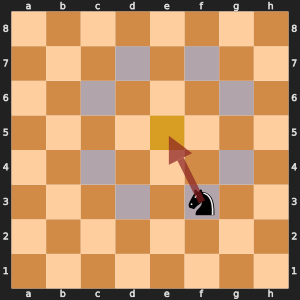
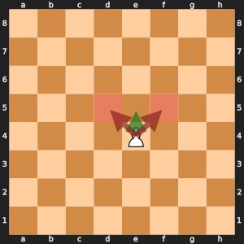

# Day 4, Period 2: Attacks

## Learning objectives

By the end of this period, each student pair can:

- Decide whether a knight, pawn, or king attacks a square. **Measured by:** The attack tests in `test_legal_moves.py` pass for all three pieces.
- Explain that a pawn attacks diagonally but moves straight. **Measured by:** The student pair marks the two squares a White pawn on e4 attacks (d5, f5) on the printed board.

## The files

New files this period:

- `attacks.py`
- `test_legal_moves.py`

Functions the student pairs write this period:

- `piece_at_offsets()` in `attacks.py`
- `attacked_by_pawn()` in `attacks.py`
- `attacked_by_king()` in `attacks.py`

In the `student` folder these functions raise `NotImplementedError` until a student pair writes them. In the `instructor` folder they are finished.

## The changes and why

### `piece_at_offsets()` in `attacks.py`

Stands on the square and looks at each offset for one piece, such as an enemy knight. Attacks work backward: instead of asking where every enemy piece can go, the test looks out from the square. A knight attacks e5 from exactly the squares a knight on e5 could jump to, so the knight, the king, and the pawn all share this one loop, the way `jump_moves()` serves both the knight and the king.



*To test e5 (yellow), the code looks at the eight knight squares around it (gray). It finds a Black knight on f3, so e5 is attacked (the red arrow).*

### `attacked_by_pawn()` in `attacks.py`

Looks diagonally for an enemy pawn on the row behind the square, from the attacker's point of view. A pawn captures diagonally even though it moves straight, so its two offsets differ from its push, and they depend on its piece color.



*The White pawn on e4 moves straight to e5 (green) but attacks d5 and f5 (red). So the test for d5 looks one row down and one column to each side for a White pawn.*

### `attacked_by_king()` in `attacks.py`

Looks one step away in all eight directions for the enemy king, with the same `KING_STEPS` the king moves by. Kings can never stand next to each other, and this check is what stops a king from walking up to the other king.

Check the work with the tests: open `run_tests.py` in the `student` folder in VS Code and click the Run Python File button (the triangle at the top right of the editor). It runs every test in the folder. To run one file on its own, such as `board.py`, open it and click the same button.

## The period step by step

| Time | Activity |
| --- | --- |
| 10:30 to 10:45 | Chess refresher on the demonstration board: check, pins, and discovered check. |
| 10:45 to 11:00 | Slides: a square is attacked if a piece could capture there. Stand on the square and look outward like a "super piece". The given code holds `attacked_by_knight()` and the sliding-line part. |
| 11:00 to 11:40 | Student pairs write `piece_at_offsets()`, then `attacked_by_pawn()` and `attacked_by_king()` on top of it. |
| 11:40 to 11:50 | Student pairs run the attack tests and the file's self-check. |
| 11:50 to 12:00 | Show and choose for `piece_at_offsets()`. |

## What you edit this period

Every other function is finished. Change only these, and only below each docstring:

| File | Function | Starts at line | Lines to type | Tests that check it |
| --- | --- | --- | --- | --- |
| `attacks.py` | `piece_at_offsets()` | 64 | 6 | `run_tests.py` |
| `attacks.py` | `attacked_by_pawn()` | 106 | 3 | `run_tests.py` |
| `attacks.py` | `attacked_by_king()` | 100 | 2 | `run_tests.py` |

Lines to type in all: 11. Each stub is two comment lines that start with `# Day ...` and a `raise NotImplementedError` statement. Delete them and write the body in their place.

## The code you type

Each block below shows the code to type with a few lines around it, so you can find the spot. A line marked `+` is one you type; a line marked `|` is already in the file. Type the code without the number and the mark, and keep the indent shown. Lines that start with `#` are comments: they explain the code, and typing them is optional.

The number at the left of each line is its line number once the code is typed. When one file holds two functions to write, type the higher one first: until it is typed, the stub of a function lower down sits a few lines higher than these numbers say.

### `piece_at_offsets()` in `attacks.py`

**Where:** lines 86 to 91 of `attacks.py`, inside `piece_at_offsets()`, in place of the stub below the docstring. It is called by `attacked_by_knight()` in `attacks.py`.

```python
64 | def piece_at_offsets(
65 |     board: Board, square: Square, piece: str, offsets: list[Direction]
     ...
84 |         True if one of the squares the offsets reach holds the piece.
85 |     """
86 +     row, col = square
87 +     for row_change, col_change in offsets:
88 +         target = (row + row_change, col + col_change)
89 +         if on_board(*target) and piece_at(board, target) == piece:
90 +             return True
91 +     return False
92 |
93 |
94 | def attacked_by_knight(board: Board, square: Square, by_color: str) -> bool:
```

**How it works:** The function adds each offset, such as (2, 1), to the square to reach a target square. If the target is on the board and holds the exact piece asked for, such as a White knight `N`, the square is attacked and the function returns True at once. After trying every offset with no match it returns False.

### `attacked_by_pawn()` in `attacks.py`

**Where:** lines 113 to 115 of `attacks.py`, inside `attacked_by_pawn()`, in place of the stub below the docstring. It is called by `is_square_attacked()` in `attacks.py`.

```python
106 | def attacked_by_pawn(board: Board, square: Square, by_color: str) -> bool:
107 |     """
      ...
111 |     stands one row below it, at (row + 1, col - 1) or (row + 1, col + 1).
112 |     """
113 +     if by_color == WHITE:
114 +         return piece_at_offsets(board, square, "P", [(1, -1), (1, 1)])
115 +     return piece_at_offsets(board, square, "p", [(-1, -1), (-1, 1)])
116 |
117 |
118 | def first_piece(board: Board, square: Square, direction: Direction) -> str:
```

**How it works:** A pawn attacks one step diagonally forward. To ask whether a White pawn attacks a square, look one row toward rank 1 from that square, at (row + 1, col - 1) and (row + 1, col + 1), because White pawns move toward row 0. For a Black pawn, look the other way, at row - 1. `piece_at_offsets` does the looking.

### `attacked_by_king()` in `attacks.py`

**Where:** lines 102 to 103 of `attacks.py`, inside `attacked_by_king()`, in place of the stub below the docstring. It is called by `is_square_attacked()` in `attacks.py`.

```python
100 | def attacked_by_king(board: Board, square: Square, by_color: str) -> bool:
101 |     """Return True if the king of by_color is one step away."""
102 +     king = "K" if by_color == WHITE else "k"
103 +     return piece_at_offsets(board, square, king, KING_STEPS)
104 |
105 |
106 | def attacked_by_pawn(board: Board, square: Square, by_color: str) -> bool:
```

**How it works:** The function picks the king letter of the attacking side, `K` for White and `k` for Black, and asks `piece_at_offsets` whether that king stands on any of the eight squares around the target.
