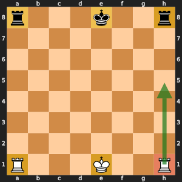

# Day 5, Period 2: Castling

## Learning objectives

By the end of this period, each student pair can:

- State the castling rules: no earlier king or rook move, empty squares between, and no check on the king's path. **Measured by:** Six-position quiz on castling: each student pair gets at least five right.
- Update the castling rights after any move. **Measured by:** The castling tests in `test_special_moves.py` pass, including a captured rook.

## The files

New files this period:

- `test_special_moves.py`

Files that grow this period. The new code in them is given code, already in the folder when the class opens it:

- `legal_moves.py`: adds `castling_moves()`; changes `legal_moves()`
- `make_move.py`: adds `castling_rook_move()`; changes `make_move()`, `undo_move()`, `main()`

Functions the student pairs write this period:

- `update_castling_rights()` in `make_move.py`

In the `student` folder these functions raise `NotImplementedError` until a student pair writes them. In the `instructor` folder they are finished.

## The changes and why

### `update_castling_rights()` in `make_move.py`

Removes castling rights when a king or rook leaves its square, or when a rook is captured on its square. Rights only ever disappear, so `replace()` deletes letters from a string such as "KQkq".



*The six home squares hold the castling rights: e1 holds K and Q, h1 holds K, a1 holds Q, and for Black e8 holds k and q, h8 holds k, and a8 holds q. When the rook leaves h1 (the green arrow), White loses K, and "KQkq" becomes "Qkq".*

Check the work with the tests: open `run_tests.py` in the `student` folder in VS Code and click the Run Python File button (the triangle at the top right of the editor). It runs every test in the folder. To run one file on its own, such as `board.py`, open it and click the same button.

## The period step by step

| Time | Activity |
| --- | --- |
| 10:30 to 10:45 | Chess refresher on the demonstration board: the five castling conditions. The rook may cross an attacked square (b1), and a rook captured on its home square removes that right. |
| 10:45 to 11:00 | Slides: the given castling generation and the attacked-square checks. |
| 11:00 to 11:20 | Student pairs write `update_castling_rights()`, the table of which moves remove K, Q, k, or q. |
| 11:20 to 11:50 | Student pairs run the castling tests and build one castling position of their own to test. |
| 11:50 to 12:00 | Show and choose for `update_castling_rights()`. |

## What you edit this period

Every other function is finished. Change only these, and only below each docstring:

| File | Function | Starts at line | Lines to type | Tests that check it |
| --- | --- | --- | --- | --- |
| `make_move.py` | `update_castling_rights()` | 24 | 4 | `test_special_moves.py::test_rook_capture_removes_the_right` |

Lines to type in all: 4. Each stub is two comment lines that start with `# Day ...` and a `raise NotImplementedError` statement. Delete them and write the body in their place.

## The code you type

Each block below shows the code to type with a few lines around it, so you can find the spot. A line marked `+` is one you type; a line marked `|` is already in the file. Type the code without the number and the mark, and keep the indent shown. Lines that start with `#` are comments: they explain the code, and typing them is optional.

The number at the left of each line is its line number once the code is typed. When one file holds two functions to write, type the higher one first: until it is typed, the stub of a function lower down sits a few lines higher than these numbers say.

### `update_castling_rights()` in `make_move.py`

**Where:** lines 41 to 44 of `make_move.py`, inside `update_castling_rights()`, in place of the stub below the docstring. It is called by `make_move()` in `make_move.py`.

```python
24 | def update_castling_rights(rights: str, move: Move) -> str:
25 |     """
     ...
39 |         The rights after the move, such as "Qkq" after the h1 rook moves.
40 |     """
41 +     for square in (move.from_square, move.to_square):
42 +         for letter in CASTLING_SQUARES.get(square, ""):
43 +             rights = rights.replace(letter, "")
44 +     return rights
45 |
46 |
47 | def castling_rook_move(move: Move) -> tuple[Square, Square]:
```

**How it works:** A move can touch two home squares, the one it leaves and the one it lands on, so the loop checks both. `CASTLING_SQUARES.get(square, "")` gives the rights that square guards, or an empty string for any other square. Each guarded letter is removed with `replace`. Moving the h1 rook removes K, and capturing the rook on h1 removes K too.
