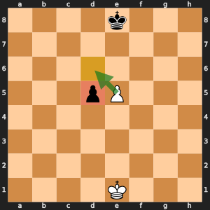

# Day 5, Period 3: En passant and the double step

## Learning objectives

By the end of this period, each student pair can:

- Capture en passant on the very next move only. **Measured by:** The en passant tests pass, including the capture that is legal only once.
- Find the square of the pawn an en passant capture removes. **Measured by:** The student pair names the removed pawn's square for exd6 (d5) on the printed board.

## The files

Files that grow this period:

- `make_move.py`
- `move_generation.py`
- `test_special_moves.py`

Functions the student pairs write this period:

- `en_passant_victim_square()` in `make_move.py`

In the `student` folder these functions raise `NotImplementedError` until a student pair writes them. In the `instructor` folder they are finished.

## The changes and why

### `en_passant_victim_square()` in `make_move.py`

Returns the square of the pawn that an en passant capture removes: the capturer's starting row and the landing column. It is the only capture where the victim is not on the landing square.



*Black has just pushed d7 to d5. The White pawn on e5 captures en passant: it lands on d6 (yellow), and the Black pawn it removes stands on d5 (red), on the capturer's starting row, rank 5, in the landing column, d.*

Check the work with the tests: open `run_tests.py` in the `student` folder in VS Code and click the Run Python File button (the triangle at the top right of the editor). It runs every test in the folder. To run one file on its own, such as `board.py`, open it and click the same button.

## The period step by step

| Time | Activity |
| --- | --- |
| 1:00 to 1:15 | Chess refresher: en passant is allowed only on the very next move after a two-square push, and the captured pawn is not on the destination square. |
| 1:15 to 1:30 | Slides: the double step sets the en passant target. The teacher walks through the en passant make and undo. |
| 1:30 to 1:55 | Student pairs write `en_passant_victim_square()`, then trace a capture and its undo on the printed board. |
| 1:55 to 2:20 | Student pairs run the en passant tests, including the rare capture that exposes the king along the rank. |
| 2:20 to 2:30 | Wrap-up: which square does the undo put the captured pawn back on? |

## What you edit this period

Every other function is finished. Change only these, and only below each docstring:

| File | Function | Starts at line | Lines to type | Tests that check it |
| --- | --- | --- | --- | --- |
| `make_move.py` | `en_passant_victim_square()` | 48 | 1 | `run_tests.py` |

Lines to type in all: 1. Each stub is two comment lines that start with `# Day ...` and a `raise NotImplementedError` statement. Delete them and write the body in their place.

## The code you type

Each block below shows the code to type with a few lines around it, so you can find the spot. A line marked `+` is one you type; a line marked `|` is already in the file. Type the code without the number and the mark, and keep the indent shown. Lines that start with `#` are comments: they explain the code, and typing them is optional.

The number at the left of each line is its line number once the code is typed. When one file holds two functions to write, type the higher one first: until it is typed, the stub of a function lower down sits a few lines higher than these numbers say.

### `en_passant_victim_square()` in `make_move.py`

**Where:** line 54 of `make_move.py`, inside `en_passant_victim_square()`, in place of the stub below the docstring. It is called by `make_move()` in `make_move.py`.

```text
48 | def en_passant_victim_square(move: Move) -> Square:
     ...
52 |     starts from, in the column it lands in.
53 |     """
54 +     return move.from_square[0], move.to_square[1]
55 |
56 |
57 | def castling_rook_move(move: Move) -> tuple[Square, Square]:
```

**How it works:** An en passant capture lands behind the pawn it takes. The captured pawn stands on the row the capturing pawn starts from, `move.from_square[0]`, and in the column it lands in, `move.to_square[1]`. Example: a White pawn on e5 captures on d6, and the Black pawn it takes stands on d5.
