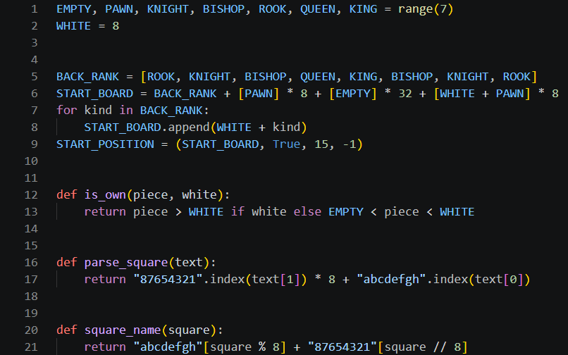

# Day 1, Period 1: Set up, and the board

8:30 to 10:00. Part of [Day 1: Remus1, legal chess at random](../Day_1_Syllabus.md).

## Goal

Every laptop is set up, the class has seen the finished Remus2 play, and the student pair has typed the first engine file.

## The big picture

Today the student pair builds Remus1 from nothing, so every file of Day 1 is a new file, and all of Day 1's typing goes into the folder `engines/Remus1`. That folder starts with one file, `remus.bat`, the line that Lucas Chess runs to start the engine. The student pair creates every other file of Remus1 there and copies nothing from another folder.

The first file is `board.py`, because every other file of the engine imports it. It answers three questions the rest of the engine keeps asking: which number stands for which piece, what the board looks like before the first move, and how a square number turns into a name such as `e2` and back. A chess engine sees the board as 64 numbers in a list, one per square. Row 0 is rank 8 and column 0 is file a, so square `row * 8 + col` names a square: a8 is square 0, h8 is square 7, a1 is square 56, and h1 is square 63.

## The period step by step

| Time | Activity |
| --- | --- |
| 8:30 to 9:15 | Setup, steps 1 to 6 of the top `README.md`: install Git, VS Code, and `uv`, clone the repository, run `uv sync`, install the extensions, and open `Remus.code-workspace`. This is the only time anyone types a git or `uv` command. |
| 9:15 to 9:30 | The teacher adds the instructor's `engines_instructor/Remus2/remus.bat` to Lucas Chess (Part 2 of the [Lucas Chess guide](../../docs/lucas_chess/lucas_chess_guide.md)) and starts it against Stockfish 1500 (Part 3), so the class sees the engine it will build by tomorrow afternoon. |
| 9:30 to 9:40 | Each student pair opens its `engines/Remus1` folder in VS Code. The folder holds `remus.bat`, the one line that starts the engine, and `verify_remus.py`, which tests the finished engine; the student pair types every other file. |
| 9:40 to 10:00 | Type `board.py` (15 code lines): the piece numbers, the starting position, and square names. The reminder before typing: row 0 is rank 8, column 0 is file a, so a8 is square 0 and h1 is square 63. |

## What the student pair types this period

| File | New or edited | What it holds | Lines in your file |
| --- | --- | --- | --- |
| `board.py` | New | The piece numbers, the starting position, and the square names | 1 to 21 |

The instructor's version of every file, with its comments, is [`engines_instructor/Remus1`](../../engines_instructor/Remus1/). The student pair copies only the code from it: no comments, no docstrings (the text in triple quotes under the first line of a file or a function), and no type hints (the `: int` after a name and the `-> bool` before a colon). The line numbers on this page count the lines of the student pair's own file, which has no comments, so they are smaller than the instructor's line numbers.

## The file, line by line

### `board.py`

Create `board.py` in `engines/Remus1`: in VS Code's Explorer, right-click the `Remus1` folder under `engines`, pick New File, and type the name. The file has 21 lines when it is done.

`EMPTY, PAWN, KNIGHT, BISHOP, ROOK, QUEEN, KING = range(7)` (line 1) gives each kind of piece a number, from 1 for a pawn to 6 for a king, and 0 for an empty square. `WHITE = 8` (line 2) is added to the number of a White piece, so a Black knight is 2 and a White knight is 10. Python assigns all seven names at once on line 1, which Java cannot do.

Lines 5 to 9 build the starting position. `BACK_RANK = [ROOK, KNIGHT, BISHOP, QUEEN, KING, BISHOP, KNIGHT, ROOK]` (line 5) lists the pieces of a back rank from file a to file h. Line 6 joins four lists with `+`: Black's back rank (rank 8), eight Black pawns (rank 7), 32 empty squares (ranks 6 to 3), and eight White pawns (rank 2). `[PAWN] * 8` is a list of eight pawns. The loop on lines 7 and 8 adds White's back rank, each piece plus 8. `START_POSITION = (START_BOARD, True, 15, -1)` (line 9) is a position: the board, `True` because White moves first, 15 for all four castling rights, and -1 because no pawn has just skipped a square for en passant.

`def is_own(piece, white):` (line 12) answers whether a square holds a piece of the side named by `white`. Its one line of code, line 13, uses Python's `a if condition else b`, which is Java's `condition ? a : b`.

`def parse_square(text):` (line 16) turns a name such as `"e2"` into a square number, and `def square_name(square):` (line 20) turns a number back into a name. Both look up a letter in a string: `"87654321".index(text[1])` finds the row of the rank digit, and `"abcdefgh"[square % 8]` picks the file letter of a column.

Leave one blank line inside the starting position block and two blank lines before each `def`, as the instructor's file does. VS Code also fixes the spacing when it saves the file.

## Done when

`board.py` in `engines/Remus1` runs with the Run button and prints nothing.
