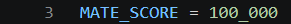
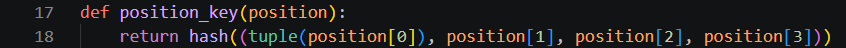
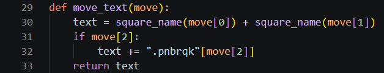
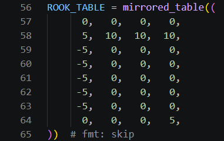
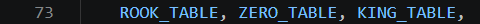
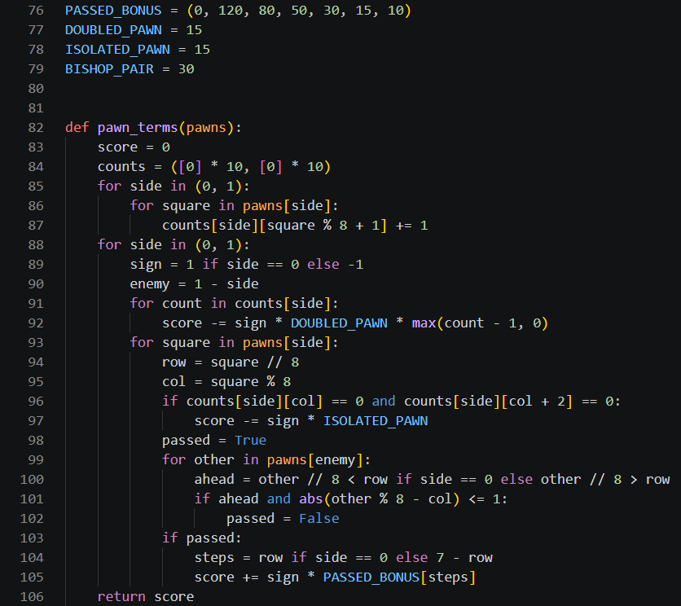
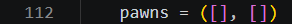
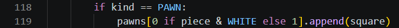
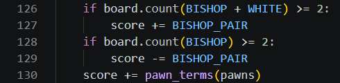
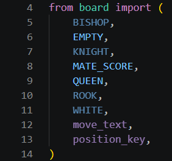

# Day 3, Period 1: Pawn structure, the bishop pair, and the rook table

8:30 to 10:00. Part of [Day 3: Remus3](../Day_3_Syllabus.md).

## Goal

Remus3's evaluation knows pawn structure, the bishop pair, and where rooks belong.

## The big picture

Today the student pair turns Remus2 into Remus3, and all of Day 3's typing goes into the folder `engines/Remus3`. The period opens in File Explorer: copy every file of `engines/Remus2` into `engines/Remus3`, and say yes when Windows asks to replace `remus.bat` and `verify_remus.py`. From then on, edit only the files in `engines/Remus3`. `engines/Remus2` stays as it is, so their Remus2 still plays, and in Period 4 their Remus3 plays it.

This period teaches the evaluation three ideas a chess player learns early. Two pawns on one file (doubled pawns) and a pawn with no friendly pawn on either neighboring file (an isolated pawn) are weak, and a pawn that no enemy pawn can stop (a passed pawn) grows stronger the closer it gets to promotion. Two bishops together are worth more than a bishop and a knight, because together they cover both colors of square. And a rook belongs on the seventh rank, where it attacks the pawns that have not moved. `evaluation.py` gets all three.

The period also moves `MATE_SCORE` from `search.py` to `board.py` and adds two small helpers to `board.py`, `position_key()` and `move_text()`. The transposition table of Period 2 needs `MATE_SCORE` and `position_key()`, and it cannot import them from `search.py`, because `search.py` imports the table. No new file is added this period.

## The period step by step

| Time | Activity |
| --- | --- |
| 8:30 to 8:35 | In File Explorer, copy every file of `engines/Remus2` into `engines/Remus3`. |
| 8:35 to 8:45 | Doubled, isolated, and passed pawns, on a position the teacher shows in Lucas Chess. Why two bishops together are worth more than a bishop and a knight. |
| 8:45 to 9:00 | Move `MATE_SCORE` from `search.py` to `board.py`, and add `position_key()` and `move_text()` (8 code lines in `board.py`). |
| 9:00 to 9:55 | In `evaluation.py`, add the rook table, `pawn_terms()`, the bishop pair, and the lines of `evaluate()` that collect the pawns (47 code lines). Run `uci.py`. |
| 9:55 to 10:00 | Swap driver and navigator. |

## What changes this period

| File | New or edited | What the student pair does | Lines in your file |
| --- | --- | --- | --- |
| `board.py` | Copied from `engines/Remus2`, edited | Add `MATE_SCORE`, `position_key()`, and `move_text()` | 3, 17 to 18, 29 to 33 |
| `evaluation.py` | Copied from `engines/Remus2`, edited | Add the rook table, the pawn terms, and the bishop pair | 1, 56 to 65, 73, 76 to 106, 112, 118 to 119, 126 to 130 |
| `search.py` | Copied from `engines/Remus2`, edited | Import `MATE_SCORE` and five more names from `board.py`, and delete its own `MATE_SCORE` | 4 to 14 |
| `make_move.py`, `attacks.py`, `move_generation.py`, `uci.py`, `remus.bat` | Copied from `engines/Remus2` | No edits this period | Unchanged |

The instructor's versions are in [`engines_instructor/Remus3`](../../engines_instructor/Remus3/). Copy only the code: no comments, no docstrings, and no type hints. The line numbers on this page count the lines of the student pair's own files in `engines/Remus3`, as they stand at the end of this period. Work from the top of each file down, and each number is right when you reach it.

## The edits, file by file

### `board.py`

`board.py` grows from 21 lines to 33. Type `MATE_SCORE = 100_000` (line 3) under `WHITE = 8`; it is the same constant `search.py` holds today.

Between `is_own()` and `parse_square()`, type `def position_key(position):` (line 17) and its one line of code, `return hash((tuple(position[0]), position[1], position[2], position[3]))` (line 18). The key is one number that stands for the whole position: the board, the side to move, the castling rights, and the en passant square. A list cannot be hashed in Python, so `tuple()` turns the board into a tuple first. Two move orders that reach the same position, such as e4 e5 Nf3 and Nf3 e5 e4, get the same key.

At the end of the file, type `def move_text(move):` (line 29) and its four lines (30 to 33). It turns a move tuple into UCI text such as `e7e8q`, the same steps that `uci.py` takes today for `bestmove`. Remus3 needs the text in three places: the `bestmove` answer, the opening book, and the line of moves the engine expects.

### `evaluation.py`

`evaluation.py` grows from 80 lines to 131.

Change the import on line 1 to `from board import BISHOP, EMPTY, PAWN, WHITE`, adding `BISHOP` and `PAWN`.

Below `KING_TABLE`, type `ROOK_TABLE = mirrored_table((` (lines 56 to 65), with `# fmt: skip` at the end of line 65. It gives a rook 10 on the seventh rank and small penalties on the a and h files. In `TABLES`, put `ROOK_TABLE` in the place of the first `ZERO_TABLE`, so line 73 reads `ROOK_TABLE, ZERO_TABLE, KING_TABLE,`.

Below `TABLES`, type the four new constants (lines 76 to 79), from `PASSED_BONUS = (0, 120, 80, 50, 30, 15, 10)` to `BISHOP_PAIR = 30`. `PASSED_BONUS` is indexed by how many steps a passed pawn still has to go: 120 for a pawn one step from promotion, 10 for a pawn six steps away.

Type `def pawn_terms(pawns):` (lines 82 to 106) above `evaluate()`. It takes the squares of White's pawns and of Black's pawns. Lines 84 to 87 count each side's pawns on each file. `counts` holds ten places per side, not eight, so file a's left neighbor and file h's right neighbor are empty places, and no test falls off the end of the list. Lines 91 and 92 subtract `DOUBLED_PAWN` for each extra pawn on a file, lines 96 and 97 subtract `ISOLATED_PAWN`, and lines 98 to 105 add the passed pawn bonus when no enemy pawn stands ahead on the pawn's file or a neighboring one. `sign` is 1 for White and -1 for Black, so one loop scores both sides.

In `evaluate()`, three edits collect the pawns and add the new terms. Type `pawns = ([], [])` (line 112) under `score = 0`. Under `kind = piece & 7`, type `if kind == PAWN:` and `pawns[0 if piece & WHITE else 1].append(square)` (lines 118 and 119). Above the last line, `return score if white else -score`, type the bishop pair and the pawn terms (lines 126 to 130), from `if board.count(BISHOP + WHITE) >= 2:` to `score += pawn_terms(pawns)`.

### `search.py`

`search.py` grows from 110 lines to 118. Replace the import `from board import EMPTY, QUEEN` with the eleven lines from `from board import (` to `)` (lines 4 to 14), one name per line. The block brings in `MATE_SCORE` today and the names that Periods 2 to 4 need: the piece kinds for `has_pieces()`, `position_key()` for the table, and `move_text()` for the line of moves.

VS Code grays out six of these names: `BISHOP`, `KNIGHT`, `ROOK`, `WHITE`, `move_text`, and `position_key`. The gray is temporary and is not an error. `search.py` does not use these names in this period, but it uses them in later periods: all but `move_text` in Period 2, and `move_text` in Period 4. Type all eleven lines now, and each name brightens when the code that uses it arrives.

Then delete `MATE_SCORE = 100_000` and the blank line above it, which stood at line 9 of the copied file: `search.py` now gets `MATE_SCORE` from `board.py`.

## Done when

`uci.py` runs and still plays.
