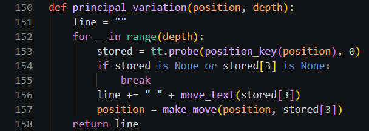
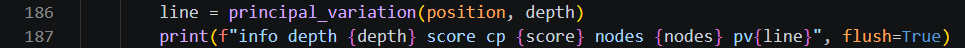

# Day 3, Period 4: The principal variation, then test Remus3

3:00 to 4:30. Part of [Day 3: Remus3](../Day_3_Syllabus.md).

## Goal

Remus3 shows the line it expects, and the student pair tests Remus3 against Remus2 and then plays it.

## The big picture

The student pair finishes Remus3 in `engines/Remus3` with a few lines in `search.py`, then tests it. No file is added.

The principal variation is the line of moves the engine expects both sides to play, such as `g8f6 g1f3 b8c6 b1c3` after 1. a3. The transposition table of Period 2 already holds it: the best move stored for the position on the board, then the best move stored for the position after that move, and so on. `principal_variation()` follows those stored moves, and `think()` prints them at the end of each `info` line after the word `pv`, which Lucas Chess shows beside the engine's score.

## The period step by step

| Time | Activity |
| --- | --- |
| 3:00 to 3:20 | Add `principal_variation()` and the `pv` of the `info` line (about 13 code lines). Run `uci.py` and send `position startpos moves a2a3` and `go movetime 5000` to `engines/Remus3` and to `engines/Remus2` (1. a3 is in no line of the book, so Remus3 searches): the `info` lines show how much deeper Remus3 searches in the same time, and the line it expects. |
| 3:20 to 3:55 | Run `verify_remus.py` in `engines/Remus3` until Remus3 passes every test. Then add `engines\Remus3\remus.bat` to Lucas Chess and play one round of their Remus3 against their Remus2, two 10-minute games. Each student pair finds one game where Remus3 played a book move. |
| 3:55 to 4:30 | One round of the student pair against their Remus3, two 10-minute games: each student plays one game, one with White and one with Black (Part 3 of the guide). |
| If time remains | One round of their Remus3 against Stockfish 1500, two 10-minute games. A student pair that also played Stockfish 1500 on Day 2 compares the results. |

## What changes this period

| File | New or edited | What the student pair does | Lines in your file |
| --- | --- | --- | --- |
| `search.py` | Edited (begun in Period 1) | Add `principal_variation()` and the `pv` of the `info` line | 150 to 158, 186 to 187 |
| All other files | Unchanged since Period 3 | No edits this period | Unchanged |

The instructor's version is [`engines_instructor/Remus3/search.py`](../../engines_instructor/Remus3/search.py). Copy only the code: no comments, no docstrings, and no type hints. The line numbers on this page count the lines of the student pair's own `search.py` in `engines/Remus3`, as it stands at the end of this period.

## The edits, file by file

### `search.py`

`search.py` grows from 180 lines to 192, the finished Remus3 file.

Type `def principal_variation(position, depth):` (lines 150 to 158) between `alpha_beta()` and `think()`, with two blank lines after it. It starts with an empty string and, at most `depth` times, probes the table for the current position, adds the stored move's UCI text, and plays the move with `make_move()`. It stops early at a position the table does not hold, or one with no stored move.

In `think()`, replace the `print` line, `print(f"info depth {depth} score cp {score} nodes {nodes}", flush=True)`, with two lines: `line = principal_variation(position, depth)` (line 186) and `print(f"info depth {depth} score cp {score} nodes {nodes} pv{line}", flush=True)` (line 187). The `f` before the string makes it an f-string, so each name in braces is replaced by its value; `line` starts with a space, so the text reads `pv g8f6 g1f3`.

Remus3 is complete. Every file in `engines/Remus3` now matches the instructor's Remus3, comments, docstrings, and type hints aside.

## Done when

The student pair's Remus3 has played one round against its Remus2, and each student has played it. A round against Stockfish 1500 follows if time remains.
