# Day 4, Period 1: Draw sense and searching less

8:30 to 10:00. Part of [Day 4: Remus4](../Day_4_Syllabus.md).

## Goal

Remus4 sees draws by repetition and the fifty-move rule, and spends less time on moves that are probably bad.

## The big picture

Today the student pair turns Remus3 into Remus4, and all of Day 4's typing goes into the folder `engines/Remus4`. The period opens in File Explorer: copy every file of `engines/Remus3` into `engines/Remus4`, `opening_book.txt` included, and say yes when Windows asks to replace `remus.bat` and `verify_remus.py`. From then on, edit only the files in `engines/Remus4`. `engines/Remus3` stays as it is.

Remus3 cannot see a draw by repetition or by the fifty-move rule, so it can throw away a won game by repeating moves, or miss a draw that would save a lost one. This period gives the position a fifth part, the halfmove clock: the number of moves since the last pawn move or capture. At 100 halfmoves, fifty moves by each side, the game is drawn. The search also keeps a history, the keys of every position on the way from the start of the game to the position it is searching, and scores a position that is already in the history as a draw.

The same period makes the search spend less time on moves that are probably bad, in three ways. Futility pruning skips a quiet move one move from the end of the search when the position stands so far below alpha that one quiet move cannot catch up. Late move reductions search the quiet moves that come late in the move order one move less deep, and search again at full depth only when one surprises. Principal variation search assumes the first move is the best, and tests every other move with the narrowest window, which is quicker, before it searches a move that passes the test with the full window.

The name line in `uci.py` stays `id name Remus3` until Period 4. No new file is added this period.

## The period step by step

| Time | Activity |
| --- | --- |
| 8:30 to 8:35 | In File Explorer, copy every file of `engines/Remus3` into `engines/Remus4`. |
| 8:35 to 8:45 | Reminder of threefold repetition and the fifty-move rule. Late move reductions, principal variation search, and futility pruning: three ways to spend less time on moves that are probably bad. |
| 8:45 to 9:55 | The halfmove clock in `board.py` and `make_move.py`, the game history in `uci.py`, then `is_draw()`, the history list, futility pruning, late move reductions, and PVS in `search.py` (about 36 code lines). Run `uci.py`. |
| 9:55 to 10:00 | Swap driver and navigator. |

## What changes this period

| File | New or edited | What the student pair does | Lines in your file |
| --- | --- | --- | --- |
| `board.py` | Copied from `engines/Remus3`, edited | Add the halfmove clock to the starting position | 10 |
| `make_move.py` | Copied from `engines/Remus3`, edited | Count the halfmove clock | 7, 13, 27 |
| `move_generation.py` | Copied from `engines/Remus3`, edited | Read only the first four parts of the position | 54 |
| `search.py` | Copied from `engines/Remus3`, edited | Add `is_draw()`, the history, futility pruning, late move reductions, and principal variation search | 20, 32, 85 to 87, 102 to 104, 123 to 170, 192 to 193, 206 |
| `uci.py` | Copied from `engines/Remus3`, edited | Record the game's positions and pass them to `think()` | 4, 30, 43, 45, 61 |
| `attacks.py`, `evaluation.py`, `transposition_table.py`, `opening_book.py`, `opening_book.txt`, `remus.bat` | Copied from `engines/Remus3` | No edits this period | Unchanged |

The instructor's versions are in [`engines_instructor/Remus4`](../../engines_instructor/Remus4/). Copy only the code: no comments, no docstrings, and no type hints. The line numbers on this page count the lines of the student pair's own files in `engines/Remus4`, as they stand at the end of this period. Work from the top of each file down, and each number is right when you reach it.

## The edits, file by file

### `board.py`

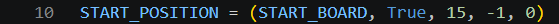

Change the starting position to `START_POSITION = (START_BOARD, True, 15, -1, 0)` (line 10). The fifth part, 0, is the halfmove clock: no move has been played yet.

### `make_move.py`

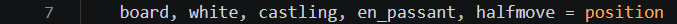

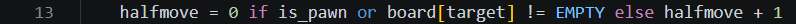

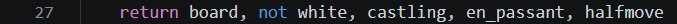

Three lines change, and the file grows from 26 lines to 27.

1. Unpack the fifth part with the others: `board, white, castling, en_passant, halfmove = position` (line 7).
2. Under `distance = abs(target - start)`, type `halfmove = 0 if is_pawn or board[target] != EMPTY else halfmove + 1` (line 13). A pawn move or a capture sets the clock back to 0, and any other move adds one. The line must come before the piece moves, while `board[target]` still shows whether the move captures.
3. Return the clock with the rest: `return board, not white, castling, en_passant, halfmove` (line 27).

### `move_generation.py`

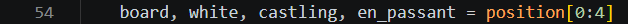

Change the first line of `generate_moves()`'s body to `board, white, castling, en_passant = position[0:4]` (line 54). The position has five parts now, and Python refuses to unpack five values into four names, so `position[0:4]` takes the first four. Move generation needs no clock.

### `search.py`

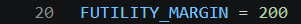

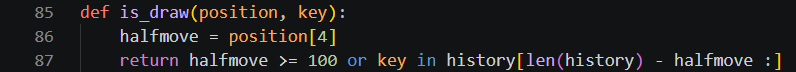

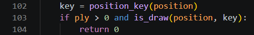

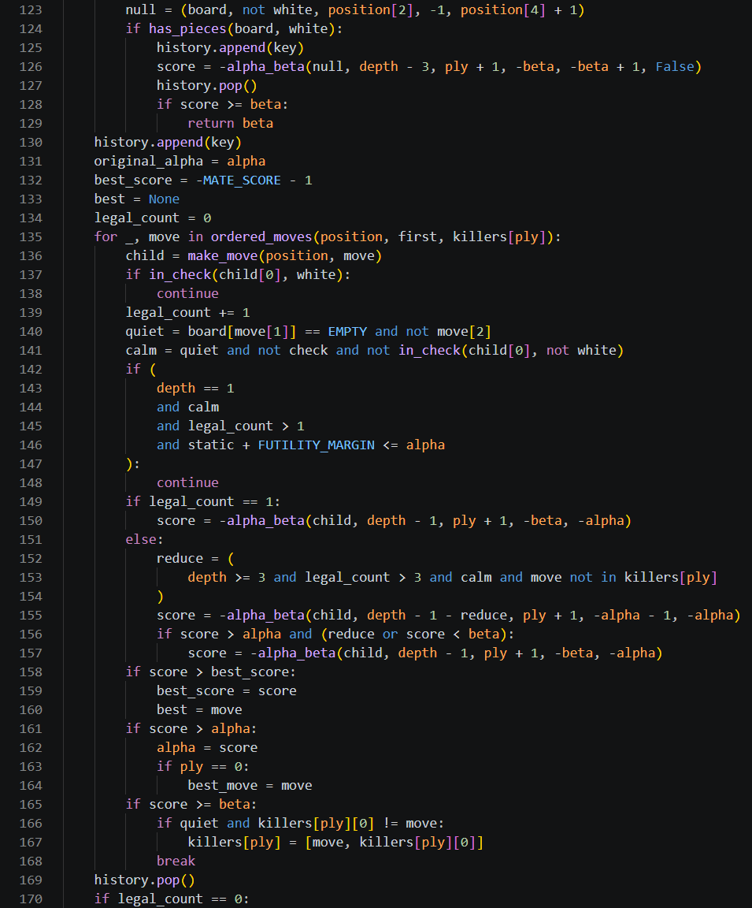

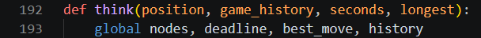

`search.py` grows from 192 lines to 224. The edits, from the top down:

1. Type `FUTILITY_MARGIN = 200` (line 20) above `ASPIRATION_WINDOW = 50`.
2. Type `history = []` (line 32) under `best_move = None`.
3. Type `def is_draw(position, key):` (lines 85 to 87) between `quiescence()` and `has_pieces()`, with two blank lines after it. A clock of 100 is a draw by the fifty-move rule. Otherwise the position is a draw if its key is among the last `halfmove` keys of the history: a position can repeat only since the last pawn move or capture, so the search looks no further back.
4. In `alpha_beta()`, under `board, white = position[0], position[1]`, type the three lines from `key = position_key(position)` to `return 0` (lines 102 to 104), and delete the `key = position_key(position)` line further down, above `stored = tt.probe(key, ply)`. The key is now needed before the check test, so the draw test can run first.
5. In the null move, give the null position a clock: `null = (board, not white, position[2], -1, position[4] + 1)` (line 123). Around the null move's recursive call, type `history.append(key)` above it (line 125) and `history.pop()` below it (line 127), so the search below the null move sees this position in the history.
6. Under the null move block, type `history.append(key)` (line 130) above `original_alpha = alpha`, and type `legal_count = 0` (line 134) under `best = None`.
7. In the loop, replace the one line `score = -alpha_beta(child, depth - 1, ply + 1, -beta, -alpha)` with the nineteen lines from `legal_count += 1` to the last `score = -alpha_beta(child, depth - 1, ply + 1, -beta, -alpha)` (lines 139 to 157). `quiet` moves up here from the cutoff, and `calm` means a quiet move, out of check, that gives no check. Lines 142 to 148 are futility pruning, `if legal_count == 1:` (line 149) searches the first move with the full window, and the `else` branch is late move reductions and principal variation search. `reduce` is `True` or `False`, and Python counts `True` as 1 in `depth - 1 - reduce`.
8. In the cutoff under `if score >= beta:`, delete the line `quiet = board[move[1]] == EMPTY and not move[2]`: step 7 already set `quiet`.
9. After the loop, replace `if best is None:` with `history.pop()` and `if legal_count == 0:` (lines 169 and 170). Futility pruning can skip every move but leave legal moves, so the count of legal moves, not the best move, decides checkmate and stalemate.
10. Change `think()`'s first two lines to `def think(position, game_history, seconds, longest):` and `global nodes, deadline, best_move, history` (lines 192 and 193).
11. Inside the `while True:` loop, above `score = alpha_beta(position, depth, 0, alpha, beta)`, type `history = game_history[:]` (line 206). Every search starts from a copy of the game's positions.

### `uci.py`

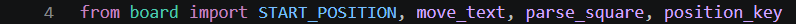

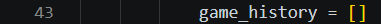

`uci.py` grows from 68 lines to 71.

1. Add `position_key` to the board import: `from board import START_POSITION, move_text, parse_square, position_key` (line 4).
2. Type `game_history = []` (line 30) under `played = []`.
3. In the `position` branch, type `game_history = []` (line 43) under `played = words[3:]`, and type `game_history.append(position_key(position))` (line 45) as the first line inside the loop `for text in played:`. Each position of the game goes into the history before its move is played.
4. Pass the history to the search: `move = think(position, game_history, seconds, longest)` (line 61).

## Done when

`uci.py` runs and still plays.
