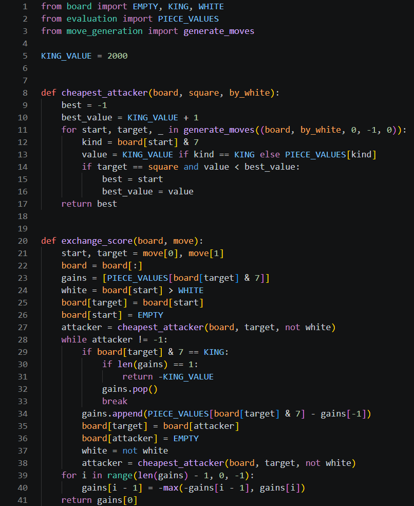
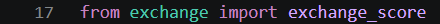
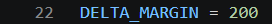
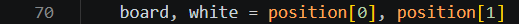
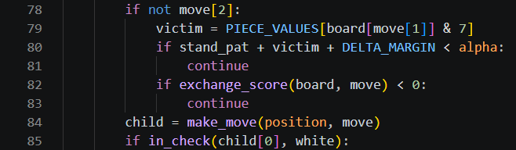

# Day 4, Period 2: Static exchange evaluation

10:30 to 12:00. Part of [Day 4: Remus4](../Day_4_Syllabus.md).

## Goal

Remus4 plays out an exchange before it trusts a capture.

## The big picture

The student pair keeps working in `engines/Remus4`, on the files copied and edited in Period 1. This period adds one new file, `exchange.py`, and edits `quiescence()` in `search.py`.

Quiescence search plays every capture, even queen takes a pawn that a pawn defends, and a capture like that costs a whole search to refute. Static exchange evaluation, the new file `exchange.py`, settles most captures without a search. It plays out every capture on one square on a copy of the board, each side taking with its cheapest attacker, and lets each side stop when going on would lose more. Queen takes a defended pawn scores 100 - 900 = -800, so `quiescence()` skips it. Delta pruning skips a capture for a second reason: when even winning the captured piece and 200 centipawns more cannot lift the score to alpha, the capture cannot matter.

## The period step by step

| Time | Activity |
| --- | --- |
| 10:30 to 10:45 | A capture is good only if the whole exchange on its square wins material: play it out on paper, cheapest attacker first. |
| 10:45 to 11:50 | Type `exchange.py` (36 code lines): `cheapest_attacker()` and `exchange_score()`. In `quiescence()`, add delta pruning and skip the captures that lose material (about 8 code lines). |
| 11:50 to 12:00 | Run `uci.py`. |

## What changes this period

| File | New or edited | What the student pair does | Lines in your file |
| --- | --- | --- | --- |
| `exchange.py` | New | Type the whole file: `cheapest_attacker()` and `exchange_score()` | 1 to 41 |
| `search.py` | Edited (begun in Period 1) | Import `exchange_score()`, and add delta pruning and the exchange test to `quiescence()` | 17, 22, 70, 78 to 85 |
| All other files | Unchanged since Period 1 | No edits this period | Unchanged |

The instructor's versions are [`engines_instructor/Remus4/exchange.py`](../../engines_instructor/Remus4/exchange.py) and [`engines_instructor/Remus4/search.py`](../../engines_instructor/Remus4/search.py). Copy only the code: no comments, no docstrings, and no type hints. The line numbers on this page count the lines of the student pair's own files in `engines/Remus4`, as they stand at the end of this period. Work from the top of each file down, and each number is right when you reach it.

## The edits, file by file

### `exchange.py`

Create `exchange.py` in `engines/Remus4`. It has 41 lines when it is done.

`KING_VALUE = 2000` (line 5) gives the king a value for this file only, larger than any other piece, so the king is always the last piece to capture.

`def cheapest_attacker(board, square, by_white):` (line 8) returns the square of the cheapest piece of one side that can capture on `square`, or -1 when there is none. It reuses `generate_moves()` from Day 1 on a position made for the test, `(board, by_white, 0, -1, 0)`: that side to move, no castling, and no en passant. The loop on lines 11 to 16 keeps the attacker with the lowest value so far.

`def exchange_score(board, move):` (line 20) plays the capture on a copy of the board (lines 22 to 26). `gains` (line 23) records, capture by capture, the material a side wins if the exchange stops right after its capture. The `while` loop on lines 28 to 38 lets the other side recapture with its cheapest attacker, then the first side, and so on until one side has no attacker left. A king may recapture only when nothing defends the square, so lines 29 to 33 end the exchange when a capture would take a king. The loop on lines 39 and 40 then works backward from the last capture: each side either takes or stops, whichever leaves it better off, and `return gains[0]` (line 41) is the result for the side that made the first capture.

### `search.py`

`search.py` grows from 224 lines to 233, all of it at the top of the file and in `quiescence()`.

1. Type `from exchange import exchange_score` (line 17) under the `evaluation` import.
2. Type `DELTA_MARGIN = 200` (line 22) under `FUTILITY_MARGIN = 200`.
3. In `quiescence()`, type `board, white = position[0], position[1]` (line 70) under `count_node()`.
4. Under the two lines `if priority < CAPTURE:` and `break`, type the six lines from `if not move[2]:` to the second `continue` (lines 78 to 83). A promotion skips both tests, because a pawn that promotes gains far more than the piece it captures.
5. Change the legality test under `child = make_move(position, move)` to `if in_check(child[0], white):` (line 85), using the name from step 3.

## Done when

`uci.py` runs and still plays.
