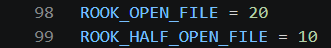
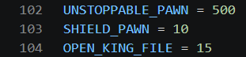
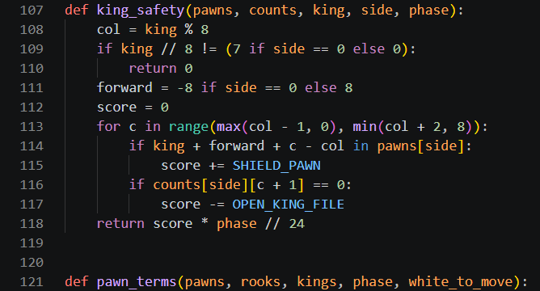
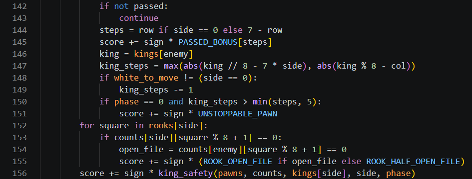
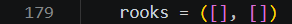
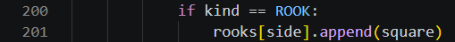
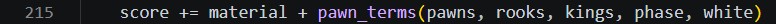
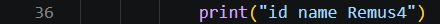

# Day 4, Period 4: The pawn terms, then test Remus4

3:00 to 4:30. Part of [Day 4: Remus4](../Day_4_Syllabus.md).

## Goal

Remus4's evaluation is complete, and the student pair tests it with `verify_remus.py`, then it plays Remus3 and Remus4-Rust.

## The big picture

The student pair finishes Remus4 in `engines/Remus4` with the last terms of the evaluation, all in `pawn_terms()` and `evaluate()`, gives the engine its name, and tests it. No file is added.

Three terms join `pawn_terms()`, because each one depends on where the pawns stand. The pawn race uses the rule of the square: in a pawn endgame, a passed pawn whose enemy king is too far away to catch it will promote, so it earns a bonus of 500, more than a rook. A rook on a file with no pawns of its own side is on a half-open file, worth 10, and on a file with no pawns at all it is on an open file, worth 20. King safety rewards a king on its home rank for each pawn in front of it and punishes each file next to it with no pawn of its own, scaled by the phase from Period 3 so it fades as the pieces come off.

## The period step by step

| Time | Activity |
| --- | --- |
| 3:00 to 3:30 | Reminder of the rule of the square. In `pawn_terms()`, add the pawn race, rooks on open files, and `king_safety()` (about 35 code lines). Change the name line to `id name Remus4`. |
| 3:30 to 4:00 | Run `verify_remus.py` in `engines/Remus4` until Remus4 passes every test. Then play one round of their Remus4 against their Remus3, two 10-minute games. |
| 4:00 to 4:30 | One round of their Remus4 against Remus4-Rust, two 10-minute games. Remus4-Rust is the instructor's Remus4 written in Rust, with the same evaluation and search and a larger table, so speed and memory alone separate the two engines. |
| If time remains | One round of the student pair against their Remus4, two 10-minute games: each student plays one game, one with White and one with Black (Part 3 of the guide). |

## What changes this period

| File | New or edited | What the student pair does | Lines in your file |
| --- | --- | --- | --- |
| `evaluation.py` | Copied from `engines/Remus3`, edited | Add the pawn race, rooks on open files, and `king_safety()` | 98 to 99, 102 to 104, 107 to 121, 142 to 156, 179, 200 to 201, 215 |
| `uci.py` | Copied from `engines/Remus3`, edited | Change the engine's name to Remus4 | 36 |
| All other files | Unchanged since Period 3 | No edits this period | Unchanged |

The instructor's versions are [`engines_instructor/Remus4/evaluation.py`](../../engines_instructor/Remus4/evaluation.py) and [`engines_instructor/Remus4/uci.py`](../../engines_instructor/Remus4/uci.py). Copy only the code: no comments, no docstrings, and no type hints. The line numbers on this page count the lines of the student pair's own files in `engines/Remus4`, as they stand at the end of this period. Work from the top of each file down, and each number is right when you reach it.

## The edits, file by file

### `evaluation.py`

`evaluation.py` grows from 183 lines to 217, the finished Remus4 file. The edits, from the top down:

1. Under `BISHOP_PAIR = 30`, type `ROOK_OPEN_FILE = 20` and `ROOK_HALF_OPEN_FILE = 10` (lines 98 and 99).
2. Under `ISOLATED_PAWN = 15`, type the three lines from `UNSTOPPABLE_PAWN = 500` to `OPEN_KING_FILE = 15` (lines 102 to 104).
3. Above `pawn_terms()`, type `def king_safety(pawns, counts, king, side, phase):` (lines 107 to 118), with two blank lines after it. A king off its home rank gets 0 (lines 109 and 110). The loop on lines 113 to 117 looks at the king's file and the files on each side: a pawn of its own one square in front of the king adds `SHIELD_PAWN`, and a file with no pawn of its own subtracts `OPEN_KING_FILE`.
4. Change the first line of `pawn_terms()` to `def pawn_terms(pawns, rooks, kings, phase, white_to_move):` (line 121).
5. At the end of the loop over a side's pawns, replace the three lines from `if passed:` to `score += sign * PASSED_BONUS[steps]` with the fifteen lines from `if not passed:` to `score += sign * king_safety(pawns, counts, kings[side], side, phase)` (lines 142 to 156). `continue` skips to the next pawn when this one is not passed. `king_steps` (line 147) counts the steps the enemy king needs to reach the pawn's promotion square, one fewer when that king moves next, and a pawn it cannot catch in a pawn endgame (phase 0) is unstoppable. Lines 152 to 155 score each rook's file, and line 156 adds king safety, once per side.
6. In `evaluate()`, type `rooks = ([], [])` (line 179) under `pawns = ([], [])`.
7. In the loop's `else:` branch, under `score += sign * MOBILITY_BONUS * len(moves)`, type `if kind == ROOK:` and `rooks[side].append(square)` (lines 200 and 201).
8. Change the `pawn_terms()` call to `score += material + pawn_terms(pawns, rooks, kings, phase, white)` (line 215).

### `uci.py`

Change the name line to `print("id name Remus4")` (line 36). Remus4 is complete, and every file in `engines/Remus4` now matches the instructor's Remus4, comments, docstrings, and type hints aside.

## Done when

The student pair's Remus4 passes every test in `verify_remus.py`, and it has played one round against its Remus3 and one against Remus4-Rust. A round against the student pair follows if time remains.
