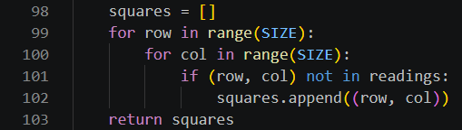
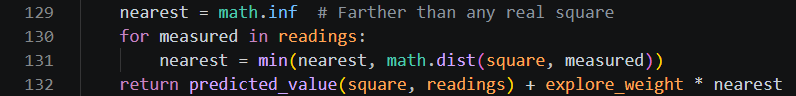
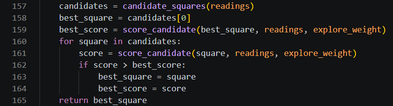
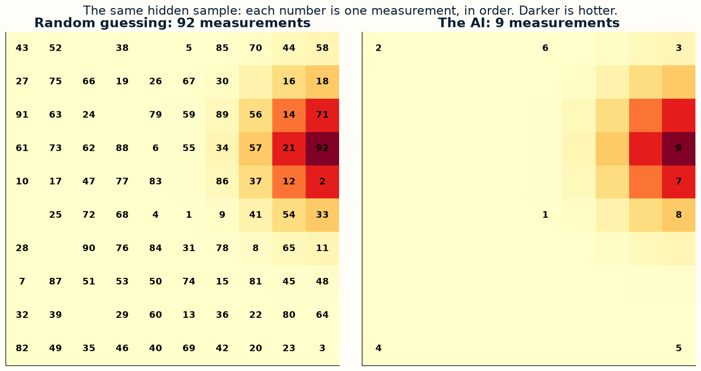
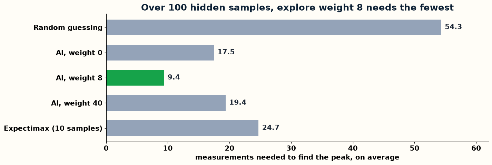

# Day 5, Period 1: Where to measure next

8:30 to 10:00. Part of [Day 5: The science project](../Day_5_Syllabus.md).

## Goal

The student pair's science AI chooses where to measure next on a sample, and beats random guessing.

## The big picture

No engine file changes today: `engines/Remus1` to `engines/Remus4` stay as they were at the end of Day 4. The student pair writes `candidate_squares()`, `score_candidate()`, and `choose_next_measurement()` in `hidden_peak.py`, a science program that reuses the engine's ideas, not its code: the squares of the sample not yet measured are the legal moves, and the score of a square is its evaluation. `hidden_peak.py` holds every other line already, so the student pair types only the bodies of these functions, from their docstrings. The student pair edits `science/hidden_peak.py`, and `science_instructor/hidden_peak.py` holds the finished version.

## The period step by step

| Time | Activity |
| --- | --- |
| 8:30 to 8:45 | A 10 by 10 sample hides a hot spot, and every measurement costs beam time. Choosing the next square is choosing a move: list the candidates, score each one, keep the best. |
| 8:45 to 9:30 | Write `candidate_squares()`, `score_candidate()`, and `choose_next_measurement()` in `hidden_peak.py` (19 code lines). Run it. |
| 9:30 to 10:00 | Tune `EXPLORE_WEIGHT` and compare. Over 100 hidden samples, random guessing needs 54.3 measurements on average, the AI with weight 0 needs 17.5, weight 8 needs 9.4, and weight 40 needs 19.4. The teacher shows the expectimax lookahead (24.7): it looks two measurements ahead, but its crude model makes it worse than the one-step AI. |

## The files

| File | The instructor's version |
| --- | --- |
| `hidden_peak.py` | [`science_instructor/hidden_peak.py`](../../science_instructor/hidden_peak.py) |

### `hidden_peak.py`

These images show the function bodies from [`science_instructor/hidden_peak.py`](../../science_instructor/hidden_peak.py). In `science/hidden_peak.py`, replace the comment and the `raise` line under each docstring with the body. Work from the top of the file down, and the line numbers match when you reach each function.

### The graphs

matplotlib drew these graphs from the results of `science_instructor/hidden_peak.py`.

## Done when

`choose_next_measurement()` needs fewer measurements on average than random guessing.
