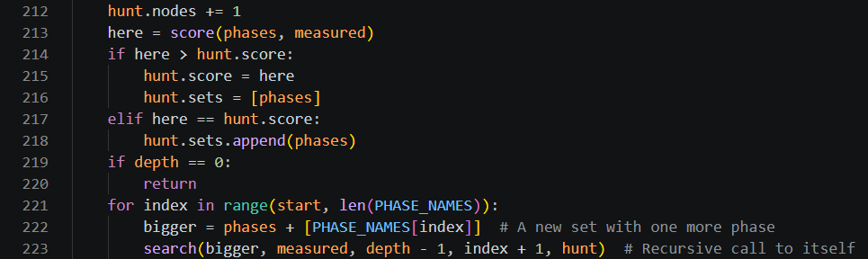
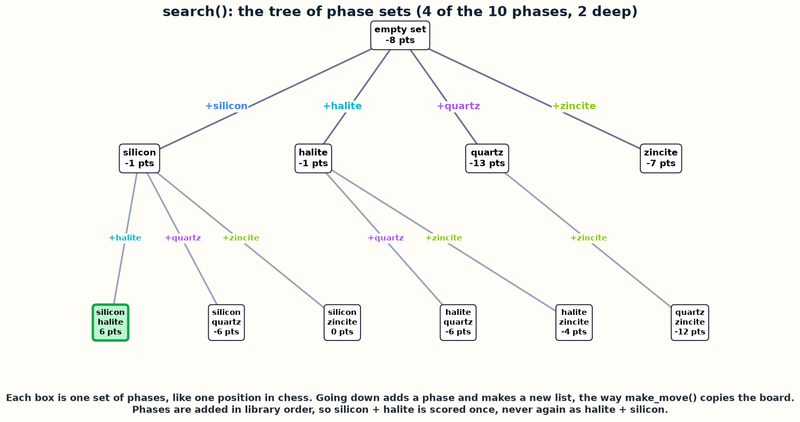
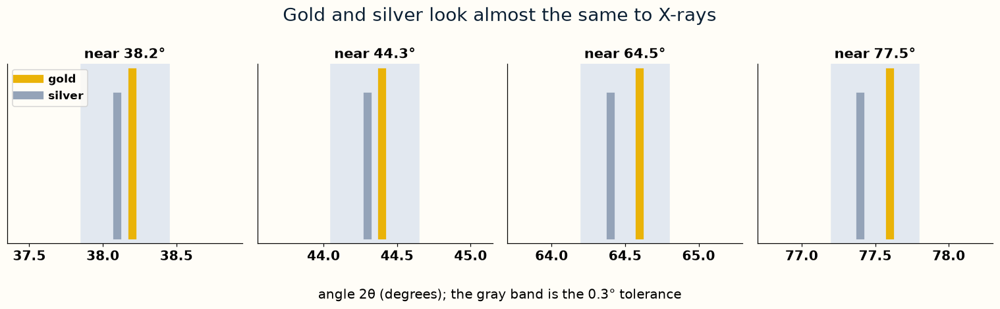
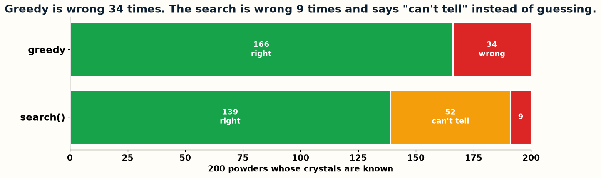

# Day 5, Period 3: Search every set, and verify

1:00 to 2:30. Part of [Day 5: The science project](../Day_5_Syllabus.md).

## Goal

The student pair searches every set of up to three phases and verifies the search on 200 known powders.

## The big picture

No engine file changes today: `engines/Remus1` to `engines/Remus4` stay as they were at the end of Day 4. The student pair writes `search()` in `phase_hunt.py`, a science program that reuses the engine's ideas, not its code: `search()` scores every set of up to three phases, the way `alpha_beta()` scores every line of moves. `phase_hunt.py` holds every other line already, so the student pair types only the bodies of these functions, from their docstrings. The student pair edits `science/phase_hunt.py`, and `science_instructor/phase_hunt.py` holds the finished version.

## The period step by step

| Time | Activity |
| --- | --- |
| 1:00 to 1:15 | The tree of phase sets beside Remus's game tree: a set is a position and adding a phase is a move. Quartz then rutile is the same set as rutile then quartz, the same idea as the transposition table. |
| 1:15 to 1:50 | Write `search()` (13 code lines), which scores every set of up to three phases and keeps every set that ties for the best score. |
| 1:50 to 2:15 | Verify on the 200 known powders: 139 right, 52 "can't tell", and 9 wrong, against greedy's 34 wrong. The search scores 176 sets per powder in library order, against 821 in every order. Change `PHASE_COST` and `MISSING` and watch the verdicts move. |
| 2:15 to 2:30 | The programs that search the same tree on real synchrotron data, and the agent that steers measurements at a beamline. |

## The files

| File | The instructor's version |
| --- | --- |
| `phase_hunt.py` | [`science_instructor/phase_hunt.py`](../../science_instructor/phase_hunt.py) |

### `phase_hunt.py`

These images show the function bodies from [`science_instructor/phase_hunt.py`](../../science_instructor/phase_hunt.py). In `science/phase_hunt.py`, replace the comment and the `raise` line under each docstring with the body. Work from the top of the file down, and the line numbers match when you reach each function.

### The graphs

matplotlib drew these graphs from the results of `science_instructor/phase_hunt.py`.

## Done when

`search()` makes fewer wrong calls than greedy.
