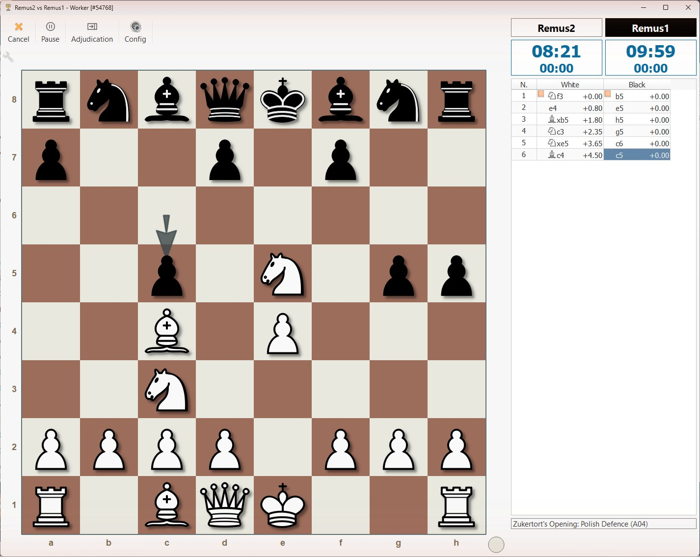
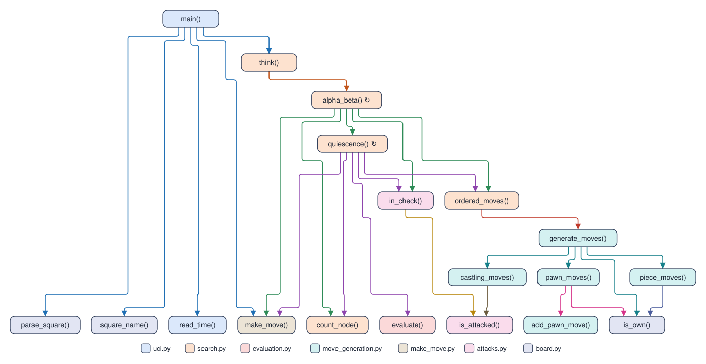

# Remus

Remus is a chess engine written in plain Python, built one lesson at a time for
the "Turning a Chess Engine into Science AI" workshop.

<table>
  <tr>
    <td width="39%" valign="top">
      <a href="docs/lucas_chess/lucas_chess_guide.md"></a>
    </td>
    <td width="61%" valign="top">
      <a href="docs/engines/Remus2/call_tree.svg"></a>
    </td>
  </tr>
  <tr>
    <td valign="top">Remus2 plays Remus1 in <a href="docs/lucas_chess/lucas_chess_guide.md">Lucas Chess</a>.</td>
    <td valign="top">Inside Remus2: which function <a href="docs/engines/Remus2/README.md">calls which</a>.</td>
  </tr>
</table>

Its name reaches back more than four thousand years. Sargon of Akkad (about 2335 to
2279 BC) founded the Akkadian Empire in Mesopotamia, the first known great empire. In
1978 his name went to Sargon, a chess program by Dan and Kathe Spracklen. Written in
Z80 assembly for the Wavemate Jupiter II, Sargon won the first microcomputer chess
tournament, at the West Coast Computer Faire in 1978, with a perfect 5-0. The
Spracklens then published its complete source as a book, *Sargon: A Computer Chess
Program* (Hayden, 1978), so anyone could read a real engine and learn from it. Sargon
II, 2.5, and III followed, and Sargon III ran on the first Macintosh.

Sargon of Akkad's first son and heir was Rimush (about 2279 to 2270 BC), who held the
empire together through widespread revolts. Remus echoes Rimush: a "son of Sargon," an
heir to the small, readable chess programs whose insides lie open for learners,
rebuilt in modern Python.

## The workshop

The workshop runs for one week, five days of four 90-minute periods, for students
who know some coding and know how to play chess, including notation. Twenty students
work in ten student pairs, one Windows 11 laptop per student pair. Each day builds the
engine of its number: Day 1 types in Remus1, Day 2 Remus2, Day 3 Remus3, and Day 4
Remus4, and the last period of each of those days tests the newest engine in Lucas Chess.
Day 5 turns the search ideas of the week into a science project.
[`workshop_syllabus.md`](workshop_syllabus.md) holds the plan of the week, and each day has its own folder at the top of the repository.

## The engines

Remus comes in four versions, each in its own folder under `engines_instructor/`. The
student pairs type every line of each one into their own folders, `engines/Remus1` to
`engines/Remus4`, copying the instructor's version file by file. The new code lines are
the lines a student pair types for that version, leaving out blank lines, comments, and
docstrings:

<table>
  <tr><th align="left">Version</th><th align="left">What it plays with</th><th align="right">New code lines</th></tr>
  <tr><td><a href="docs/engines/Remus1/README.md">Remus1</a></td><td>Legal chess, one random legal move at a time, with no search</td><td align="right">193</td></tr>
  <tr><td><a href="docs/engines/Remus2/README.md">Remus2</a></td><td>Legal chess, the evaluation, alpha-beta, quiescence, MVV-LVA ordering, a check extension, and iterative deepening</td><td align="right">161</td></tr>
  <tr><td><a href="docs/engines/Remus3/README.md">Remus3</a></td><td>Remus2 plus killer moves, pawn structure, a transposition table, an opening book, aspiration windows, time management, null-move pruning, the principal variation, the bishop pair, and the rook table</td><td align="right">193</td></tr>
  <tr><td><a href="docs/engines/Remus4/README.md">Remus4</a></td><td>Remus3 plus every other enhancement: draw sense, the endgame terms, late move reductions, principal variation search, pruning margins, static exchange evaluation, and the last evaluation terms</td><td align="right">159</td></tr>
  <tr><td></td><td align="right"><strong>Total lines of code</strong></td><td align="right"><strong>706</strong></td></tr>
</table>

Each instructor engine folder holds only what the engine runs: its Python files, `remus.bat`,
which Lucas Chess starts, and for Remus3 and Remus4 `opening_book.txt`, plus a copy of
`verify_remus.py`. Each engine's
README and `call_tree.svg`, a picture of which function calls which, live in
`docs/engines/Remus1` to `docs/engines/Remus4`.
The four folders in `engines/` start with only `remus.bat` and `verify_remus.py`, which tests a finished version: each student pair
fills `engines/Remus1` on Day 1, then copies its files forward into the next folder at the start of each
day and edits them there.
[`docs/engines/remus_versions.md`](docs/engines/remus_versions.md) lists every
enhancement and the version that holds it.

A fifth engine, [Remus4-Rust](docs/engines/Remus4-Rust/README.md), is the instructor's
Remus4 written in Rust, with a larger table. Nobody types it. In the same time it
searches more than 100 times as many positions, so on Day 4 the class sees what speed buys
when the algorithms stay the same.

Everything else sits in the plan of the week, the day folders, `science/`, `science_instructor/`, and `docs/`:

| Place | What it holds |
| --- | --- |
| [`workshop_syllabus.md`](workshop_syllabus.md) | The plan of the five days on one page |
| `Day 1 - ...` to `Day 5 - ...` | One folder per day, such as [`Day 1 - Remus1 plays legal chess`](Day%201%20-%20Remus1%20plays%20legal%20chess/Day_1_Syllabus.md), with a page for the day and a folder for each period |
| [`science/`](science/) | The two Day 5 science programs, with the functions the student pairs write left empty |
| [`science_instructor/`](science_instructor/) | The same two programs, finished |
| [`docs/engines/`](docs/engines/) | One folder per engine with its README and call tree, and [`remus_versions.md`](docs/engines/remus_versions.md), the plan of the versions |
| [`docs/lucas_chess/`](docs/lucas_chess/) | The [Lucas Chess guide](docs/lucas_chess/lucas_chess_guide.md) and its pictures |
| [`docs/chess_tutor/`](docs/chess_tutor/) | [`learn_chess.md`](docs/chess_tutor/learn_chess.md), the rarer rules and how moves are written, [`uci.md`](docs/chess_tutor/uci.md), the conversation between Lucas Chess and Remus, videos on minimax, negamax, and alpha-beta, and [`fide_titles_and_elo_ratings.md`](docs/chess_tutor/fide_titles_and_elo_ratings.md), the FIDE titles and the ratings that go with them |
| [`docs/briefs/`](docs/briefs/) | The [management brief](docs/briefs/Turning_a_Chess_Engine_into_Science_AI_Management_Brief.pdf) and the [student and parent brief](docs/briefs/Turning_a_Chess_Engine_into_Science_AI_Student_and_Parent_Brief.pdf), one page each, as PDFs |

## Setup

Remus runs on Windows 11 with [Git](https://git-scm.com/),
[uv](https://docs.astral.sh/uv/), [VS Code](https://code.visualstudio.com/), and Lucas
Chess. On Day 1, period 1, the teacher walks each student pair through steps 1 to 6
below. A class laptop that already holds VS Code or Lucas Chess skips that install.
After that setup no student or teacher types a git or uv command: every step of the
workshop runs from VS Code's Run button. The same steps set up any other computer,
such as the teacher's laptop or a computer at home.

1. Open **PowerShell** from the Start menu and install Git and VS Code with winget:

   ```powershell
   winget install --id Git.Git -e
   winget install --id Microsoft.VisualStudioCode -e
   ```

2. Install uv, which manages Python and the project's packages:

   ```powershell
   winget install --id astral-sh.uv -e
   ```

   Close PowerShell and open a new window, so that it finds `git`, `uv`, and `code`.

3. Clone the repository and change into its folder:

   ```powershell
   git clone https://github.com/dbiersach/remus.git Remus
   cd Remus
   ```

   Cloning a public repository needs no GitHub account, so the students never create
   one.

4. Install Python 3.14, `matplotlib` for the Day 5 graphs, and the development tools
   (`python-chess` and `ruff`) into the project:

   ```powershell
   uv sync
   ```

   uv reads `.python-version` and downloads Python 3.14 by itself, so no separate
   Python install is needed.

5. Install the VS Code extensions the class uses, then open the Remus workspace:

   ```powershell
   .\install_vscode_extensions.ps1
   code Remus.code-workspace
   ```

   The Python extension (`ms-python.python`) is the one that matters most: it adds
   the Run Python File button. The workspace file sets the font sizes, formats code
   with ruff on save, and points VS Code at the project's `.venv`. If PowerShell
   refuses to run the script, run
   `Set-ExecutionPolicy -Scope CurrentUser RemoteSigned` once and try again.

6. Install Lucas Chess, the chess board that plays against Remus. Download the
   Windows installer from
   [lucaschess.pythonanywhere.com/downloads](https://lucaschess.pythonanywhere.com/downloads)
   and run it. Lucas Chess comes with Stockfish, so no other engine is needed.

   Every laptop then adds the engines: close Lucas Chess, open
   [`docs/lucas_chess/install_lucas_engines.py`](docs/lucas_chess/install_lucas_engines.py)
   in VS Code, and press the Run button. The program adds the instructor's Remus1 to
   Remus4 and Remus4-Rust to the External engines list, keeps every engine already
   there, and adds no duplicates, so nobody adds an engine by hand. The
   [Lucas Chess guide](docs/lucas_chess/lucas_chess_guide.md) shows, with screenshots, how
   to play those engines and watch them play.

### Stockfish

Stockfish is the strongest free chess engine in the world, and like Remus it speaks
UCI. Remus plays it in class at a reduced strength, such as 1500 Elo, to see how good
Remus really is. Lucas Chess installs its own copy of Stockfish, so the class laptops
need nothing more.

To get the newest Stockfish at home, download it free from
[stockfishchess.org](https://stockfishchess.org/). On Windows, pick the file
`stockfish-windows-x86-64-universal.exe`. This "universal" build checks which
processor the computer has when it starts and uses that processor's fastest
instructions, such as AVX2, so there is no need to choose among the other builds.
Stockfish has no board of its own: add the `.exe` to Lucas Chess as an external
engine, the way the "Lucas Chess at home" part of the guide adds a `remus.bat`.

### Running the files

From here on, every file runs inside VS Code. Open a file, such as `uci.py` in
the student pair's own `engines/Remus2`, and click the Run Python File button (the triangle at the top right
of the editor).

The engines use only the Python standard library. The development group adds
`python-chess`, which the workshop designer's engine checks use as an outside
reference, and `ruff`. Lucas Chess talks to Remus over UCI.

## License

BSD 3-Clause. See [`LICENSE`](LICENSE).
