# Lucas Chess: Play and Watch Remus

Remus has no board window of its own. It reads moves as text and answers with text.
**Lucas Chess** is the chess app on every class laptop, and it gives Remus a board,
pieces, and clocks. Lucas Chess starts Remus through the file `remus.bat` and talks
to Remus in UCI, the Universal Chess Interface: Lucas sends `position startpos moves
e2e4` and `go`, and Remus answers `bestmove c7c5`. [`uci.md`](../chess_tutor/uci.md) explains that
conversation line by line.

This guide shows four things:

1. Start Lucas Chess.
2. Add Remus1 to Lucas Chess as an engine.
3. Play a game against Remus1, as each student does at the end of Day 1.
4. Run tournaments between the versions: Remus2 against Remus1, Remus3 against Remus2,
   and Remus4 against Remus3.

## Part 1: Start Lucas Chess

Click the Windows **Start** button, then **All**, and find **Lucas Chess (R)** under
the letter L. You can also double-click the Lucas Chess icon on the desktop.

Always start Lucas Chess one of these two ways. Both start it from its own folder,
and Lucas needs that folder to run engine-against-engine games.

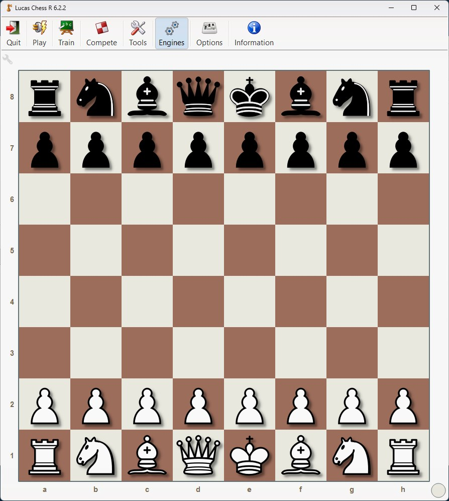

The buttons along the top open menus. This guide uses **Play** and **Engines**.

## Part 2: Add Remus as an engine

You do this once for each `remus.bat` you want to use. The steps add Remus1, and the
other versions go in the same way: only the folder of `remus.bat` changes.

**Step 1.** Copy the full path of `remus.bat`. In VS Code, right-click `remus.bat` in
the file list on the left and choose **Copy Path**. The path looks like
`C:\...\Remus\engines\Remus1\remus.bat`.

**Step 2.** In Lucas Chess, click **Engines**, then **External engines**.

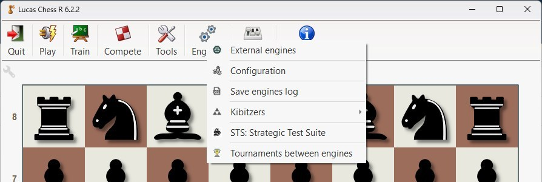

**Step 3.** The External engines window lists every engine you have added. Click
**New**.

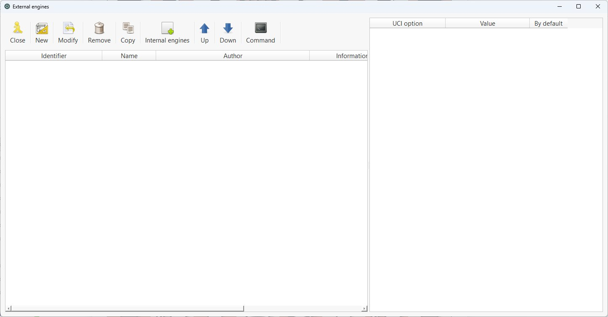

**Step 4.** A window opens to choose the engine file. It shows only `.exe` files, so
`remus.bat` does not appear in the list. Click the **File name** box, paste the path
with **Ctrl+V**, and click **Open**.

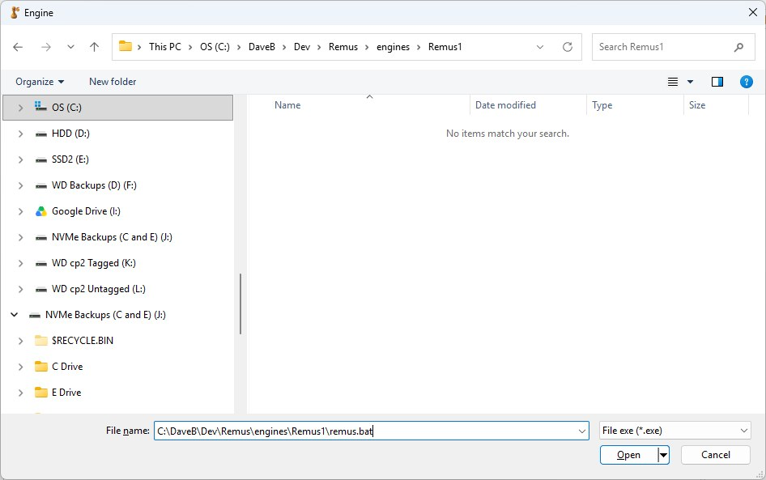

**Step 5.** Lucas starts Remus and asks for its name. Remus1 says `id name Remus1`,
so both boxes start as "Remus1". Keep that name.
Leave every other box at 0, and check that the last line shows your `remus.bat`.
Click **Accept**.

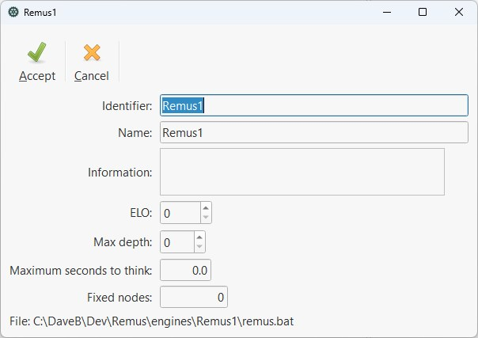

**Step 6.** Remus1 is now in the list. Click **Close**.

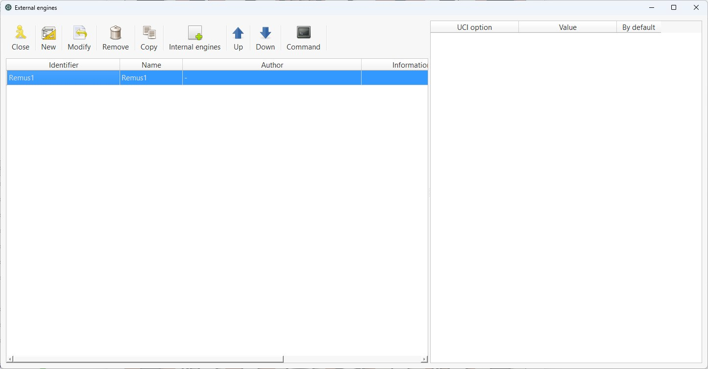

If Lucas shows an error in Step 5, Remus did not start. See "When something goes
wrong" at the end of this guide.

## Part 3: Play against Remus yourself

**Step 1.** Click **Play**, then **Play against an engine**.

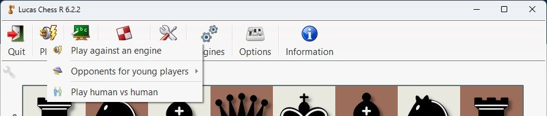

**Step 2.** Under **Opponent**, click the wide button with the engine's name, then
choose **External engines** and **Remus1**. Under **Side you play with**, pick White,
Black, or Random.

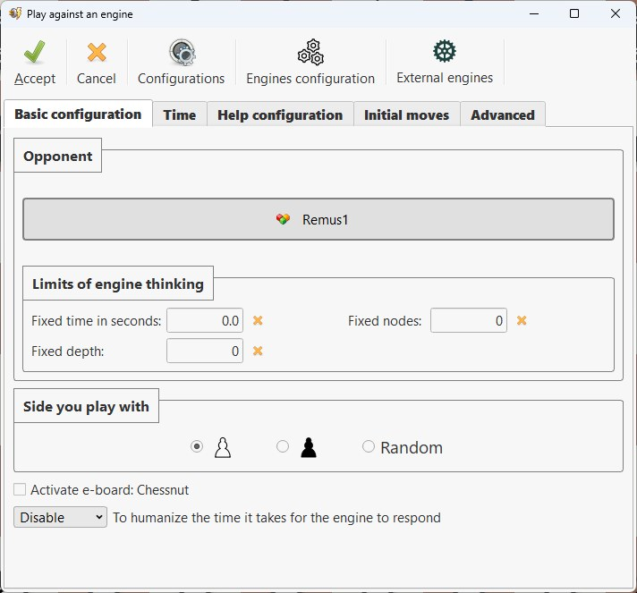

**Step 3.** Open the **Time** tab and tick **Activate the time control**. Set **Total
minutes** to 10 and **Seconds added per move** to 0, so each side has 10 minutes for
the whole game.

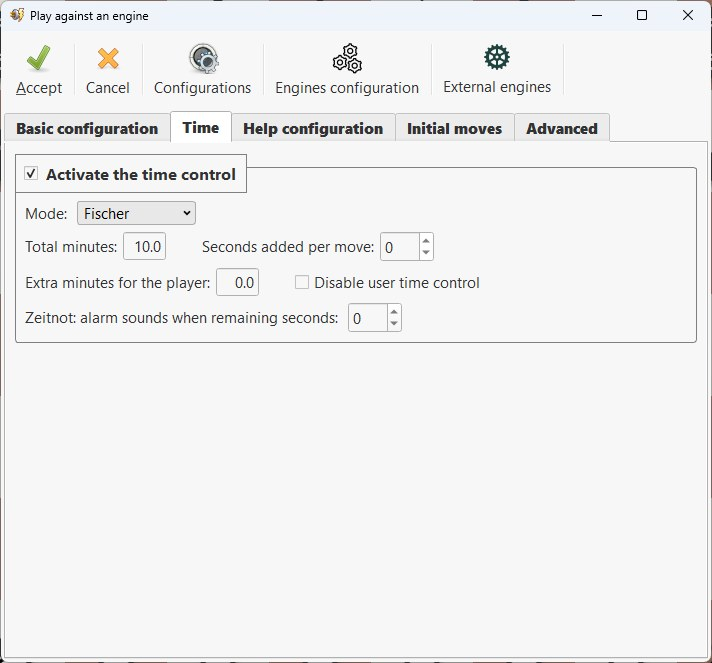

**Step 4.** Click **Accept**, then **Continue**, and drag a piece to make your move.
Remus answers on the board.

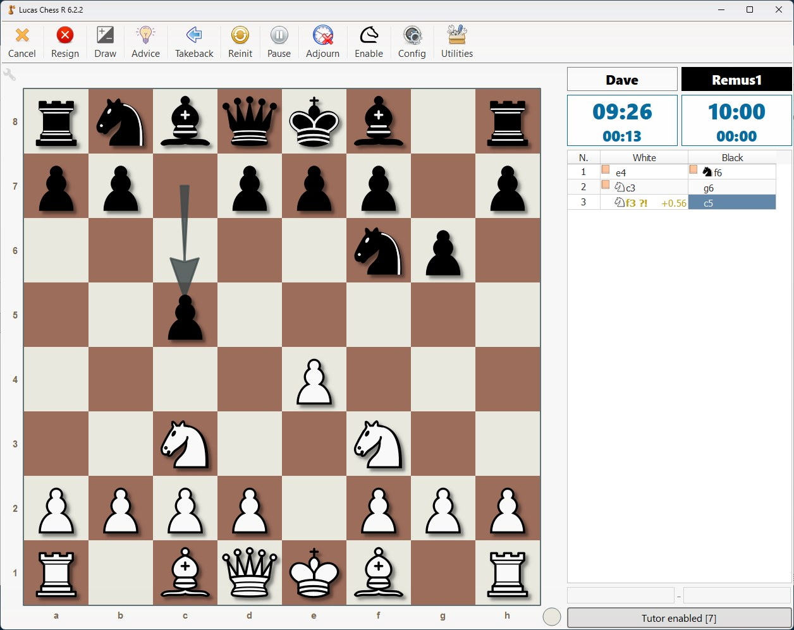

In this game White has played e4, Nc3, and Nf3, and Remus1 has answered Nf6, g6, and
c5. Remus1 picks a legal move at random and answers at once, so its clock stays near
10:00. Every later version spends about one thirtieth of the time left on its clock
for each move.

Lucas has a tutor, and the bar under the moves shows that it is on. When the tutor
finds a better move than yours, a small menu opens beside the board. Click **Select my
move** to keep your move, or **Try again** to take it back.

To end a game early, click **Cancel** and answer **Yes**, then click **Close**.

A student pair plays one round against each finished version: each student plays one
game, one with White and one with Black.

## Part 4: Run a tournament between two versions

Lucas calls a match between engines a "tournament", even when it has only two players.
The class runs three of them, one each time a new version is finished:

| Tournament | New engine | Previous engine |
| --- | --- | --- |
| `Remus2 vs Remus1` | Remus2 | Remus1 |
| `Remus3 vs Remus2` | Remus3 | Remus2 |
| `Remus4 vs Remus3` | Remus4 | Remus3 |

Both engines must be on the list from Part 2. These steps build the first tournament,
and the other two go in the same way.

**Step 1.** Click **Engines**, then **Tournaments between engines** (the last line of
the menu in the picture from Part 2). Click **New**, type the name `Remus2 vs Remus1`,
and click **Accept**.

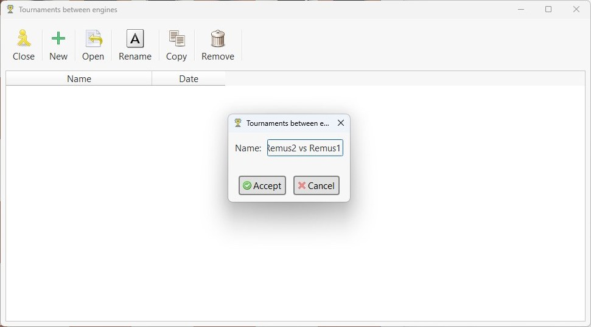

**Step 2.** The **Configuration** tab opens. Lucas can stop a game early and give the
win to whichever side is far ahead. To watch every game to the end, set **Minimum
centipawns to assign winner** to `0` and **Minimum movements to assign draw** to `0`.
A centipawn is one hundredth of a pawn, so 350 centipawns means "ahead by three and a
half pawns".

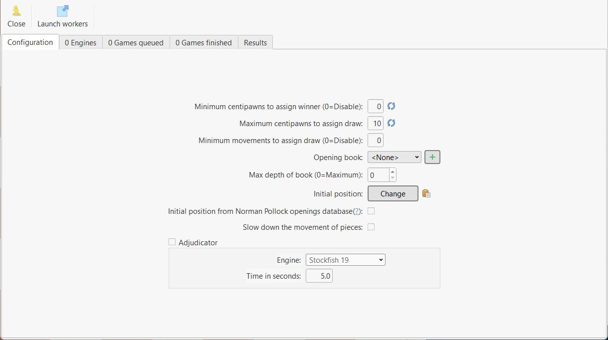

**Step 3.** Open the **Engines** tab and click **Import**. Choose **External
engines**, then **Remus2**. Click **Import** again, and choose **External engines**,
then **Remus1**.

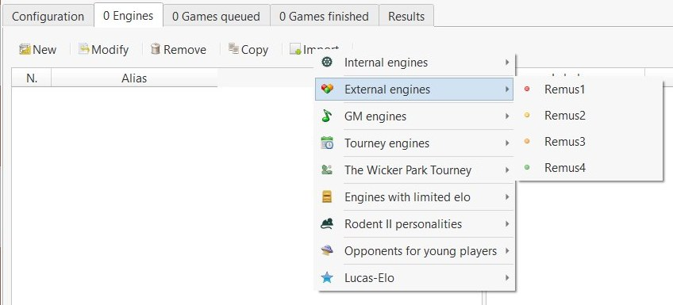

**Step 4.** The tab shows two engines. Click a name to see its settings on the right.

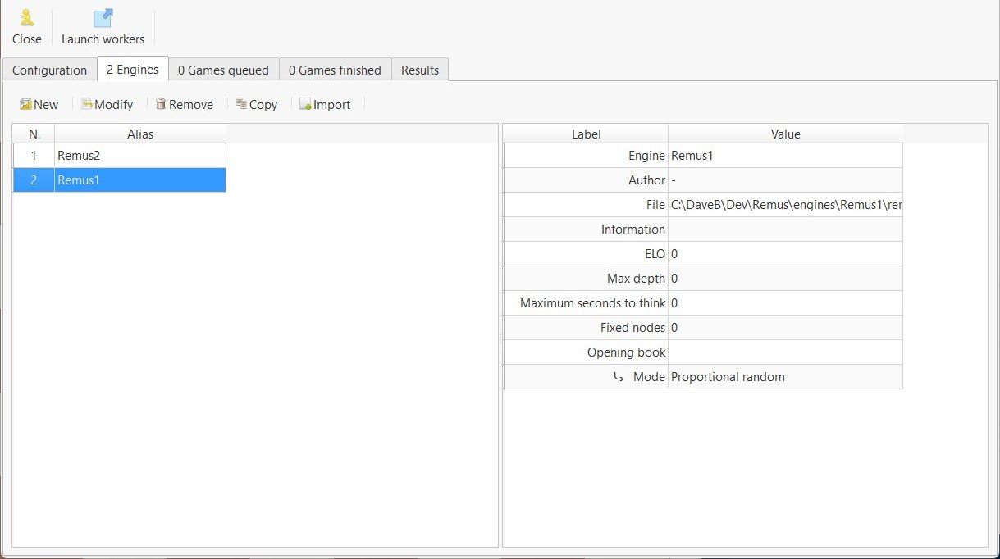

**Step 5.** Open the **Games queued** tab and click **New**. Set **Rounds** to 1,
**Total minutes** to 10, and **Seconds added per move** to 0, and click **Accept**. Each
engine gets 10 minutes on its clock for the whole game.

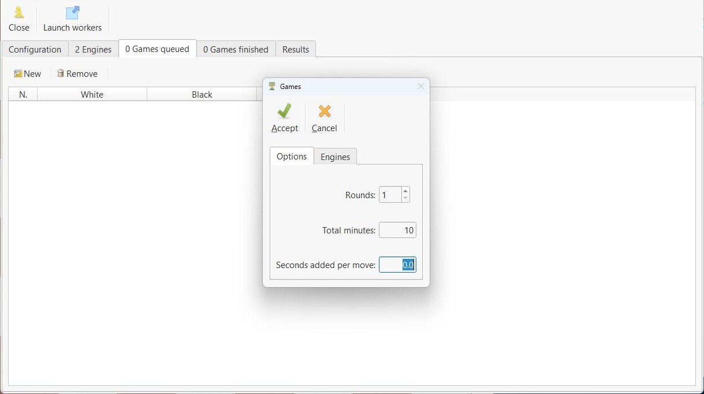

**Step 6.** One round makes two games, so each engine plays once with White and once
with Black. The **Time** column shows 600 seconds.

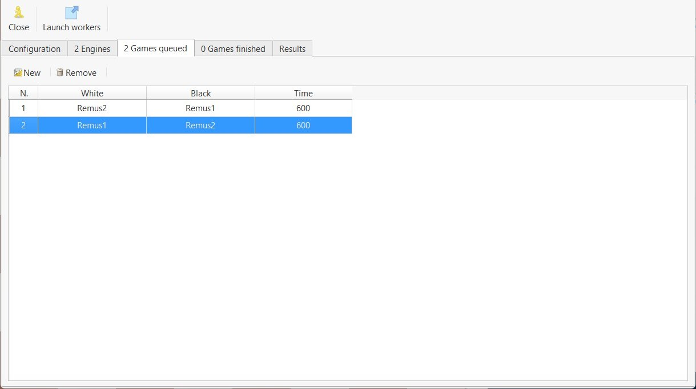

**Step 7.** Click **Launch workers** at the top of the window and choose **1**. A
worker is a second Lucas window that plays the games one after the other.

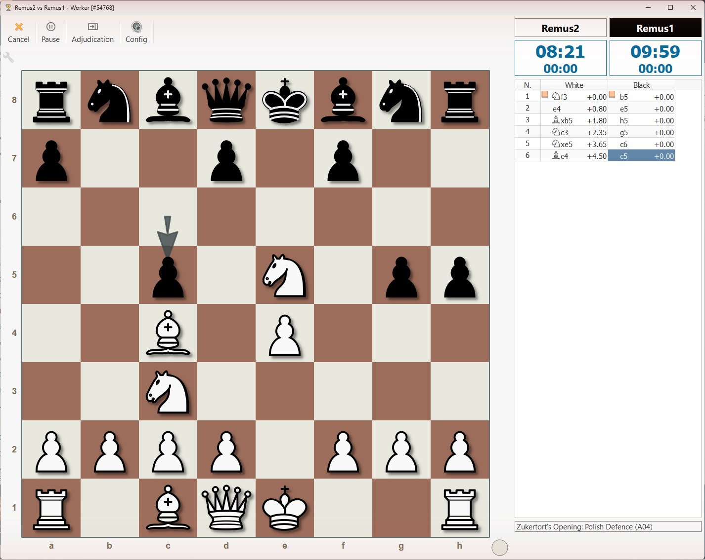

The worker window shows the board, both clocks, and the moves. The number after each
move is the engine's score in pawns: +1.80 means "White is ahead by almost two pawns".
Remus2 wins material quickly here, because Remus1 reports +0.00 for every move and has
looked at none of the replies.

A game lasts up to 20 minutes, so the two games last up to 40 minutes. When they are
over, the **Games finished** and **Results** tabs of the tournament show who won. To
stop early, click **Cancel** in the worker window; the unfinished games stay in **Games
queued**.

**Step 8.** Build the other two tournaments the same way when their versions are
finished. Remus3 and Remus4 start from an opening book, and the box at the bottom right
of the worker window shows the line the engine expects to follow.

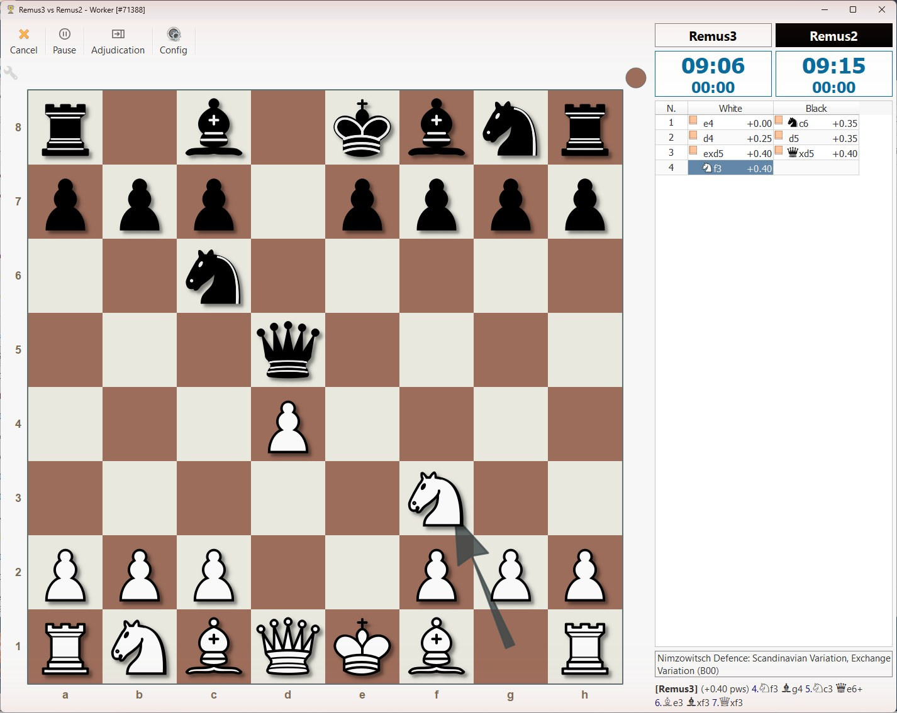

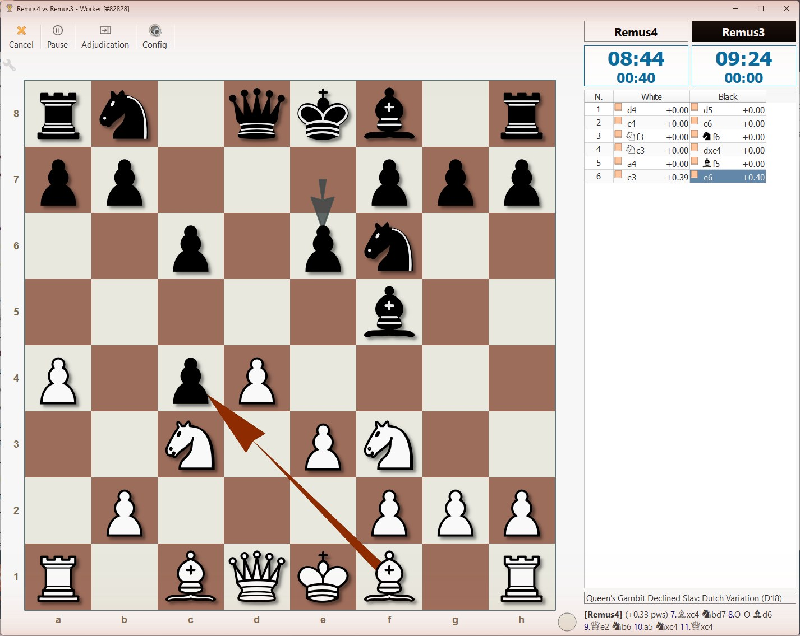

The list of tournaments keeps each one, so you can open it later to read its results.

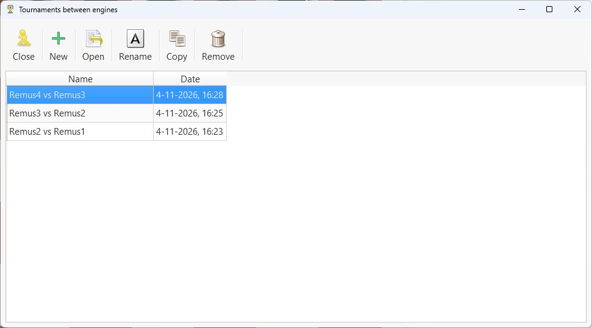

### A tournament against Stockfish 1500

This tournament comes last in Period 4, after the round against the previous version
and the round against the student pair, and a class short of time skips it.

Stockfish is one of the strongest chess engines in the world. Lucas Chess comes with
a Stockfish that is held back to play like a 1500 Elo club player. To use it as an
opponent, click **Import** in Step 3 and choose **Engines with limited elo**, then
**1500**, then **Stockfish 19 (1500)**. Click its name in the **Engines** tab, and its
ELO line reads 1500. The rest of the tournament goes the same way: one round, with 10
minutes for each side.

## Lucas Chess at home

Lucas Chess is free. To use it on your own computer at home, download the installer
from the official site, [lucaschess.pythonanywhere.com/downloads](https://lucaschess.pythonanywhere.com/downloads),
and run it. It installs like any other Windows program, and it comes with Stockfish,
so every tournament in Part 4 works the same way at home. Remus and its `remus.bat`
launcher run on Windows only.

To play your own Remus at home, copy the Remus folder from your USB drive to a Windows
computer, install `uv`, and run `uv sync` once in the Remus folder, the same setup as
on Day 1 (see the setup steps in the top `README.md`). Then add your `remus.bat` as in
Part 2.

## When something goes wrong

| What you see | What to check |
| --- | --- |
| Lucas shows an error when you add Remus | Open `uci.py` in the folder of `remus.bat` and press Run. A module that fails to import stops Remus before it can say `uciok`, and the error names the file and line. |
| Remus never moves | Open `uci.py` in the folder of `remus.bat` in VS Code and press Run. In the panel that opens, type `uci` and press Enter. Remus must print `uciok`. Then type `position startpos` and `go`, and Remus must print a `bestmove` line. |
| **Launch workers** does nothing | Quit Lucas Chess and start it again from the Start menu or the desktop icon. |
| Remus plays an old version of your code | Each `remus.bat` runs the code in its own folder. Add the `remus.bat` from the folder you are working in, or select the engine in **External engines** and click **Modify**. |
