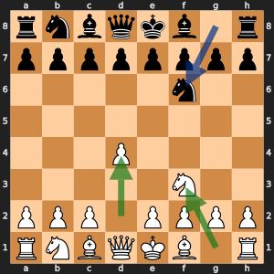

# Remus-RED: Transposition table

Remember positions already searched, so the same position reached in two move orders is scored once.

## Learning objectives

By the end of Day 9, each student pair can:

- Explain the idea of this enhancement in two sentences. **Measured by:** The student pair explains the idea to another student pair, who can restate it.
- Add the enhancement without breaking the rules. **Measured by:** `run_tests.py` passes in the version folder.
- Run a fair experiment: same opening, both piece colors. **Measured by:** In the Day 9 battles, `play_battle.py` in the version folder plays both 10-minute games with no illegal moves or crashes when the student pair presses Run in VS Code, and the student pair says why two games cannot show which enhancement is stronger.

## The idea, with an example

1. Nf3 Nf6 2. d4 and 1. d4 Nf6 2. Nf3 reach the same position by two different move orders. Chess players call that a transposition.

*The green arrows are White's two moves, Nf3 and d4, and the blue arrow is Black's Nf6. Play them in either order and the board ends up the same.*

A search meets transpositions all the time: Remus playing Nf3 then d4 against ...Nf6 and ...e6 reaches one position four ways. Remus-WHITE searches that position four times. Remus-RED searches it once, writes the result in a dict (the transposition table), and looks it up the other three times.

Each entry, keyed by `position_key`, holds the depth searched, the score, the move that was best, and a bound that says how much the score can be trusted. Alpha-beta often stops early, so a score is not always exact:

- `EXACT`: the search found the true score.
- `LOWER`: a move caused a cutoff, so the true score is at least this much.
- `UPPER`: no move beat alpha, so the true score is at most this much.

`probe()` answers from the table only when the stored search went at least as deep as the one needed and the bound settles the question. A lower bound of +120 settles a search that only asks "is it at least +100?" (beta = 100), but not one that asks for the exact score.

## Why it makes Remus stronger

A lookup replaces a whole subtree. Even when the stored score cannot be used, because it is too shallow or its bound does not settle the question, the stored best move is tried first. Iterative deepening makes this pay twice: the depth 3 search fills the table with best moves that put the depth 4 search's best move first almost everywhere, and alpha-beta prunes most when the best move comes first.

## What it costs

One dict lookup and one dict write per position. The key is already in the game history, so it costs nothing to build. The table starts empty for every move and holds one entry per position searched, a few hundred thousand at most, which a laptop's memory holds easily. Mate scores are not stored, because a mate score counts plies from the root, so the same position gets a different mate score at a different ply.

## Measured against Remus-WHITE

Each version searched the ten positions of the designer's benchmark, `misc/designer/remus_benchmark.py`, one depth at a time up to depth 4, on one computer. Fewer positions for the same depth means a smaller search tree. Positions per second shows what each position costs. The last column gave each position 5 seconds, the way a game does, and averages the deepest search that finished.

| Version | Positions to finish depth 4 | Share of Remus-WHITE's | Positions per second | Average depth in 5 seconds |
| --- | ---: | ---: | ---: | ---: |
| Remus-WHITE | 431,212 | 100% | 5,183 | 3.1 |
| Remus-RED | 243,223 | 56% | 4,994 | 3.7 |

## What to expect

Remus-RED is the only engine with one enhancement that rated clearly above Remus-WHITE in the designer's league: +101 plus or minus 67. Fewer positions for the same depth, and the biggest savings in endgames, where a few pieces shuffle between the same squares and nearly every position is reached many ways. Positions per second stay close to Remus-WHITE's.

## Where your code fits

`table_search()` in `search.py` replaces Remus-WHITE's search. At the top of every position it calls `probe()`, and if the answer is a score, it returns at once. After a cutoff it calls `store()` with `LOWER`; after searching every move it calls `store()` with `EXACT` if a move beat alpha and `UPPER` if none did. `store()` keeps the deeper of two results for the same position.

## The files

This folder is Remus-WHITE, the finished Day 9 Remus in `00 Remus-WHITE - No enhancements` beside it, plus this one enhancement. The student pair writes `store()` in `transposition_table.py`, `probe()` in `transposition_table.py`, `test_transposition_table_bounds()` in `test_upgrades.py`.

## The changes and why

### `store()` in `transposition_table.py`

Saves what one search learned about a position under its key: the depth, the score, whether that score is exact or only a bound, and the best move. A dict holds the table, so looking a position up again costs one step.

### `probe()` in `transposition_table.py`

Looks up a position in the table and returns a stored score only when it answers this search: it was searched deep enough, and its bound fits the window. One position reached by two move orders is then searched once.

### `test_transposition_table_bounds()` in `test_upgrades.py`

Proves the rules of `probe()` with three made-up entries before any real search uses them. A bound is the tricky part: "at least 80" settles a window whose beta is 70, but says nothing useful when beta is 100.

## Check it

Check the work by opening `run_tests.py` in this folder and pressing Run. Then open `basic_test.py` in VS Code and press Run: Remus-RED plays one 2-minute game against Remus-WHITE, which shows that the engine plays legal moves to the end of a game. In the Day 9 battles, follow the numbered steps at the top of `play_battle.py`: copy the visiting student pair's engine folder into `engines/student`, set `VISITING_ENGINE` to the visitor's engine color, and press Run. Remus-RED plays it twice at 10 minutes a side, once with each piece color, and both games go into misc/games/remus_games.pgn. Each script runs `misc/designer/version_match.py`, which plays the games.
