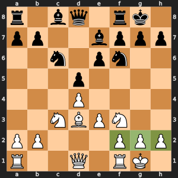
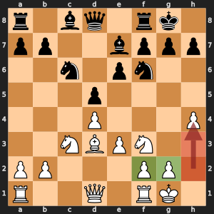

# Remus-GRAY: King safety

While the enemy queen is on the board, reward pawns that shelter the king.

## Learning objectives

By the end of Day 9, each student pair can:

- Explain the idea of this enhancement in two sentences. **Measured by:** The student pair explains the idea to another student pair, who can restate it.
- Add the enhancement without breaking the rules. **Measured by:** `run_tests.py` passes in the version folder.
- Run a fair experiment: same opening, both piece colors. **Measured by:** In the Day 9 battles, `play_battle.py` in the version folder plays both 10-minute games with no illegal moves or crashes when the student pair presses Run in VS Code, and the student pair says why two games cannot show which enhancement is stronger.

## The idea, with an example

White has castled kingside: king on g1, pawns on f2, g2, and h2. Each of the king's three files has a White pawn one or two squares in front, so Remus-GRAY adds 3 x 15 = 45 points. Push the h-pawn to h4, and the h-file no longer shelters the king: 30 points.

 

*Left: the three green pawns on f2, g2, and h2 shield the king on g1, 45 points. Right: after h2 to h4, no White pawn stands on h2 or h3 (the red squares), so only f2 and g2 count, 30 points. Black's queen is still on d8, so the bonus counts in both.*

The bonus counts only while the enemy queen is on the board, because the queen is the piece that makes an open king dangerous. Once the queens come off, the king should walk toward the center, and the term is 0.

## Why it makes Remus stronger

A king attack takes many moves to build, too many for a depth 4 search to see. The shield bonus teaches Remus to castle and to keep the pawns in front of its king, before an attack is in range of the search.

## What it costs

A scan of the board for the enemy queen and the king, and up to six squares checked in front of the king, in every evaluated position. Remus-GRAY evaluates a few positions a second fewer than Remus-WHITE.

## Measured against Remus-WHITE

Each version searched the ten positions of `compare_search.py`, one depth at a time up to depth 4, on one computer. Fewer positions for the same depth means a smaller search tree. Positions per second shows what each position costs. The last column gave each position 5 seconds, the way a game does, and averages the deepest search that finished.

| Version | Positions to finish depth 4 | Share of Remus-WHITE's | Positions per second | Average depth in 5 seconds |
| --- | ---: | ---: | ---: | ---: |
| Remus-WHITE | 431,212 | 100% | 5,183 | 3.1 |
| Remus-GRAY | 459,732 | 107% | 4,927 | 3.1 |

## What to expect

Earlier castling, fewer pawn pushes in front of its own king, and a reason to trade queens when its own shield is broken.

## Where your code fits

`white_score()` in `evaluation.py` adds `king_safety(board)` to material and placement. White's pawns stand in front of its king at smaller rows, because row 0 is rank 8, so the code steps the other way for Black.

## The files

This folder is Remus-WHITE, the finished Day 9 Remus in `00 WHITE - No enhancements` beside it, plus this one enhancement. The student pair writes `king_safety()` in `evaluation.py`.

## The changes and why

### `king_safety()` in `evaluation.py`

Rewards each pawn that shelters the king on its own file or a neighbor, one or two squares ahead, while the enemy queen is on the board. A king without pawn cover is easy to attack.

## Check it

Check the work by opening `run_tests.py` in this folder and pressing Run. Then open `basic_test.py` in VS Code and press Run: Remus-GRAY plays one 2-minute game against Remus-WHITE, which shows that the engine plays legal moves to the end of a game. In the Day 9 battles, follow the numbered steps at the top of `play_battle.py`: copy the visiting student pair's engine folder into `engines/student`, set `VISITING_ENGINE` to the visitor's engine color, and press Run. Remus-GRAY plays it twice at 10 minutes a side, once with each piece color, and both games go into misc/games/remus_games.pgn. Each script runs `misc/scripts/version_match.py`, which plays the games.

## What you edit this period

Every other function is finished. Change only these, and only below each docstring:

| File | Function | Starts at line | Lines to type | Tests that check it |
| --- | --- | --- | --- | --- |
| `evaluation.py` | `king_safety()` | 126 | 24 | `test_upgrades.py::test_king_safety_rewards_the_pawn_shield` |

Lines to type in all: 24. Each stub is two comment lines that start with `# Day ...` and a `raise NotImplementedError` statement. Delete them and write the body in their place.

## The code you type

Each block below shows the code to type with a few lines around it, so you can find the spot. A line marked `+` is one you type; a line marked `|` is already in the file. Type the code without the number and the mark, and keep the indent shown. Lines that start with `#` are comments: they explain the code, and typing them is optional.

The number at the left of each line is its line number once the code is typed. When one file holds two functions to write, type the higher one first: until it is typed, the stub of a function lower down sits a few lines higher than these numbers say.

### `king_safety()` in `evaluation.py`

**Where:** lines 143 to 167 of `evaluation.py`, inside `king_safety()`, in place of the stub below the docstring. It is called by `evaluate()` in `evaluation.py`, `explain_evaluation()` in `evaluation.py`.

```python
126 | def king_safety(board: Board) -> int:
127 |     """
      ...
141 |         queens are gone the king is safe enough to walk forward, so the term is 0.
142 |     """
143 +     score = 0
144 +     # White's pawns stand in front of its king at smaller rows, since row 0 is rank 8
145 +     for king, pawn, enemy_queen, forward, sign in (
146 +         ("K", "P", "q", -1, 1),
147 +         ("k", "p", "Q", 1, -1),
148 +     ):
149 +         queen_on_board = False
150 +         for row in board:
151 +             if enemy_queen in row:
152 +                 queen_on_board = True
153 +         if not queen_on_board:
154 +             continue
155 +         for row in range(8):
156 +             for col in range(8):
157 +                 if board[row][col] != king:
158 +                     continue
159 +                 for file in (col - 1, col, col + 1):
160 +                     if not 0 <= file < 8:
161 +                         continue
162 +                     for step in (1, 2):
163 +                         ahead = row + forward * step
164 +                         if 0 <= ahead < 8 and board[ahead][file] == pawn:
165 +                             score += sign * SHIELD_PAWN
166 +                             break
167 +     return score
168 |
169 |
170 | def evaluate(state: dict) -> int:
```

**How it works:** The loop runs twice, once for each side. The first pass looks at White's king `K`, its pawns `P`, and Black's queen `q`. White's pawns stand in front of its king at smaller row numbers (row 0 is rank 8), so `forward` is -1, and `sign` is +1 because points for White are positive. The second pass swaps all four for Black. The first small loop sets `queen_on_board` to True if the enemy queen is anywhere on the board; with no enemy queen, `continue` skips that side, since a king is safe enough without a shield. Next the two loops over `row` and `col` find the king. For the king's own file and the files on each side (`col - 1` to `col + 1`), the code looks one and then two squares ahead. The first friendly pawn it finds adds `SHIELD_PAWN` (15) and `break` stops, so each file counts at most once. Example: a White king on g1 with pawns on f2, g2, and h2 earns 3 x 15 = 45.
