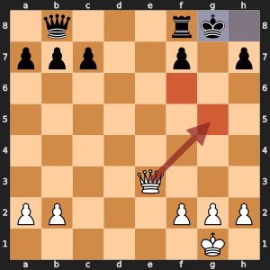

# Remus-YELLOW: Draw sense

Score a repeated position, or one at the fifty-move limit, as a draw inside the search.

## Learning objectives

By the end of Day 9, each student pair can:

- Explain the idea of this enhancement in two sentences. **Measured by:** The student pair explains the idea to another student pair, who can restate it.
- Add the enhancement without breaking the rules. **Measured by:** `run_tests.py` passes in the version folder.
- Run a fair experiment: same opening, both piece colors. **Measured by:** In the Day 9 battles, `play_battle.py` in the version folder plays both 10-minute games with no illegal moves or crashes when the student pair presses Run in VS Code, and the student pair says why two games cannot show which enhancement is stronger.

## The idea, with an example

Remus-WHITE is a rook behind, and the opponent's king can be checked forever.



*White, to move, is a rook behind. Qg5+ (the red arrow) drives the king to h8, Qf6+ drives it back to g8, and Qg5+ starts again. The red squares are the queen's two checking squares and the blue squares are the king's only two squares.*

Inside its search,Remus-WHITE scores the position after the third repetition as a rook behind, because nothing in its search knows that the game ends there as a draw. So it avoids the checks and loses slowly. Remus-YELLOW scores any position that already appeared in the game or in the search line as 0, a draw, and so does a position after 100 half moves with no capture or pawn move (the fifty-move rule). It sees that the checks save half a point and plays them.

## Why it makes Remus stronger

The same knowledge works the other way. A side that is ahead stops repeating positions, because a repetition scores 0 instead of its +300 lead. A repetition can only be claimed after the third time, but the search treats the second time as a draw: if repeating once is the best either side can do, it can repeat again.

## What it costs

`is_draw_in_search()` counts the position key in the game history at every position, a short list scan. Positions per second stay close to Remus-WHITE's, and the search saves work when it meets a repetition, because a draw ends that line at once.

## Measured against Remus-WHITE

Each version searched the ten positions of `compare_search.py`, one depth at a time up to depth 4, on one computer. Fewer positions for the same depth means a smaller search tree. Positions per second shows what each position costs. The last column gave each position 5 seconds, the way a game does, and averages the deepest search that finished.

| Version | Positions to finish depth 4 | Share of Remus-WHITE's | Positions per second | Average depth in 5 seconds |
| --- | ---: | ---: | ---: | ---: |
| Remus-WHITE | 431,212 | 100% | 5,183 | 3.1 |
| Remus-YELLOW | 431,138 | 100% | 5,048 | 3.1 |

## What to expect

More draws in lost positions and fewer accidental draws in won ones. The benchmark positions below start with no game history, so they hold almost no repetitions and the numbers match Remus-WHITE's; the difference shows up in games.

## Where your code fits

`draw_sense_search()` in `search.py` calls `is_draw_in_search()` at the top of every position below the root, before any move is generated. The root is skipped, because Remus must still choose a move there.

## The files

This folder is Remus-WHITE, the finished Day 9 Remus in `00 WHITE - No enhancements` beside it, plus this one enhancement. The student pair writes `is_draw_in_search()` in `search.py`, `test_draw_sense_search_agrees_with_alpha_beta()` in `test_upgrades.py`, `test_a_repeated_position_is_a_draw()` in `test_upgrades.py`, `test_the_fifty_move_limit_is_a_draw()` in `test_upgrades.py`.

## The changes and why

### `is_draw_in_search()` in `search.py`

Says a position is a draw when it already appeared earlier in the game or the search, or when the fifty-move limit is reached. Then Remus aims for a repetition when losing and avoids one when winning.

### `test_draw_sense_search_agrees_with_alpha_beta()` in `test_upgrades.py`

In a position with no repetition, draw sense must change nothing, so the version search and the Day 9 search must find the same score.

### `test_a_repeated_position_is_a_draw()` in `test_upgrades.py`

Plays Nf3 Nf6 Ng1 Ng8, which brings back the starting position, and checks that `is_draw_in_search()` says draw only after the knights come home.

### `test_the_fifty_move_limit_is_a_draw()` in `test_upgrades.py`

Loads a FEN whose halfmove clock is 100 and checks that it counts as a draw. The FEN carries the clock, so no game needs to be played.

## Check it

Check the work by opening `run_tests.py` in this folder and pressing Run. Then open `smoke_test.py` in VS Code and press Run: Remus-YELLOW plays one 2-minute game against Remus-WHITE, which shows that the engine plays legal moves to the end of a game. In the Day 9 battles, follow the numbered steps at the top of `play_battle.py`: copy the visiting student pair's engine folder into `engines/student`, set `VISITING_ENGINE` to the visitor's engine color, and press Run. Remus-YELLOW plays it twice at 10 minutes a side, once with each piece color, and both games go into misc/games/remus_games.pgn. Each script runs `version_match.py` from the folder above this one.

## What you edit this period

Every other function is finished. Change only these, and only below each docstring:

| File | Function | Starts at line | Lines to type | Tests that check it |
| --- | --- | --- | --- | --- |
| `search.py` | `is_draw_in_search()` | 396 | 2 | `test_upgrades.py::test_a_repeated_position_is_a_draw`, `test_upgrades.py::test_the_fifty_move_limit_is_a_draw` |
| `test_upgrades.py` | `test_draw_sense_search_agrees_with_alpha_beta()` | 21 | 7 | `run_tests.py` |
| `test_upgrades.py` | `test_a_repeated_position_is_a_draw()` | 32 | 5 | `run_tests.py` |
| `test_upgrades.py` | `test_the_fifty_move_limit_is_a_draw()` | 41 | 2 | `run_tests.py` |

Lines to type in all: 16. Each stub is two comment lines that start with `# Day ...` and a `raise NotImplementedError` statement. Delete them and write the body in their place.

## The code you type

Each block below shows the code to type with a few lines around it, so you can find the spot. A line marked `+` is one you type; a line marked `|` is already in the file. Type the code without the number and the mark, and keep the indent shown. Lines that start with `#` are comments: they explain the code, and typing them is optional.

The number at the left of each line is its line number once the code is typed. When one file holds two functions to write, type the higher one first: until it is typed, the stub of a function lower down sits a few lines higher than these numbers say.

### `is_draw_in_search()` in `search.py`

**Where:** lines 413 to 414 of `search.py`, inside `is_draw_in_search()`, in place of the stub below the docstring. It is called by `draw_sense_search()` in `search.py`.

```python
396 | def is_draw_in_search(state: dict) -> bool:
397 |     """
      ...
411 |         the search scores it 0 instead of chasing a win that cannot happen.
412 |     """
413 +     key = state["history"][-1]
414 +     return state["history"].count(key) >= 2 or state["halfmove_clock"] >= 100
415 |
416 |
417 | def draw_sense_search(
```

**How it works:** `state["history"]` holds the key of every position of the game so far, with the current position last, so `key` is the position on the board right now. `count(key) >= 2` is True when that same position appeared before, the first step toward a threefold repetition. The search treats the first repeat as a draw: if the line can repeat once, the side that wants a draw can repeat it again. `halfmove_clock >= 100` catches the fifty-move rule: 100 half-moves, 50 by each side, with no capture and no pawn move. `or` makes the function return True when either rule applies.

### `test_draw_sense_search_agrees_with_alpha_beta()` in `test_upgrades.py`

**Where:** lines 23 to 29 of `test_upgrades.py`, inside `test_draw_sense_search_agrees_with_alpha_beta()`, in place of the stub below the docstring. `run_tests.py` runs it with every other test in the folder.

```python
21 | def test_draw_sense_search_agrees_with_alpha_beta() -> None:
22 |     """The enhanced engine saves work but finds the same score at the same depth."""
23 +     state = state_from_fen(ITALIAN)
24 +     before = state_snapshot(state)
25 +     plain_score, _ = alpha_beta_with_quiescence(state, 3, 0, *WIDE, SearchInfo())
26 +     score, pv = draw_sense_search(state, 3, 0, *WIDE, SearchInfo())
27 +     assert score == plain_score
28 +     assert pv
29 +     assert state_snapshot(state) == before
30 |
31 |
32 | def test_a_repeated_position_is_a_draw() -> None:
```

**How it works:** The test sets up the Italian opening from its FEN and takes a snapshot of the whole state. It runs the plain search, `alpha_beta_with_quiescence`, to depth 3 with the wide window, then the enhanced engine's `draw_sense_search` on the same position. The three asserts check that both searches give the same score, that the new search returns a line of moves (a non-empty principal variation), and that the snapshot is unchanged, which proves every `make_move` was undone. `*WIDE` unpacks the pair of numbers into the two arguments `alpha` and `beta`.

### `test_a_repeated_position_is_a_draw()` in `test_upgrades.py`

**Where:** lines 34 to 38 of `test_upgrades.py`, inside `test_a_repeated_position_is_a_draw()`, in place of the stub below the docstring. `run_tests.py` runs it with every other test in the folder.

```python
32 | def test_a_repeated_position_is_a_draw() -> None:
33 |     """After Nf3 Nf6 Ng1 Ng8 the starting position appears for the second time."""
34 +     state = state_from_fen(START_FEN)
35 +     assert not is_draw_in_search(state)
36 +     for text in ("g1f3", "g8f6", "f3g1", "f6g8"):
37 +         make_move(state, move_from_uci(text))
38 +     assert is_draw_in_search(state)
39 |
40 |
41 | def test_the_fifty_move_limit_is_a_draw() -> None:
```

**How it works:** The game starts from the normal starting position, where nothing has repeated, so the first assert expects False. The loop plays four moves from their UCI text: the knights jump out (g1f3, g8f6) and back (f3g1, f6g8). The board then looks exactly like the start, with White to move, so its key is in the history twice and `is_draw_in_search` must say True.

### `test_the_fifty_move_limit_is_a_draw()` in `test_upgrades.py`

**Where:** lines 43 to 44 of `test_upgrades.py`, inside `test_the_fifty_move_limit_is_a_draw()`, in place of the stub below the docstring. `run_tests.py` runs it with every other test in the folder.

```python
41 | def test_the_fifty_move_limit_is_a_draw() -> None:
42 |     """A halfmove clock of 100 is 50 moves by each side with no capture or pawn move."""
43 +     state = state_from_fen("4k3/8/8/8/8/8/8/R3K3 w - - 100 80")
44 +     assert is_draw_in_search(state)
```

**How it works:** The FEN puts a king and rook against a lone king and sets the halfmove clock, the fifth field, to 100. Nothing has repeated, so only the fifty-move rule can make the assert pass.
