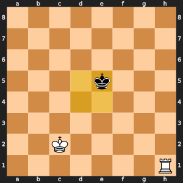
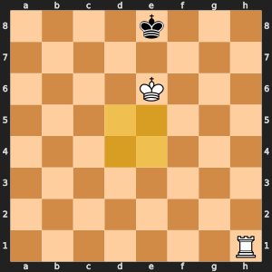

# Remus-CYAN: Mating bonus

With a big material lead, drive the losing king to the edge and bring the winning king close.

## Learning objectives

By the end of Day 9, each student pair can:

- Explain the idea of this enhancement in two sentences. **Measured by:** The student pair explains the idea to another student pair, who can restate it.
- Add the enhancement without breaking the rules. **Measured by:** `run_tests.py` passes in the version folder.
- Run a fair experiment: same opening, both piece colors. **Measured by:** In the Day 9 battles, `play_battle.py` in the version folder plays both 10-minute games with no illegal moves or crashes when the student pair presses Run in VS Code, and the student pair says why two games cannot show which enhancement is stronger.

## The idea, with an example

White has king and rook, Black has only a king. Mate needs the Black king on the edge, and it takes far more than 4 plies of good moves to drive it there. Remus-WHITE sees no mate within its depth and scores every rook move the same, +500, so it shuffles. Remus-CYAN adds a bonus once one side leads by at least 200 and the losing side has at most 600 left: 10 points for each step the losing king stands from the center, and 4 points for each step the winning king has closed in.

 

*The yellow squares are the center. Left: the Black king stands on e5, 0 steps from the center, and the White king on c2 is 3 steps away, so the bonus is 4 x (7 - 3) = 16. Right: the Black king on e8 is 3 steps from the center and the White king on e6 is 2 steps away, so the bonus is 10 x 3 + 4 x (7 - 2) = 50.*

Now every move that squeezes the king toward the edge scores higher, and the search walks it into a mating net.

## Why it makes Remus stronger

An evaluation term can stand in for a search that is too deep to run. The bonus turns a long plan, "push the king to the edge, then mate", into small steps that a shallow search can see.

## What it costs

One scan of the board to count material and find the kings, in every evaluated position. In most positions the margins are not met and the bonus is 0, so the cost is the scan only.

## Measured against Remus-WHITE

Each version searched the ten positions of `compare_search.py`, one depth at a time up to depth 4, on one computer. Fewer positions for the same depth means a smaller search tree. Positions per second shows what each position costs. The last column gave each position 5 seconds, the way a game does, and averages the deepest search that finished.

| Version | Positions to finish depth 4 | Share of Remus-WHITE's | Positions per second | Average depth in 5 seconds |
| --- | ---: | ---: | ---: | ---: |
| Remus-WHITE | 431,212 | 100% | 5,183 | 3.1 |
| Remus-CYAN | 425,602 | 99% | 4,864 | 3.1 |

## What to expect

Faster wins in won endgames, and no change before that. Many games are decided or drawn before such an endgame appears, so the league rating moves little.

## Where your code fits

`white_score()` in `evaluation.py` adds `mating_bonus(board)` to material and placement. `CENTER_DISTANCE` gives each row and column's distance from the center: 3 on the edge, 0 in the middle.

## The files

This folder is Remus-WHITE, the finished Day 9 Remus in `00 WHITE - No enhancements` beside it, plus this one enhancement. The student pair writes `mating_bonus()` in `evaluation.py`.

## The changes and why

### `mating_bonus()` in `evaluation.py`

With a big lead and a weak opponent, rewards pushing the losing king to the edge and bringing the winning king close. Without it, Remus can be a queen up and still wander without mating.

## Check it

Check the work by opening `run_tests.py` in this folder and pressing Run. Then open `smoke_test.py` in VS Code and press Run: Remus-CYAN plays one 2-minute game against Remus-WHITE, which shows that the engine plays legal moves to the end of a game. In the Day 9 battles, follow the numbered steps at the top of `play_battle.py`: copy the visiting student pair's engine folder into `engines/student`, set `VISITING_ENGINE` to the visitor's engine color, and press Run. Remus-CYAN plays it twice at 10 minutes a side, once with each piece color, and both games go into misc/games/remus_games.pgn. Each script runs `version_match.py` from the folder above this one.

## What you edit this period

Every other function is finished. Change only these, and only below each docstring:

| File | Function | Starts at line | Lines to type | Tests that check it |
| --- | --- | --- | --- | --- |
| `evaluation.py` | `mating_bonus()` | 126 | 24 | `test_upgrades.py::test_mating_bonus_prefers_the_losing_king_in_the_corner` |

Lines to type in all: 24. Each stub is two comment lines that start with `# Day ...` and a `raise NotImplementedError` statement. Delete them and write the body in their place.

## The code you type

Each block below shows the code to type with a few lines around it, so you can find the spot. A line marked `+` is one you type; a line marked `|` is already in the file. Type the code without the number and the mark, and keep the indent shown. Lines that start with `#` are comments: they explain the code, and typing them is optional.

The number at the left of each line is its line number once the code is typed. When one file holds two functions to write, type the higher one first: until it is typed, the stub of a function lower down sits a few lines higher than these numbers say.

### `mating_bonus()` in `evaluation.py`

**Where:** lines 143 to 166 of `evaluation.py`, inside `mating_bonus()`, in place of the stub below the docstring. It is called by `evaluate()` in `evaluation.py`, `explain_evaluation()` in `evaluation.py`.

```python
126 | def mating_bonus(board: Board) -> int:
127 |     """
      ...
141 |         winning king has closed toward it.
142 |     """
143 +     white_material = 0
144 +     black_material = 0
145 +     kings = {}
146 +     for row in range(8):
147 +         for col in range(8):
148 +             piece = board[row][col]
149 +             if piece in "Kk":
150 +                 kings[piece] = (row, col)
151 +             elif piece != EMPTY:
152 +                 if piece.isupper():
153 +                     white_material += PIECE_VALUES[piece]
154 +                 else:
155 +                     black_material += PIECE_VALUES[piece.upper()]
156 +     lead = white_material - black_material
157 +     weaker = min(white_material, black_material)
158 +     if abs(lead) < MATING_MARGIN or weaker > WEAK_SIDE_LIMIT:
159 +         return 0
160 +     winner, loser = ("K", "k") if lead > 0 else ("k", "K")
161 +     loser_row, loser_col = kings[loser]
162 +     winner_row, winner_col = kings[winner]
163 +     edge = CENTER_DISTANCE[loser_row] + CENTER_DISTANCE[loser_col]
164 +     kings_apart = max(abs(loser_row - winner_row), abs(loser_col - winner_col))
165 +     bonus = 10 * edge + 4 * (7 - kings_apart)
166 +     return bonus if lead > 0 else -bonus
167 |
168 |
169 | def evaluate(state: dict) -> int:
```

**How it works:** The first loops walk the board once. They remember where each king stands in the dict `kings` and add up the material of each side with `PIECE_VALUES`, using the uppercase letter for a Black piece. `lead` is White's material minus Black's, and `weaker` is the smaller of the two totals. If the lead is under `MATING_MARGIN` (200) or the weaker side still has more than `WEAK_SIDE_LIMIT` (600), the endgame is not yet a mating race and the function returns 0. Otherwise the code picks the winning and losing kings. `CENTER_DISTANCE` gives 3 for an edge row or column and 0 for the middle, so `edge` grows as the losing king is pushed toward the edge or a corner. `kings_apart` counts the king steps between the two kings, and `7 - kings_apart` grows as the winning king closes in. The bonus is positive when White is winning and negative when Black is.
