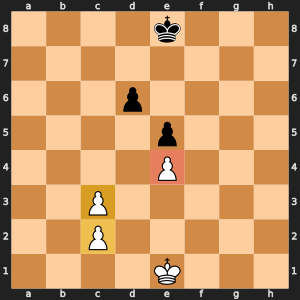

# Remus-PURPLE: Pawn structure

Penalize doubled and isolated pawns and reward passed pawns.

## Learning objectives

By the end of Day 9, each student pair can:

- Explain the idea of the color version's enhancement in two sentences. **Measured by:** The student pair explains the idea to another student pair, who can restate it.
- Add the enhancement without breaking the rules. **Measured by:** `run_tests.py` passes in the version folder.
- Run a fair experiment: same opening, both piece colors. **Measured by:** In the Day 9 battles, `play_battle.py` in the version folder plays both 10-minute games with no illegal moves or crashes when the student pair presses Run in VS Code, and the student pair says why two games cannot show which enhancement is stronger.

## The idea, with an example

White pawns on c2, c3, and e4, Black pawns on d6 and e5: White's c-pawns are doubled (two on one file), and the e4 pawn is isolated (no White pawn on the d- or f-file beside it).



*The yellow squares are White's doubled pawns on the c-file. The red square is the isolated pawn on e4: no White pawn stands anywhere on the d-file or the f-file to protect it.*

Remus-PURPLE scores each doubled pawn -8 and each isolated pawn -20. A passed pawn, with no enemy pawn in front of it on its own file or a neighboring file, earns a bonus that grows as it advances: 0, 10, 20, 40, 60, and then 70 one step from promotion. Remus-WHITE counts every pawn as 100 plus its square's placement value and sees none of this.

## Why it makes Remus stronger

Pawns cannot move backward, so a weak pawn stays weak for the whole game, and a passed pawn becomes a queen threat that ties down enemy pieces. A search at depth 4 cannot see those long-term effects, but an evaluation term can score them in every position.

## What it costs

`pawn_structure()` scans the board for pawns, then looks ahead of each pawn for enemy pawns, in every evaluated position. Evaluation is most of Remus's work at the ends of lines, so Remus-PURPLE evaluates fewer positions a second than Remus-WHITE. The number of positions per depth changes a little either way, because different scores lead alpha-beta to different cutoffs.

## Measured against Remus-WHITE

Each version searched the ten positions of `compare_search.py`, one depth at a time up to depth 4, on one computer. Fewer positions for the same depth means a smaller search tree. Positions per second shows what each position costs. The last column gave each position 5 seconds, the way a game does, and averages the deepest search that finished.

| Version | Positions to finish depth 4 | Share of Remus-WHITE's | Positions per second | Average depth in 5 seconds |
| --- | ---: | ---: | ---: | ---: |
| Remus-WHITE | 431,212 | 100% | 5,183 | 3.1 |
| Remus-PURPLE | 452,398 | 105% | 4,547 | 3.1 |

## What to expect

Better pawn moves: Remus-PURPLE avoids doubling its own pawns, attacks isolated enemy pawns, and pushes passed pawns in the endgame. The cost in speed can cancel the gain at a short clock.

## Where your code fits

`white_score()` in `evaluation.py` adds `pawn_structure(board)` to material and placement, and `explain_evaluation()` prints it as its own line, so a student pair can see the term in any position.

## The files

This folder is Remus-WHITE, the finished Day 9 Remus in `00 WHITE - No enhancements` beside it, plus this one enhancement. The student pair writes `pawn_structure()` in `evaluation.py`.

## The changes and why

### `pawn_structure()` in `evaluation.py`

Counts doubled and isolated pawns as weaknesses and passed pawns as strengths, more the further they have gone. Pawns cannot move back, so their shape lasts the whole game.

## Check it

Check the work by opening `run_tests.py` in this folder and pressing Run. Then open `smoke_test.py` in VS Code and press Run: Remus-PURPLE plays one 2-minute game against Remus-WHITE, which shows that the engine plays legal moves to the end of a game. In the Day 9 battles, follow the numbered steps at the top of `play_battle.py`: copy the visiting student pair's engine folder into `engines/student`, set `VISITING_ENGINE` to the visitor's engine color, and press Run. Remus-PURPLE plays it twice at 10 minutes a side, once with each piece color, and both games go into misc/games/remus_games.pgn. Each script runs `version_match.py` from the folder above this one.

## What you edit this period

Every other function is finished. Change only these, and only below each docstring:

| File | Function | Starts at line | Lines to type | Tests that check it |
| --- | --- | --- | --- | --- |
| `evaluation.py` | `pawn_structure()` | 128 | 29 | `test_upgrades.py::test_pawn_structure_is_level_at_the_start`, `test_upgrades.py::test_doubled_isolated_pawns_cost_points`, `test_upgrades.py::test_a_passed_pawn_earns_a_bonus` |

Lines to type in all: 29. Each stub is two comment lines that start with `# Day ...` and a `raise NotImplementedError` statement. Delete them and write the body in their place.

## The code you type

Each block below shows the code to type with a few lines around it, so you can find the spot. A line marked `+` is one you type; a line marked `|` is already in the file. Type the code without the number and the mark, and keep the indent shown. Lines that start with `#` are comments: they explain the code, and typing them is optional.

The number at the left of each line is its line number once the code is typed. When one file holds two functions to write, type the higher one first: until it is typed, the stub of a function lower down sits a few lines higher than these numbers say.

### `pawn_structure()` in `evaluation.py`

**Where:** lines 144 to 172 of `evaluation.py`, inside `pawn_structure()`, in place of the stub below the docstring. It is called by `evaluate()` in `evaluation.py`, `explain_evaluation()` in `evaluation.py`.

```text
128 | def pawn_structure(board: Board) -> int:
      ...
142 |         file or a neighboring file), bigger the further it has advanced.
143 |     """
144 +     score = 0
145 +     for pawn, enemy, sign in (("P", "p", 1), ("p", "P", -1)):
146 +         files = [0] * 8
147 +         for row in range(8):
148 +             for col in range(8):
149 +                 if board[row][col] == pawn:
150 +                     files[col] += 1
151 +         for row in range(8):
152 +             for col in range(8):
153 +                 if board[row][col] != pawn:
154 +                     continue
155 +                 if files[col] > 1:
156 +                     score -= sign * DOUBLED_PAWN
157 +                 left = files[col - 1] if col > 0 else 0
158 +                 right = files[col + 1] if col < 7 else 0
159 +                 if left == 0 and right == 0:
160 +                     score -= sign * ISOLATED_PAWN
161 +                 ahead = (
162 +                     range(row) if pawn == "P" else range(row + 1, 8)
163 +                 )  # White moves to row 0
164 +                 blocked = False
165 +                 for ahead_row in ahead:
166 +                     for ahead_col in (col - 1, col, col + 1):
167 +                         if 0 <= ahead_col < 8 and board[ahead_row][ahead_col] == enemy:
168 +                             blocked = True
169 +                 if not blocked:
170 +                     advanced = 6 - row if pawn == "P" else row - 1
171 +                     score += sign * PASSED_PAWN[advanced]
172 +     return score
173 |
174 |
175 | def evaluate(state: dict) -> int:
```

**How it works:** The outer loop runs once for White (`P`, enemy `p`, sign +1) and once for Black. First it counts the side's pawns on each file in the list `files`, so `files[4]` is the number of pawns on the e-file. The second pass visits each pawn. A file with more than one pawn means doubled pawns, and each costs `DOUBLED_PAWN` (8). If both neighboring files hold no friendly pawn, the pawn is isolated and costs `ISOLATED_PAWN` (20); a pawn on the a-file or h-file has only one neighbor, so the missing side counts as 0. Then `ahead` lists the rows in front of the pawn: smaller rows for White, because row 0 is rank 8. If no enemy pawn stands on those rows on the pawn's own file or a neighboring file, nothing can stop it, so it is passed. `advanced` counts how far it has come from its starting row, and `PASSED_PAWN[advanced]` gives a bigger bonus the closer it is to promoting.
