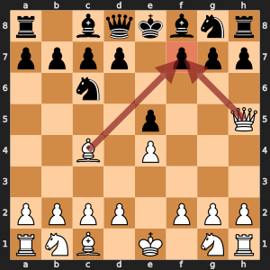

# Remus-BLUE: Killer moves

Try quiet moves that caused a cutoff at the same depth right after the captures.

## Learning objectives

By the end of Day 9, each student pair can:

- Explain the idea of this enhancement in two sentences. **Measured by:** The student pair explains the idea to another student pair, who can restate it.
- Add the enhancement without breaking the rules. **Measured by:** `run_tests.py` passes in the version folder.
- Run a fair experiment: same opening, both piece colors. **Measured by:** In the Day 9 battles, `play_battle.py` in the version folder plays both 10-minute games with no illegal moves or crashes when the student pair presses Run in VS Code, and the student pair says why two games cannot show which enhancement is stronger.

## The idea, with an example

Black has just made a weak move, and White's quiet move Qh5 threatens mate on f7.



*After 1. e4 e5 2. Bc4 Nc6 3. Qh5, the queen and the bishop both aim at f7 (the red arrows). Only Black's king guards f7, so Qxf7 would be mate.*

Deep in the search, the same Qh5 refutes many different Black moves at the same ply: almost any Black move that does not defend f7 loses to it. Remus-WHITE tries the captures first, then the quiet moves in the order the generator found them, so it may try 20 quiet moves before Qh5 each time. Remus-BLUE remembers Qh5 as a killer move for that ply, because it caused a cutoff there, and tries it right after the captures in every other position at the same ply.

## Why it makes Remus stronger

Alpha-beta cuts off a position as soon as one move is good enough to refute it. The sooner that move comes, the fewer moves are searched. Captures are easy to rank by value, but quiet moves have no such order. Killers give the quiet moves an order learned from the search itself.

## What it costs

Very little: two moves stored per ply, and a check whether each quiet move is one of them while ordering. Positions per second stay close to Remus-WHITE's.

## Measured against Remus-WHITE

Each version searched the ten positions of `compare_search.py`, one depth at a time up to depth 4, on one computer. Fewer positions for the same depth means a smaller search tree. Positions per second shows what each position costs. The last column gave each position 5 seconds, the way a game does, and averages the deepest search that finished.

| Version | Positions to finish depth 4 | Share of Remus-WHITE's | Positions per second | Average depth in 5 seconds |
| --- | ---: | ---: | ---: | ---: |
| Remus-WHITE | 431,212 | 100% | 5,183 | 3.1 |
| Remus-BLUE | 328,889 | 76% | 4,998 | 3.4 |

## What to expect

Fewer positions for the same depth, most of all in quiet middlegame positions with many moves. A killer that is a capture or a promotion is not stored, because captures and promotions are already ordered first.

## Where your code fits

`killer_search()` in `search.py` calls `remember_killer()` whenever a quiet move causes a cutoff, and passes the killers of the next ply to `order_moves()` in `move_ordering.py`. `order_moves()` scores captures by MVV-LVA, gives a killer `KILLER_SCORE` (50, below every capture and above every other quiet move), and puts the best move of the last depth in front of them all.

## The files

This folder is Remus-WHITE, the finished Day 9 Remus in `00 WHITE - No enhancements` beside it, plus this one enhancement. The student pair writes `remember_killer()` in `search.py`, `order_moves()` in `move_ordering.py`, `test_killers_keep_two_quiet_moves()` in `test_upgrades.py`.

## The changes and why

### `remember_killer()` in `search.py`

Keeps up to two quiet moves per ply that caused a cutoff. A move that refuted one position often refutes its neighbors, so trying it early saves work.

### `order_moves()` in `move_ordering.py`

Sorts the moves so captures come first by MVV-LVA, then this ply's killer moves, then every other move. The earlier a good move comes, the sooner alpha-beta cuts off the rest.

### `test_killers_keep_two_quiet_moves()` in `test_upgrades.py`

Feeds three cutoff moves to `remember_killer()` and checks that only the two newest stay, newest first. Writing the expected list before running the test is how a student pair shows it understands the two slots.

## Check it

Check the work by opening `run_tests.py` in this folder and pressing Run. Then open `smoke_test.py` in VS Code and press Run: Remus-BLUE plays one 2-minute game against Remus-WHITE, which shows that the engine plays legal moves to the end of a game. In the Day 9 battles, follow the numbered steps at the top of `play_battle.py`: copy the visiting student pair's engine folder into `engines/student`, set `VISITING_ENGINE` to the visitor's engine color, and press Run. Remus-BLUE plays it twice at 10 minutes a side, once with each piece color, and both games go into misc/games/remus_games.pgn. Each script runs `misc/scripts/version_match.py`, which plays the games.

## What you edit this period

Every other function is finished. Change only these, and only below each docstring:

| File | Function | Starts at line | Lines to type | Tests that check it |
| --- | --- | --- | --- | --- |
| `search.py` | `remember_killer()` | 397 | 6 | `test_upgrades.py::test_killers_keep_two_quiet_moves` |
| `move_ordering.py` | `order_moves()` | 52 | 16 | `test_search.py::test_capture_moves_and_mvv_lva` |
| `test_upgrades.py` | `test_killers_keep_two_quiet_moves()` | 21 | 5 | `run_tests.py` |

Lines to type in all: 27. Each stub is two comment lines that start with `# Day ...` and a `raise NotImplementedError` statement. Delete them and write the body in their place.

## The code you type

Each block below shows the code to type with a few lines around it, so you can find the spot. A line marked `+` is one you type; a line marked `|` is already in the file. Type the code without the number and the mark, and keep the indent shown. Lines that start with `#` are comments: they explain the code, and typing them is optional.

The number at the left of each line is its line number once the code is typed. When one file holds two functions to write, type the higher one first: until it is typed, the stub of a function lower down sits a few lines higher than these numbers say.

### `remember_killer()` in `search.py`

**Where:** lines 399 to 404 of `search.py`, inside `remember_killer()`, in place of the stub below the docstring. It is called by `killer_search()` in `search.py`.

```python
397 | def remember_killer(info: SearchInfo, ply: int, move: Move, board: Board) -> None:
398 |     """Keep a quiet move that caused a cutoff as one of two killers for this ply."""
399 +     if piece_at(board, move.to_square) != EMPTY or move.promotion is not None:
400 +         return  # Captures are already ordered first
401 +     killers = info.killers.setdefault(ply, [])
402 +     if move not in killers:
403 +         killers.insert(0, move)
404 +         del killers[2:]
405 |
406 |
407 | def killer_search(
```

**How it works:** A killer is a quiet move that caused a cutoff, so the first line returns at once for a capture or a promotion, which move ordering already puts first. `info.killers` maps each ply to its list of killers; `setdefault` makes an empty list the first time a ply appears. A new killer goes to the front of the list with `insert(0, move)`, and `del killers[2:]` cuts the list back to the two newest moves.

### `order_moves()` in `move_ordering.py`

**Where:** lines 79 to 95 of `move_ordering.py`, inside `order_moves()`, in place of the stub below the docstring. It is called by `quiescence()` in `search.py`, `alpha_beta_with_quiescence()` in `search.py`, `killer_search()` in `search.py`, `think()` in `search.py`.

```python
52 | def order_moves(
53 |     moves: list[Move],
     ...
77 |         `first` at the front.
78 |     """
79 +     killers = killers or []
80 +     ordered = []
81 +     scores = []
82 +     for move in moves:
83 +         score = mvv_lva_score(move, board)
84 +         if score == 0 and move in killers:
85 +             score = KILLER_SCORE
86 +         # Step past every move that scores at least as high, so ties keep their order
87 +         place = 0
88 +         while place < len(scores) and scores[place] >= score:
89 +             place += 1
90 +         ordered.insert(place, move)
91 +         scores.insert(place, score)
92 +     if first in ordered:
93 +         ordered.remove(first)
94 +         ordered.insert(0, first)
95 +     return ordered
96 |
97 |
98 | def main():
```

**How it works:** Each move gets a score: `mvv_lva_score` gives a capture a high score and a quiet move 0, and a quiet move that is one of this ply's killers gets `KILLER_SCORE` (50) instead, which ranks it above the other quiet moves but below every capture. The `while` loop finds where the move belongs in the list kept sorted from the highest score down, stepping past every move that scores at least as high so that ties keep the order the generator gave them. `insert` puts the move and its score at that place. At the end, the move named `first`, such as the best move of the last iteration, moves to the very front.

### `test_killers_keep_two_quiet_moves()` in `test_upgrades.py`

**Where:** lines 23 to 27 of `test_upgrades.py`, inside `test_killers_keep_two_quiet_moves()`, in place of the stub below the docstring. `run_tests.py` runs it with every other test in the folder.

```python
21 | def test_killers_keep_two_quiet_moves() -> None:
22 |     """Expected: after three cutoffs at ply 2, the two newest moves stay, newest first."""
23 +     info = SearchInfo()
24 +     board = state_from_fen(START_FEN)["board"]
25 +     for text in ("e2e4", "d2d4", "g1f3"):
26 +         remember_killer(info, 2, move_from_uci(text), board)
27 +     assert [move_to_uci(move) for move in info.killers[2]] == ["g1f3", "d2d4"]
28 |
29 |
30 | def test_killer_search_agrees_with_alpha_beta() -> None:
```

**How it works:** The test takes the board of the starting position and records three quiet moves as killers at ply 2: e2e4, then d2d4, then g1f3. Only two fit, the newest first, so the list must read g1f3, d2d4. `move_to_uci` turns each Move into text for the comparison.
