# Lucas Chess: Play and Watch Remus

Remus has no board window of its own. It reads moves as text and answers with text.
**Lucas Chess** is the chess app on every class laptop, and it gives Remus a board,
pieces, and clocks. Lucas Chess starts Remus through the file `remus.bat` and talks
to Remus in UCI, the Universal Chess Interface: Lucas sends `position startpos moves
e2e4` and `go`, and Remus answers `bestmove c7c5`.

This guide shows four things:

1. Start Lucas Chess.
2. Add Remus to Lucas Chess as an engine.
3. Watch Remus play a full game against Stockfish at 1500 Elo.
4. Play against Remus yourself.

The pictures use Remus-WHITE, the finished Day 9 Remus with no enhancements. Every
other Remus, from the random-move Remus of Day 5 to your own color version, goes in
the same way: only the folder of `remus.bat` changes.

## Part 1: Start Lucas Chess

Click the Windows **Start** button, then **All**, and find **Lucas Chess (R)** under
the letter L. You can also double-click the Lucas Chess icon on the desktop.

Always start Lucas Chess one of these two ways. Both start it from its own folder,
and Lucas needs that folder to run engine-against-engine games.

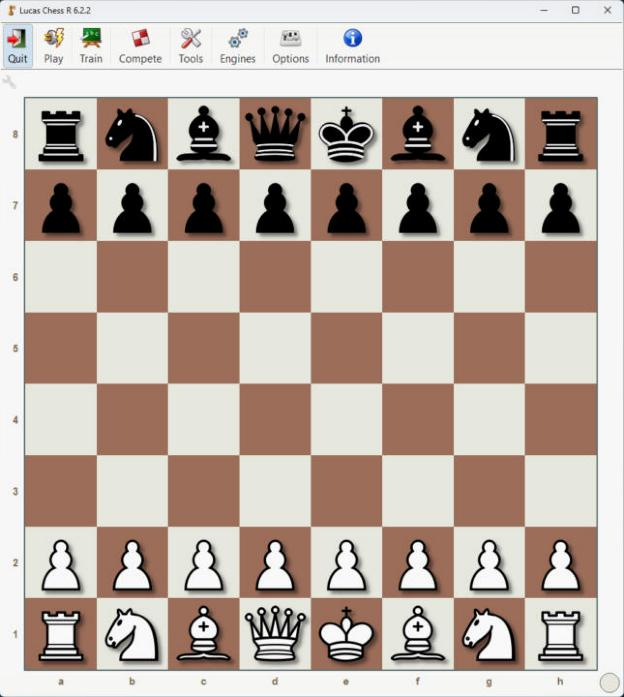

The buttons along the top open menus. This guide uses **Engines** and **Play**.

## Part 2: Add Remus as an engine

You do this once for each `remus.bat` you want to use.

**Step 1.** Copy the full path of `remus.bat`. In VS Code, right-click `remus.bat` in
the file list on the left and choose **Copy Path**. The path looks like
`C:\...\Day 09 - Add the clock and build enhanced engines\period1\instructor\remus.bat`.

**Step 2.** In Lucas Chess, click **Engines**, then **External engines**.

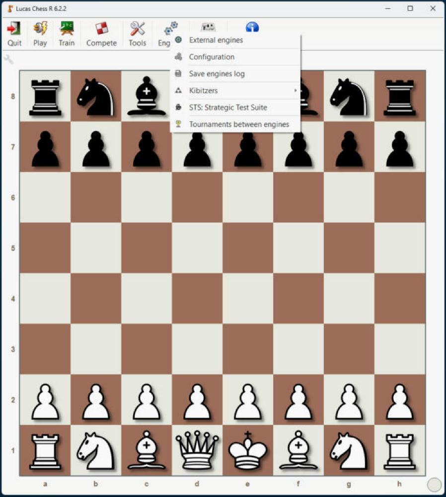

**Step 3.** The External engines window lists every engine you have added. Click
**New**.

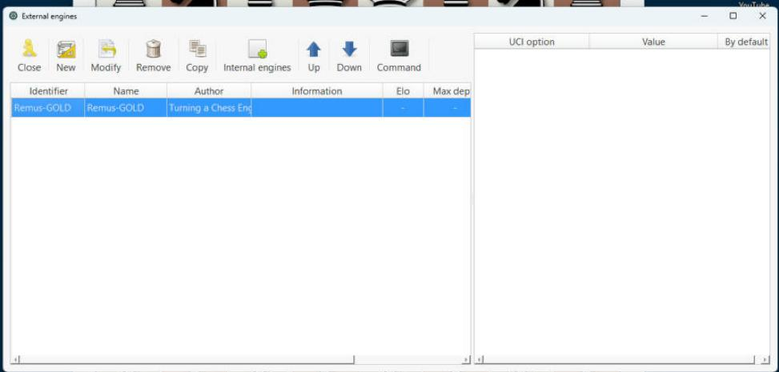

**Step 4.** A window opens to choose the engine file. It shows only `.exe` files, so
`remus.bat` does not appear in the list. Click the **File name** box, paste the path
with **Ctrl+V**, and click **Open**.

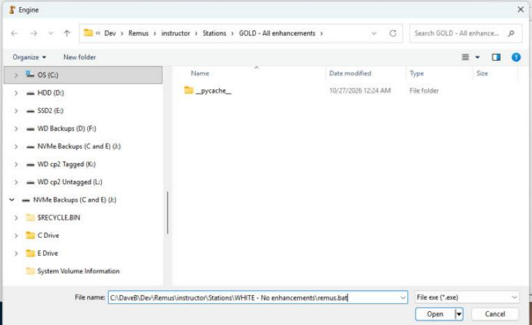

**Step 5.** Lucas starts Remus and asks for its name. Remus says `id name Remus`, so
both boxes start as "Remus". Give each version its own name so you can tell them
apart: type `Remus-WHITE` in **Identifier** and in **Name**. Leave every other box at 0,
and check that the last line shows your `remus.bat`. Click **Accept**.

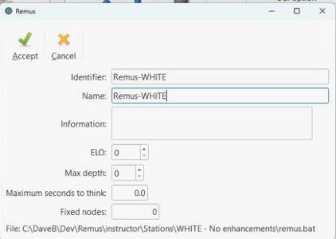

**Step 6.** Remus-WHITE is now in the list. Click **Close**.

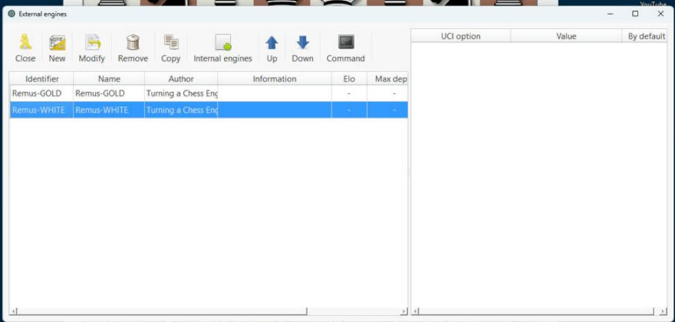

If Lucas shows an error in Step 5, Remus did not start. In the folder of `remus.bat`,
open `run_tests.py` in VS Code and press Run, and fix any failing test first.

## Part 3: Watch Remus play Stockfish 1500

Stockfish is one of the strongest chess engines in the world. Lucas Chess comes with
a Stockfish that is held back to play like a 1500 Elo club player, a fair opponent for
Remus. Lucas calls a match between engines a "tournament", even when it has only two
players.

**Step 1.** Click **Engines**, then **Tournaments between engines** (the last line of
the menu in the picture from Part 2). Click **New**, type a name such as
`Remus-WHITE vs Stockfish 1500`, and click **Accept**.

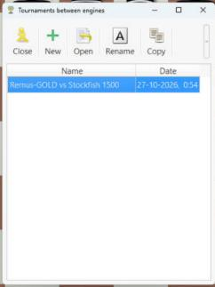

**Step 2.** The **Configuration** tab opens. Lucas can stop a game early and give the
win to whichever side is far ahead. To watch every game to the end, set **Minimum
centipawns to assign winner** to `0` and **Minimum movements to assign draw** to `0`.
A centipawn is one hundredth of a pawn, so 350 centipawns means "ahead by three and a
half pawns".

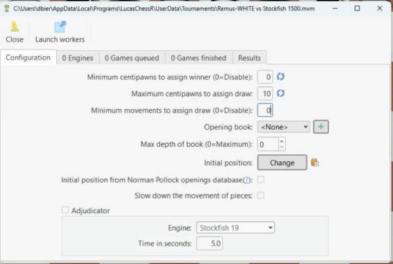

**Step 3.** Open the **Engines** tab and click **Import**. Choose **External
engines**, then **Remus-WHITE**.

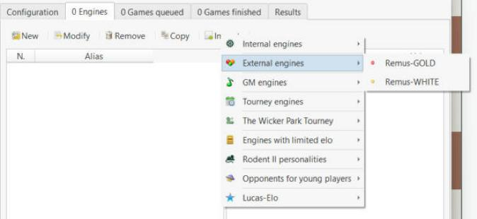

**Step 4.** Click **Import** again. Choose **Engines with limited elo**, then
**1500**, then **Stockfish 19 (1500)**.

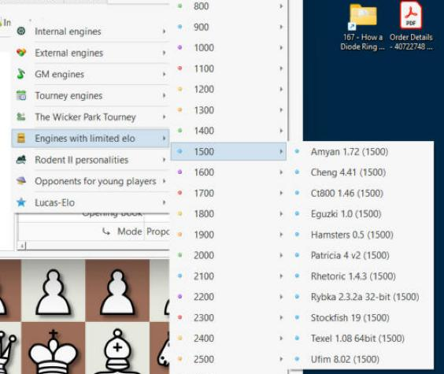

**Step 5.** The tab shows two engines. Click a name to see its settings on the right:
Stockfish's ELO line reads 1500.

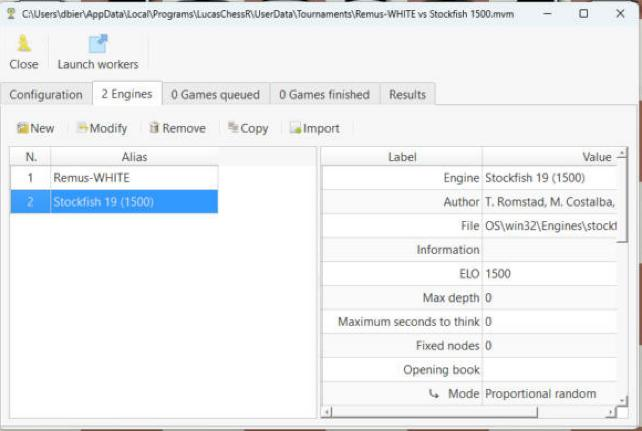

**Step 6.** Open the **Games queued** tab and click **New**. Leave **Rounds** at 1 and
**Total minutes** at 5, and click **Accept**. Each engine gets 5 minutes on its clock
for the whole game.

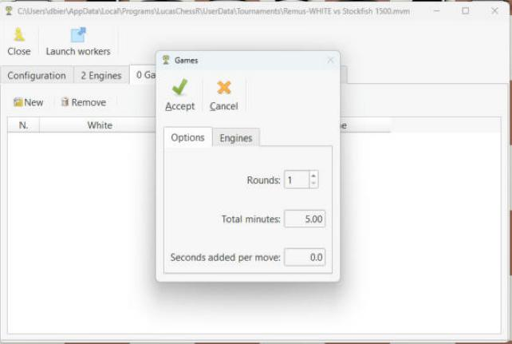

**Step 7.** One round makes two games, so each engine plays once with White and once
with Black.

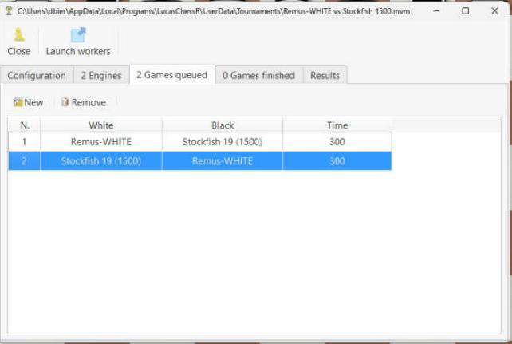

**Step 8.** Click **Launch workers** at the top of the window and choose **1**. A
worker is a second Lucas window that plays the games one after the other.

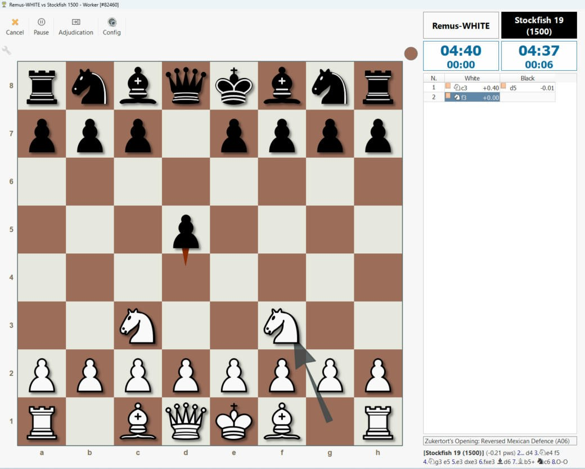

The worker window shows the board, both clocks, and the moves. The number after each
move is the engine's score in pawns: +0.40 means "White is ahead by almost half a
pawn". The box at the bottom right shows the line Stockfish expects to follow.

A game lasts up to 10 minutes. When both games are over, the **Games finished** and
**Results** tabs of the tournament show who won. To stop early, click **Cancel** in the
worker window; the unfinished game stays in **Games queued**.

## Part 4: Play against Remus yourself

**Step 1.** Click **Play**, then **Play against an engine**.

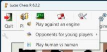

**Step 2.** Under **Opponent**, click the wide button with the engine's name, then
choose **External engines** and your Remus. Under **Side you play with**, pick White,
Black, or Random.

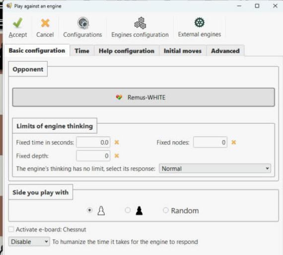

**Step 3.** Open the **Time** tab and tick **Activate the time control**. Ten minutes
with 6 seconds added per move gives a relaxed game. With the clock on, Lucas tells
Remus how much time is left on each move, and the Day 9 Remus uses that time to
decide how deep to search.

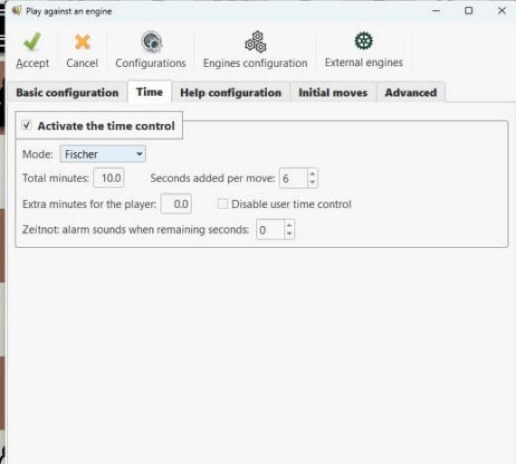

**Step 4.** Click **Accept**, then **Continue**, and drag a piece to make your move.
Remus answers on the board, and its clock runs while it thinks.

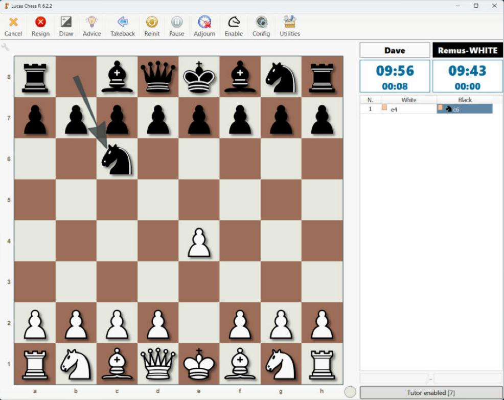

To end a game early, click **Cancel** and answer **Yes**.

## Lucas Chess at home

Lucas Chess is free. To use it on your own computer at home, download the installer
from the official site, [lucaschess.pythonanywhere.com/downloads](https://lucaschess.pythonanywhere.com/downloads),
and run it. It installs like any other Windows program, and it comes with Stockfish,
so Part 3 works the same way at home. Remus and its `remus.bat` launcher run on
Windows only.

To play your own Remus at home, copy the Remus folder from your USB drive to a Windows
computer, install `uv`, and run `uv sync` once in the Remus folder, the same setup as
on Day 1 (see "Take it home" in the course plan). Then add your `remus.bat` as in
Part 2.

## When something goes wrong

| What you see | What to check |
| --- | --- |
| Lucas shows an error when you add Remus | Open `run_tests.py` in the folder of `remus.bat` and press Run. A module that fails to import stops Remus before it can say `uciok`. |
| Remus never moves | Open `uci_engine.py` in the folder of `remus.bat` in VS Code and press Run. In the panel that opens, type `uci` and press Enter. Remus must print `uciok`. Then type `position startpos` and `go`, and Remus must print a `bestmove` line. |
| **Launch workers** does nothing | Quit Lucas Chess and start it again from the Start menu or the desktop icon. |
| Remus plays an old version of your code | Each `remus.bat` runs the code in its own folder. Add the `remus.bat` from the folder you are working in, or select the engine in **External engines** and click **Modify**. |
