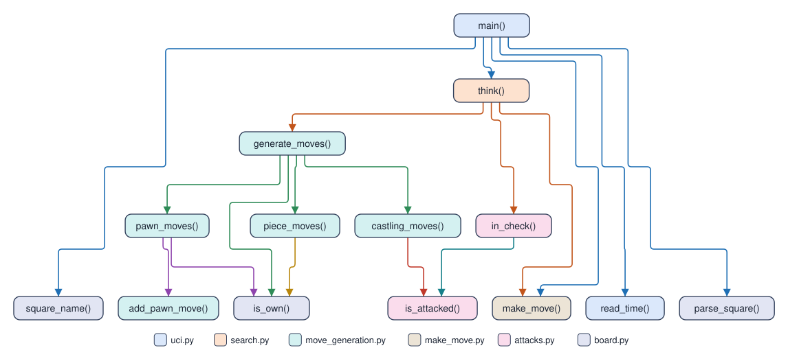

# Remus1: legal chess, picked at random

Remus1 is the engine the student pairs finish at the end of Day 1. It knows every
rule of chess but looks no moves ahead: `think()` lists the legal moves and plays one
at random. It plays legal chess, and it plays it badly, so the first game in Lucas
Chess shows that the move generator works before any search exists. It speaks UCI to
Lucas Chess through `remus.bat` and uses only the standard library.

[Remus2](../Remus2/README.md) holds the same `board.py`, `make_move.py`, `attacks.py`,
and `move_generation.py`, and the same `uci.py`, except that its `id name` line says
Remus2. Remus2 also adds `evaluation.py` and replaces the 12 lines of this `search.py`
with alpha-beta search.

## Files

| File | Code lines | What it does |
| --- | ---: | --- |
| `board.py` | 15 | The piece numbers, the starting position, and square names |
| `make_move.py` | 23 | Play a move on a copy of the board |
| `attacks.py` | 34 | Is a square attacked? Is a king in check? |
| `move_generation.py` | 65 | List the moves of the side to move, castling included |
| `search.py` | 12 | Pick a random legal move |
| `uci.py` | 44 | The UCI loop: `uci`, `isready`, `position`, `go`, `quit` |
| **Total** | **193** | |

The code lines leave out blank lines, comments, and docstrings.

## The call tree

Each box is a function, colored by its file, and each arrow runs from a function to
a function it calls. Lucas Chess starts `main()` in `uci.py`.

## How it picks a move

`think()` makes each move that `generate_moves()` lists, keeps it only if the
mover's own king is not in check afterward, and returns one of the kept moves with
`random.choice()`. With no legal move, checkmate or stalemate, it returns `None`, and
`uci.py` sends `bestmove 0000`. The course designer's
`verify_engines.py` checks Remus1's perft
counts against the published counts from six positions, and its UCI answers.

## Play it

The student pair adds its own `engines/Remus1/remus.bat` to Lucas Chess, as the
[Lucas Chess guide](../../lucas_chess/lucas_chess_guide.md) shows. It names itself
`Remus1`. It answers at once, whatever the clock.
