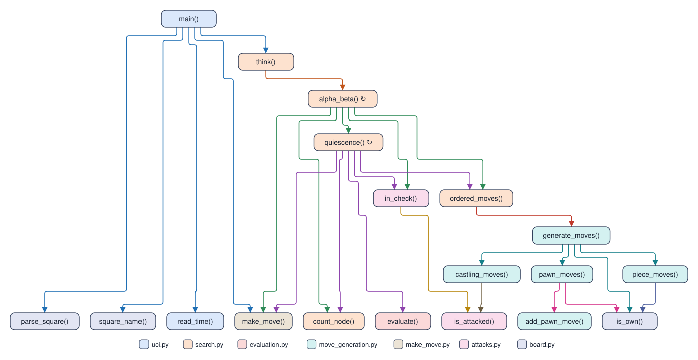

# Remus2: legal chess and alpha-beta

Remus2 is [Remus1](../Remus1/README.md), the random mover the student pairs finish on
Day 1, with `evaluation.py` and a real `search.py` in place of Remus1's random one. It
plays legal chess with an alpha-beta search, a quiescence search
that plays out the captures at the end of each line, MVV-LVA move ordering (most
valuable victim, least valuable attacker), a check extension, and iterative deepening.
It speaks UCI to Lucas Chess through `remus.bat` and uses only the standard library.

[Remus3](../Remus3/README.md) adds the biggest gains for the fewest lines, and
[Remus4](../Remus4/README.md) adds every other enhancement.
[`remus_versions.md`](../remus_versions.md) lists each enhancement
and the version that holds it.

## Files

| File | Code lines | What it does |
| --- | ---: | --- |
| `board.py` | 15 | The piece numbers, the starting position, and square names |
| `make_move.py` | 23 | Play a move on a copy of the board |
| `attacks.py` | 34 | Is a square attacked? Is a king in check? |
| `move_generation.py` | 65 | List the moves of the side to move, castling included |
| `evaluation.py` | 68 | Material plus four piece-square tables |
| `search.py` | 93 | Move ordering, quiescence, alpha-beta, iterative deepening |
| `uci.py` | 44 | The UCI loop: `uci`, `isready`, `position`, `go`, `quit` |
| **Total** | **342** | |

The code lines leave out blank lines, comments, and docstrings.

## The call tree

Each box is a function, colored by its file, and each arrow runs from a function to
a function it calls. A circle arrow after a name marks a function that calls itself.
Lucas Chess starts `main()` in `uci.py`.

## How it keeps the code small

- **One function moves every piece but the pawn.** `piece_moves()` takes the steps a
  piece may take and whether it slides: a knight or king takes one step in each
  direction, while a bishop, rook, or queen keeps going until a piece or the edge stops
  it.
- **`is_attacked()` uses the same idea in reverse.** It looks out from the square with
  the steps of each kind of piece, and the first piece it meets on each line attacks
  the square if it is the right kind.
- **`ordered_moves()` generates the moves and sorts them,** and hands each one to the
  search with its priority. Quiescence stops at the first quiet move, whose priority
  is 0.
- **A position is one tuple,** `(board, white, castling, en_passant)`, so
  `make_move()` takes a position and returns the next one, and every search call
  passes one value instead of four.
- **Copy, don't undo.** `make_move()` copies the board with `board[:]` and returns
  the new position, so the search never takes a move back.
- **Pieces are numbers.** A piece is its kind, from 1 for a pawn to 6 for a king, plus
  8 if it is White, so `piece & 7` gives the kind. The castling rights are four bits:
  1 and 2 for White's kingside and queenside, 4 and 8 for Black's. The starting board
  is built from one back rank, `BACK_RANK`, that both sides share, and letters appear
  only in UCI move text such as `e7e8q`.
- **Half tables.** Every piece-square table is the same on both sides of the board (a
  knight earns the same bonus on c3 and on f3), so each table lists only files a to d,
  rank 8 first, and `mirrored_table()` copies them in reverse order onto files e to h.
- **No legal-move list.** The search makes each pseudo-legal move and skips it if its
  own king is attacked.

## What it leaves out

Tests, perft, FEN, notation, undo, the repetition and fifty-move rules, and the
principal variation. Lucas Chess sends `position startpos moves ...` for every game
from the starting position, which is all Remus2 plays. The course designer's
`verify_engines.py` checks Remus2 from
outside: its perft counts match the published counts from six positions, and it
finds a forced mate in all ten mate puzzles (the key move in nine).

## Play it

The student pair adds its own `engines/Remus2/remus.bat` to Lucas Chess, as the
[Lucas Chess guide](../../lucas_chess/lucas_chess_guide.md) shows. It names itself
`Remus2`.
