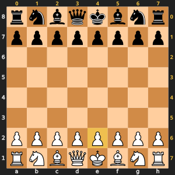

# board.py: The chessboard

*First appears in `Day 01 - Draw the board/period4/instructor`.*

## The big picture

This file holds the chessboard. Every other file stands on it.

The board is a grid of 8 rows and 8 columns. Each square holds one letter. `P` is a
White pawn, `p` is a Black pawn, and `.` is an empty square.

People name squares like `e2`. Python finds them by number, like `board[6][4]`.
This file turns one into the other.

## Where this piece fits

board.py is the bottom piece of the puzzle. It uses no other Remus file, and almost every other file uses it.

- **Uses:** no other Remus file
- **Used by:** [`attacks.py`](attacks.md), [`evaluation.py`](evaluation.md), [`fen.py`](fen.md), [`game_end.py`](game_end.md), [`game_state.py`](game_state.md), [`legal_moves.py`](legal_moves.md), [`make_move.py`](make_move.md), [`move_generation.py`](move_generation.md), [`move_ordering.py`](move_ordering.md), [`moves.py`](moves.md), [`notation.py`](notation.md), [`search.py`](search.md), [`show_board.py`](../class_demos.md#show_boardpy-draw-the-board-as-a-picture)

## Words to know

- **row:** a line of squares going across. Row 0 is rank 8, at the top.
- **column:** a line of squares going up and down. Column 0 is file a, on the left.
- **file:** a column of the chessboard, named by a letter from a to h.
- **rank:** a row of the chessboard, named by a number from 1 to 8.
- **list of lists:** a Python list where each item is another list. Here, 8 rows of 8 squares.
- **type alias:** a short name for a long type. `Square` means `tuple[int, int]`, a
  `(row, col)` pair, and `Board` means `list[list[str]]`, the grid of letters. Every
  other file writes `board: Board, square: Square` instead of the brackets.

## What it stores

```text
         col 0   col 1  ...  col 7
row 0      r       n    ...    r      <- rank 8 (Black's back row)
row 1      p       p    ...    p      <- rank 7
  ...
row 6      P       P    ...    P      <- rank 2
row 7      R       N    ...    R      <- rank 1 (White's back row)
```

Uppercase letters are White. Lowercase letters are Black. The letters are K king,
Q queen, R rook, B bishop, N knight, and P pawn.

Two strings help with names. `BOARD_FILES` is `"abcdefgh"`, one letter per column.
`BOARD_RANKS` is `"87654321"`, one digit per row. So square `(6, 4)` is
`BOARD_FILES[4] + BOARD_RANKS[6]`, which is `"e2"`.



*The letters a to h along the bottom and the ranks 1 to 8 down the left are the names
people use. The yellow numbers along the top are Remus's columns, and the yellow
numbers down the right are its rows. The yellow square, e2, is column 4 of row 6:
`(6, 4)`.*

## How it works

1. `new_board()` copies the starting rows into a fresh grid.
2. `print_board()` prints each row with its rank number, top to bottom.
3. `square_name()` turns `(6, 4)` into `"e2"`.
4. `parse_square()` turns `"e2"` back into `(6, 4)`. It rejects names like `"z9"`.
5. `piece_at()` and `set_piece()` read and write one square.

## Call tree

Each function is listed with the functions it calls, indented below it.
A name in [brackets] lives in another file.

```text
new_board()

print_board()

square_name()

parse_square()

piece_at()

set_piece()
```

## The functions

| Function | What it does | Arrives |
| --- | --- | --- |
| `new_board` | Makes a new board with every piece on its starting square. | Day 1, period 4 |
| `print_board` | Shows the board on the screen, rank 8 at the top. | Day 1, period 4 |
| `square_name` | Turns a (row, col) pair into a name like e2. | Day 1, period 4 |
| `parse_square` | Turns a name like e2 into a (row, col) pair. | Day 1, period 4 |
| `piece_at` | Tells you which letter sits on a square. | Day 1, period 4 |
| `set_piece` | Puts a letter (or an empty square) on a square. | Day 2, period 3 |

## How the file grows

- **Day 1, period 4:** `new_board`, `print_board`, `square_name`, `parse_square`, `piece_at`
- **Day 2, period 3:** `set_piece`

## Try it

Open `board.py` from a period folder that has the file in VS Code, and click the Run Python File
button (the triangle at the top right of the editor).

You should see: The starting board, then three checks such as `e2 is (6, 4), expected (6, 4)`.

## Puzzle questions

1. Which (row, col) pair is square a8? Which is h1?
2. Why does row 0 hold rank 8 instead of rank 1?

## Slides

Slides 1.3, 1.4, 1.5 in the [slide plan](../../teachers/slide_plan.md).
