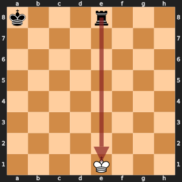
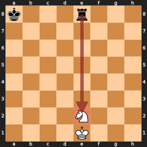
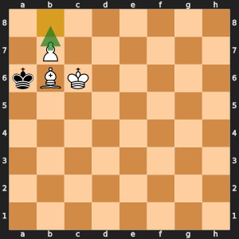

# Learn chess: the rules that trip people up, and how moves are written

You know how the pieces move. This page holds the rest: the rules that catch nearly
everyone, the value of each piece, and the way people and programs write a move down.
Each rule says which day of the workshop needs it, so you can read the rule right
before you write the code for it.

## The rules that trip people up

### Check, pins, and discovered check (Day 4)

A move is legal only if your own king is safe after it. That one rule covers three
cases. You may not leave your king in check. You may not move a **pinned** piece off
the line between an enemy piece and your king, because the king would then be in
check. You may not make a move that uncovers an enemy piece's line to your king, a
**discovered check** against yourself. Remus checks all three the same way: it makes
the move, asks whether its own king is attacked, and takes the move back.

 

*On the left, White is in check and must deal with the rook. On the right, the knight
on e2 blocks the check, so it is pinned: any knight move would leave the king in
check, and none of them is legal.*

### Castling (Day 5)

The king moves two squares toward a rook, and that rook jumps over the king to the
square beside it. Castling is allowed only when all of these hold:

1. The king and that rook have never moved.
2. The squares between them are empty.
3. The king is not in check.
4. The king does not pass through, or land on, a square that an enemy piece attacks.

The rook may cross an attacked square: on the queen's side, an attack on b1 does not
stop White from castling. A rook that moves loses its castling right for good, even
if it comes back, and a rook captured on its home square loses it too. Remus keeps
the rights as the letters `KQkq`, and removes a letter when a king or rook leaves
its home square.


*The marked squares are the six home squares that hold the castling rights. A move
from one of them, or a capture on one of them, removes a letter from `KQkq`.*

### En passant (Day 5)

When a pawn moves two squares and lands beside an enemy pawn, that enemy pawn may
capture it on the very next move only, as if it had moved one square. The capturing
pawn lands on the square the pawn skipped, and the captured pawn disappears from the
square beside it, not from the square the capturer lands on. The rare trap: an en
passant capture can open a line along the rank to your own king, so Remus tests the
king's safety after the captured pawn is gone.


*Black has just played d7 to d5. White's pawn on e5 captures on d6, and the pawn on d5
leaves the board.*

### Promotion and underpromotion (Day 5)

A pawn that reaches the last rank becomes a queen, a rook, a bishop, or a knight,
the player's choice. Choosing anything but a queen is an **underpromotion**. It is
rare, but sometimes it is the only move that wins: a knight can promote with check
and a fork, and a new queen can give stalemate by mistake. One side may end up with
two queens, so Remus never assumes one queen per side.



*White to move. A new queen on b8 attacks every square the Black king could go to but
does not give check, so Black has no legal move and the game is a draw by stalemate. A
new knight on b8 gives check, and the king still has no square: checkmate.*

### The draws (Day 7)

| Draw | The rule |
| --- | --- |
| Stalemate | The side to move has no legal move and is not in check. The game is a draw, not a loss |
| Threefold repetition | The same position, with the same side to move and the same castling and en passant rights, appears three times. The three times need not be in a row. A player may claim the draw; at five times the game ends by itself |
| Fifty-move rule | Fifty moves by each side (100 half-moves) with no capture and no pawn move. A player may claim the draw at 50; at 75 the game ends by itself |
| Insufficient material | Neither side can ever give checkmate: king against king, king and bishop against king, king and knight against king, and king and bishop against king and bishop with both bishops on the same color of square |

Remus's `game_end.py` checks all four, and its `history` list of positions is what
makes the repetition rule possible.

### Piece values and the three tactics (Day 7)

| Piece | Value in pawns |
| --- | ---: |
| Pawn | 1 |
| Knight | 3 |
| Bishop | 3 |
| Rook | 5 |
| Queen | 9 |

The king has no value because it can never be captured. Remus scores in
**centipawns**, hundredths of a pawn, so a knight is 300. Three tactics win material
with these values: a **fork** attacks two pieces at once, a **pin** holds a piece in
front of a more valuable one, and a **skewer** attacks a valuable piece so that the
piece behind it falls when it moves.

## Chess notation: how people write down moves


Chess players write every move of a game so they can play it over later, send it to a
friend, or study it in a book. The usual way is called **SAN**, short for Standard
Algebraic Notation. Remus prints its moves in SAN, and Lucas Chess lists every move of a
game in SAN.

### Name every square

The board has eight **files**, the columns `a` to `h` from White's left to White's
right, and eight **ranks**, the rows `1` to `8` from White's side to Black's side.
A square's name is its file letter, then its rank number.

- White's king starts on `e1`, and Black's king starts on `e8`.
- The corner to White's left is `a1`. It is always a dark square.
- The square in front of White's king pawn is `e3`, and two squares ahead is `e4`.

### Name every piece

Each piece except the pawn has a capital letter:

| Piece | Letter |
| --- | --- |
| King | `K` |
| Queen | `Q` |
| Rook | `R` |
| Bishop | `B` |
| Knight | `N` (because `K` is the king) |
| Pawn | no letter |

### Write a move

A move is the piece letter, then the square it lands on.

- `Nf3`: a knight moves to f3.
- `Bc4`: a bishop moves to c4.
- `e4`: a pawn moves to e4. A pawn move is only the square.

### Captures

An `x` means the piece takes something on the square.

- `Bxf7`: a bishop captures on f7.
- `exd5`: a pawn captures on d5. A pawn capture starts with the file the pawn came
  from, here the e-file, because the pawn moves diagonally.

### Two pieces that could make the same move

When two of the same piece can reach a square, the move adds the file or the rank
the piece leaves from, so the reader knows which one moved.

- Knights on b1 and f3 can both reach d2. `Nbd2` moves the knight from the b-file.
- Rooks on a1 and a5 can both reach a3. `R1a3` moves the rook from rank 1.

### Castling, promotion, check, and checkmate

| Writing | Meaning |
| --- | --- |
| `O-O` | Castle on the king's side (the king moves two squares toward the h-file) |
| `O-O-O` | Castle on the queen's side (the king moves two squares toward the a-file) |
| `e8=Q` | A pawn reaches the last rank and becomes a queen |
| `e8=N` | The same pawn becomes a knight instead (an underpromotion) |
| `+` at the end | The move gives check, such as `Bb5+` |
| `#` at the end | The move gives checkmate, such as `Qxf7#` |

Castling uses the capital letter O, not the number zero.

### Read a whole move

```text
N  b  x  d2  +
|  |  |  |   gives check
|  |  |  square it lands on
|  |  captures
|  which knight (the one on the b-file)
piece letter (no letter for a pawn)
```

### A short game

A game is written as numbered moves, White's move first, then Black's.

```text
1. e4 e5 2. Bc4 Nc6 3. Qh5 Nf6 4. Qxf7#
```

On move 3 Black's knight on f6 attacks the queen, but only the king guards the pawn
on f7. On move 4 the queen captures that pawn with checkmate: the bishop on c4
protects the queen, so the king cannot take it, and every square the king could step
to is attacked or blocked.

### The notation chess programs use

Lucas Chess and Remus talk to each other in **UCI** notation instead. A UCI move is
only the square a piece leaves and the square it lands on, with no piece letter:
`e2e4`, `g1f3`, and `e1g1` for White castling on the king's side. A promotion adds
the new piece in a small letter: `e7e8q`. UCI is easy for a program to read but
harder for people, so Remus uses UCI only to talk to Lucas Chess and SAN everywhere a
person reads or types a move.

### Where Remus uses it

[`notation.py`](engine_code/notation.md) writes Remus's moves in SAN and reads the
SAN you type. [`uci_engine.py`](engine_code/uci_engine.md) reads and writes UCI
moves for Lucas Chess.

### Questions

1. What is the SAN of a pawn on g7 that captures on h8 and becomes a queen?
2. Rooks on a1 and h1 can both move to d1. How do you write each move?
3. The knight on g1 moves to f3. How does Lucas Chess write that move in UCI?
