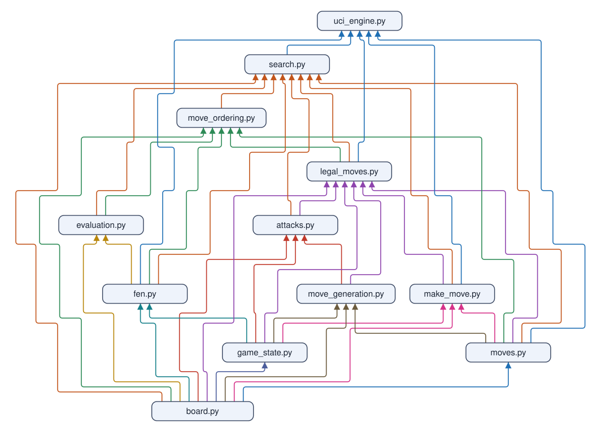

# Remus Program Overview

Remus is a chess engine in plain Python, built over ten workshop days. This page shows
how the pieces fit together. Each engine script has its own page in
[`engine_code/`](engine_code/), each Python lab has its section in
[`python_labs.md`](python_labs.md), and the teacher's [`slide_plan.md`](../teachers/slide_plan.md) lists the slides that
picture the data structures and the program flow.
[`lucas_chess_guide.md`](lucas_chess_guide.md) shows how to run Remus in Lucas Chess,
the chess app on every class laptop.

## How the code is organized

Each day of the workshop has its own folder at the top of Remus, and each Day folder
holds four period folders, `period1` to `period4`, one for each class period:

| Folder | What the new code does compared to the day before |
| --- | --- |
| `Day 01 - Draw the board` | Holds the board as an 8x8 list and converts square names |
| `Day 02 - Make and undo moves` | Adds the game state, the `Move` record, and exact make and undo |
| `Day 03 - Generate piece moves` | Lists every move each piece can make by its movement rules |
| `Day 04 - Keep only legal moves` | Finds attacked squares and drops moves that leave the king in check |
| `Day 05 - Add castling, en passant, and promotion` | Completes the rules of movement |
| `Day 06 - Count positions and read FEN` | Proves the rules right by counting positions against published totals, then reads and writes FEN |
| `Day 07 - Play full games and score positions` | Adds game endings, SAN, two simple brains, the UCI link to the GUI, and the evaluation |
| `Day 08 - Search ahead with alpha-beta` | Looks ahead with minimax and negamax, then prunes with alpha-beta, searches captures to quiet positions, and orders moves |
| `Day 09 - Add the clock and build enhanced engines` | Thinks on a clock with iterative deepening (Remus-WHITE), builds the ten enhanced engines, and ends with battles between the colors |
| `Day 10 - Solve a science problem using chess AI` | Holds only the hidden-peak and phase-hunt Science AI; the Day 10 engine is Remus-GOLD in `engines/instructor/11 Remus-GOLD - All enhancements`, with all ten enhancements |

Every period folder holds two folders. `instructor/` holds only finished reference
code that runs as it is, with no blanks to fill in, and `student/` holds the code
students write and change. Every `instructor/` folder is a complete, runnable copy of Remus as it stands at the end of that period. Beside the two folders sits the
period's goals file, such as `Day_06_Period_02_Goals.md`, which names the period, its learning objectives with how each is measured, the
files that are new or growing, the functions the student pairs write, and a paragraph on each
change and why (the text comes from `period_guides.py`), then the timed steps of the
period and the student pairs' exact tasks. `period4/instructor` holds the finished code of the day. `make_period_folders.py`
builds the instructor folders of `period1` to `period3` from it, so a file that grows during the day, such as
`make_move.py` on Day 5, gains castling in `period2`, en passant in `period3`, and
promotion in `period4`. Above the period folders, each Day folder's syllabus, such as `Day_05_Syllabus.md`, gives
the whole day at a glance: its objectives, what the student pairs write in each period, a
timed sequence of activities for all four periods, and the checkpoint at 4:30.
`make_student_folders.py` writes it from `DAY_GUIDES` in `period_guides.py` into the
top of each Day folder.

Each `student/` folder mirrors the `instructor/` folder beside it. In each student
folder, the functions the class writes in that period are stubs that raise
`NotImplementedError`, and the tests fail until a student pair writes them.
`make_student_folders.py` builds every `student/` folder and lists every student
function; the [student guide](README.md) shows the same list. A
student who opens `Day 06 - Count positions and read FEN/period2/student` finds every file from Days 1 to 5, some of
them grown, plus `perft.py` with `perft()` left to write. Nothing in a period folder
imports from another folder.

The table under "When each engine file appears and changes" below, and the "How the
file grows" list on each page in [`engine_code/`](engine_code/), say when each file
first appears and what each later period adds to it. The teacher's
[`student_edit_plan.md`](../teachers/student_edit_plan.md) lists the same by period.

### The naming rule for newer versions

A module keeps one file name from the day it appears to Day 10. When a later lesson
makes a file smarter, the new code goes into the same file under a new function name,
next to the function it improves. The old function stays, so students can run both and
compare them.

| File | Simpler version | Smarter version beside it | Day |
| --- | --- | --- | --- |
| `attacks.py` | `is_attacked_by_scanning` (ask every enemy piece) | `is_square_attacked` (look outward from the square) | 4 |
| `search.py` | `random_move`, `greedy_move` | `minimax`, then `negamax` | 7, 8 |
| `search.py` | `negamax` | `alpha_beta`, then `alpha_beta_with_quiescence` | 8 |
| `search.py` | `alpha_beta_with_quiescence` | `upgraded_search` | 10 |
| `evaluation.py` | `material`, `placement` | adds `pawn_structure`, `mating_bonus`, `king_safety` | 7, 10 |
| `move_ordering.py` | captures by MVV-LVA | adds killer moves | 8, 10 |

Imports never break, because no file is ever renamed. A script that called `negamax` on
Day 8 still finds `negamax` on Day 10.

### Running the code

Open a script in VS Code, such as `perft.py` in
`Day 06 - Count positions and read FEN/period4/instructor`, and click the Run Python
File button (the triangle at the top right of the editor).

Every script prints its own check, with the expected answer beside it. Tests sit next
to the modules. Because each period folder repeats the same module names, pytest runs
one folder at a time: open `run_tests.py` in the folder, such as
`Day 04 - Keep only legal moves/period3/instructor`, and press Run.

The course designer's tools in `misc/designer/`, listed in
[its README](../designer/README.md), build the period, version, and student folders,
run every test, and rate the Remus versions. Students never open that folder.
`version_match.py`, which plays the Day 9 battles, is there too. Student pairs never
open it: `play_battle.py` and `basic_test.py` in their engine folder run it.

## The puzzle box and its pieces

Think of this page as the picture on a jigsaw puzzle box. Each `.py` file is one
piece, and each piece has its own page or section: an engine file in
[`engine_code/`](engine_code/), a lab in [`python_labs.md`](python_labs.md), a class
demo in [`class_demos.md`](class_demos.md), and a science file in
[`science_ai.md`](science_ai.md). Each one starts with the big picture, then shows
where the piece fits, its call tree, and what each function does.

The engine pieces stack up. A file uses only files in its own row or the rows above it:

| Row | Files | What they do |
| ---: | --- | --- |
| 1 | [`board.py`](engine_code/board.md) | The grid of squares |
| 2 | [`game_state.py`](engine_code/game_state.md), [`moves.py`](engine_code/moves.md) | Whose turn it is, and what a move looks like |
| 3 | [`make_move.py`](engine_code/make_move.md) | Play a move and take it back |
| 4 | [`move_generation.py`](engine_code/move_generation.md) | Every move the pieces can make |
| 5 | [`attacks.py`](engine_code/attacks.md), [`legal_moves.py`](engine_code/legal_moves.md) | Keep only the legal moves |
| 6 | [`fen.py`](engine_code/fen.md), [`notation.py`](engine_code/notation.md) | Read and write positions (FEN) and moves (SAN) |
| 7 | [`perft.py`](engine_code/perft.md), [`game_end.py`](engine_code/game_end.md) | Count positions and spot the end of a game; only the tests use these two |
| 8 | [`evaluation.py`](engine_code/evaluation.md) | How good is a position? |
| 9 | [`move_ordering.py`](engine_code/move_ordering.md), [`transposition_table.py`](engine_code/transposition_table.md), [`opening_book.py`](engine_code/opening_book.md) | Try good moves first, remember searched positions, and play known openings |
| 10 | [`search.py`](engine_code/search.md) | Choose a move |
| 11 | [`uci_engine.py`](engine_code/uci_engine.md) | Talk to Lucas Chess |

The pages, in the order the class builds them:

| Page | What the file does |
| --- | --- |
| [`python_setup.py`](python_labs.md#python_setuppy-is-the-laptop-ready) | Day 1 lab: is the laptop ready? |
| [`python_strings.py`](python_labs.md#python_stringspy-square-names-are-text) | Day 1 lab: square names are text |
| [`python_lists.py`](python_labs.md#python_listspy-a-board-is-a-list-of-rows) | Day 1 lab: a board is a list of rows |
| [`board.py`](engine_code/board.md) | The chessboard |
| [`show_board.py`](class_demos.md#show_boardpy-draw-the-board-as-a-picture) | Draw the board and its moves as a picture |
| [`python_functions.py`](python_labs.md#python_functionspy-small-questions-as-functions) | Day 2 lab: small functions and their tests |
| [`python_dicts.py`](python_labs.md#python_dictspy-a-dict-a-copy-and-a-dataclass) | Day 2 lab: a dict, a copy, and a dataclass |
| [`game_state.py`](engine_code/game_state.md) | Everything the board does not show |
| [`moves.py`](engine_code/moves.md) | What a move looks like |
| [`make_move.py`](engine_code/make_move.md) | Make a move, then take it back |
| [`python_loops.py`](python_labs.md#python_loopspy-walk-until-something-stops-you) | Day 3 lab: walk until something stops you |
| [`move_generation.py`](engine_code/move_generation.md) | Every move the pieces can make |
| [`python_modules.py`](python_labs.md#python_modulespy-one-file-uses-another) | Day 4 lab: one file uses another |
| [`attacks.py`](engine_code/attacks.md) | Is this square under attack? |
| [`legal_moves.py`](engine_code/legal_moves.md) | Keep only the legal moves |
| [`demo_practice_positions.py`](class_demos.md#demo_practice_positionspy-predict-then-count) | Day 4 demo: predict, then count the legal moves |
| [`python_sets.py`](python_labs.md#python_setspy-castling-rights-as-letters) | Day 5 lab: castling rights as letters |
| [`demo_promotion.py`](class_demos.md#demo_promotionpy-why-a-pawn-becomes-a-knight) | Day 5 demo: why a pawn becomes a knight |
| [`python_recursion.py`](python_labs.md#python_recursionpy-a-function-that-calls-itself) | Day 6 lab: a function that calls itself |
| [`perft.py`](engine_code/perft.md) | Count positions to prove the rules |
| [`hunt.py`](class_demos.md#huntpy-find-three-planted-bugs) | Day 6 demo: find three planted bugs |
| [`python_fen_fields.py`](python_labs.md#python_fen_fieldspy-the-six-fields-of-fen) | Day 6 lab: the six fields of FEN |
| [`fen.py`](engine_code/fen.md) | A whole position in one line |
| [`notation.py`](engine_code/notation.md) | Moves the way people write them |
| [`game_end.py`](engine_code/game_end.md) | Is the game over? |
| [`python_input_output.py`](python_labs.md#python_input_outputpy-read-commands-answer-at-once) | Day 7 lab: read commands, answer at once |
| [`uci_engine.py`](engine_code/uci_engine.md) | Talk to Lucas Chess |
| [`play_match.py`](engine_code/play_match.md) | Two Remus brains play each other |
| [`evaluation.py`](engine_code/evaluation.md) | How good is this position? |
| [`search.py`](engine_code/search.md) | Choosing a move |
| [`python_sorting.py`](python_labs.md#python_sortingpy-sort-start-at-minus-infinity-time-it) | Day 8 lab: sort, start at minus infinity, time it |
| [`compare_search.py`](class_demos.md#compare_searchpy-prove-that-alpha-beta-saves-work) | Prove that alpha-beta saves work |
| [`move_ordering.py`](engine_code/move_ordering.md) | Try the best moves first |
| [`python_caches.py`](python_labs.md#python_cachespy-remember-answers-in-a-dict) | Day 9 lab: remember answers in a dict |
| [`transposition_table.py`](engine_code/transposition_table.md) | Remember positions already searched |
| [`opening_book.py`](engine_code/opening_book.md) | Play known openings without thinking |
| [`estimate_elo.py`](engine_code/estimate_elo.md) | Measures the Elo rating of Remus against Stockfish |
| [`demo_results.py`](class_demos.md#demo_resultspy-read-a-battle-result) | Day 9 demo: read a battle result |
| [`misc/designer/version_match.py`](remus_versions.md#the-day-9-battles-version_matchpy) | Plays one enhanced engine against Remus-WHITE, the Day 9 Remus with no enhancements, or against another enhanced engine: the Day 9 battles |
| [`misc/designer/version_league.py`](../designer/engines_elo.md#rank-every-version-again-version_leaguepy) | Ranks all 12 Remus versions with a round robin and one fitted Elo rating each |
| [`hidden_peak.py`](science_ai.md#hidden_peakpy-science-ai-find-the-hidden-peak) | Science AI: find the hidden peak |
| [`phase_hunt.py`](science_ai.md#phase_huntpy-science-ai-name-the-crystals-in-a-powder) | Science AI: name the crystals in a powder |
| [The test files](#the-test-files-checking-that-remus-works) | Checking that Remus works |

### Remus-GOLD code lines, script by script

Remus-GOLD, the finished engine in `engines/instructor/11 Remus-GOLD - All
enhancements`, loads 15 of the engine pieces when it plays a game: every file in the stack of rows
above except `perft.py` and `game_end.py`, which only the tests use. The next table
lists those 15 scripts in alphabetical order with the lines of Python code in each.
Only a line that holds code counts: a docstring does not count, even when it runs over
many lines, and neither does a comment line or a blank line. A line that holds code
and ends with a comment counts once. The opening book's move list,
`opening_book.txt`, is data rather than Python, so it does not count.

| Script | Code lines |
| --- | ---: |
| [`attacks.py`](../../engines/instructor/11%20Remus-GOLD%20-%20All%20enhancements/attacks.py) | 105 |
| [`board.py`](../../engines/instructor/11%20Remus-GOLD%20-%20All%20enhancements/board.py) | 50 |
| [`evaluation.py`](../../engines/instructor/11%20Remus-GOLD%20-%20All%20enhancements/evaluation.py) | 208 |
| [`fen.py`](../../engines/instructor/11%20Remus-GOLD%20-%20All%20enhancements/fen.py) | 81 |
| [`game_state.py`](../../engines/instructor/11%20Remus-GOLD%20-%20All%20enhancements/game_state.py) | 54 |
| [`legal_moves.py`](../../engines/instructor/11%20Remus-GOLD%20-%20All%20enhancements/legal_moves.py) | 44 |
| [`make_move.py`](../../engines/instructor/11%20Remus-GOLD%20-%20All%20enhancements/make_move.py) | 112 |
| [`move_generation.py`](../../engines/instructor/11%20Remus-GOLD%20-%20All%20enhancements/move_generation.py) | 135 |
| [`move_ordering.py`](../../engines/instructor/11%20Remus-GOLD%20-%20All%20enhancements/move_ordering.py) | 44 |
| [`moves.py`](../../engines/instructor/11%20Remus-GOLD%20-%20All%20enhancements/moves.py) | 26 |
| [`notation.py`](../../engines/instructor/11%20Remus-GOLD%20-%20All%20enhancements/notation.py) | 71 |
| [`opening_book.py`](../../engines/instructor/11%20Remus-GOLD%20-%20All%20enhancements/opening_book.py) | 66 |
| [`search.py`](../../engines/instructor/11%20Remus-GOLD%20-%20All%20enhancements/search.py) | 380 |
| [`transposition_table.py`](../../engines/instructor/11%20Remus-GOLD%20-%20All%20enhancements/transposition_table.py) | 37 |
| [`uci_engine.py`](../../engines/instructor/11%20Remus-GOLD%20-%20All%20enhancements/uci_engine.py) | 78 |
| **Total, 15 scripts** | **1,491** |

`search.py` holds a quarter of GOLD's code, 380 lines, because six of the ten
enhancements change it: draw sense, principal variation search, null-move pruning,
late move reductions, killer moves, and the transposition table. `evaluation.py` comes
next with 208 lines, because king safety, the mating bonus, and pawn structure each
add a term to the score.

[`engines_elo.md`](../designer/engines_elo.md#how-big-is-each-version) counts the code lines
of every Remus version the same way.

## Remus-WHITE across the course

Remus-WHITE is the finished Day 9 Remus, in `engines/instructor/00 Remus-WHITE - No
enhancements`. It holds 25 Python files.

### Which file imports which

The diagram shows the 12 files that a game of chess runs: `uci_engine.py`, the program
that Lucas Chess and every match start, and every file it imports, directly or through
another file. An arrow points from a file to each file that imports it: `evaluation.py`
points at `search.py` because `search.py` calls `evaluate()`. A two-headed arrow would
mean two files import each other; no two Remus files do. Every arrow points up the page,
from the code that is used to the code that uses it. `uci_engine.py` sits at the top,
because no file imports it, and each file sits one row below the lowest file that
imports it. `board.py` imports no Remus file and almost every file imports it, so it
sits alone in the bottom row, where its 10 arrows leave side by side along its top edge.
Every arrow runs straight up or bends at right angles, leaves and reaches a box at its
own spot, and takes the color of the file it points at, so the eye can follow the arrows
that gather at one file. The test files and `game_end.py`, `notation.py`, `perft.py`,
`play_match.py`, and `run_tests.py` are left out: they check Remus or run its matches,
and no game loads them.



### When each engine file appears and changes

The table follows the same files as the diagram, the ones a game of chess loads. Each
row is one file, in the order the class meets it. Each column is a period that brings a
new engine file or has the student pairs edit one; D07 P2 means Day 7, period 2. N marks
the period the file first appears, and E marks a period when the student pairs write
code in it. On Day 9, periods 2 and 3, each student pair edits its own enhanced engine's
copy of the file in `engines/student`. Between those periods the student pairs type
nothing in the file: any other code it gains is already written in that period's folder
when the student pairs open it.

| File | D01 P4 | D02 P3 | D02 P4 | D03 P2 | D03 P3 | D03 P4 | D04 P2 | D04 P3 | D05 P2 | D05 P3 | D05 P4 | D06 P4 | D07 P3 | D07 P4 | D08 P1 | D08 P2 | D08 P3 | D08 P4 | D09 P1 | D09 P2 | D09 P3 |
| --- | :---: | :---: | :---: | :---: | :---: | :---: | :---: | :---: | :---: | :---: | :---: | :---: | :---: | :---: | :---: | :---: | :---: | :---: | :---: | :---: | :---: |
| `board.py` | NE |  |  |  |  |  |  |  |  |  |  |  |  |  |  |  |  |  |  |  |  |
| `game_state.py` |  | NE |  |  |  |  |  |  |  |  |  |  |  |  |  |  |  |  |  |  |  |
| `moves.py` |  | NE |  |  |  |  |  |  |  |  |  |  |  |  |  |  |  |  |  |  |  |
| `make_move.py` |  |  | NE |  |  |  |  |  | E | E |  |  |  |  |  |  |  |  |  |  |  |
| `move_generation.py` |  |  |  | NE | E | E |  |  |  |  |  |  |  |  |  |  |  |  |  |  |  |
| `attacks.py` |  |  |  |  |  |  | NE | E |  |  |  |  |  |  |  |  |  |  |  |  |  |
| `legal_moves.py` |  |  |  |  |  |  |  | NE |  |  |  |  |  |  |  |  |  |  |  |  |  |
| `uci_engine.py` |  |  |  |  |  |  |  |  |  |  | N |  |  |  |  |  |  |  |  |  |  |
| `fen.py` |  |  |  |  |  |  |  |  |  |  |  | NE |  |  |  |  |  |  |  |  |  |
| `search.py` |  |  |  |  |  |  |  |  |  |  |  |  | NE |  | E | E | E |  | E | E | E |
| `evaluation.py` |  |  |  |  |  |  |  |  |  |  |  |  |  | NE |  |  |  |  |  | E | E |
| `move_ordering.py` |  |  |  |  |  |  |  |  |  |  |  |  |  |  |  |  |  | NE |  | E | E |

## The three boundaries

| Part | Files | Responsibility |
| --- | --- | --- |
| Native Python engine | `board.py` to `search.py` | Board, rules, legal moves, state, search, evaluation, move choice |
| UCI adapter | `uci_engine.py`, `remus.bat` | Speaks UCI with Lucas Chess on standard input and output |
| Referees and designer tools | `play_match.py`, `estimate_elo.py`, `misc/designer/version_match.py`, `misc/designer/version_league.py`, tests | Use `python-chess` as an outside referee; the engine never imports it |

## The core data structures

**The board** is a list of 8 rows, each a list of 8 one-character strings. Row 0 is
rank 8 and column 0 is file a, so `board[6][4]` is e2, which holds `"P"` at the start.
Uppercase letters are White, lowercase letters are Black, and `"."` is an empty square.

**A square** is a `(row, col)` tuple inside the engine. Square names such as `"e2"`
appear only at the edges: printing, FEN, SAN, and UCI.

**The game state** is a dict:

```python
state = {
    "board": board,             # 8x8 list of lists
    "turn": "w",                # "w" or "b"
    "castling": "KQkq",         # Castling rights still allowed
    "en_passant": None,         # The square a pawn skipped, such as (5, 4) for e3
    "halfmove_clock": 0,        # Moves since the last capture or pawn move
    "fullmove_number": 1,       # Goes up after each Black move
    "history": [key],           # position_key of every position so far (Day 7)
}
```

**A move** is a frozen dataclass `Move(from_square, to_square, promotion)`. The move
e2-e4 is `Move((6, 4), (4, 4))`, and a pawn promoting to a queen on e8 is
`Move((1, 4), (0, 4), "Q")`.

**An undo record** is a dict that `make_move` returns. It holds the moved piece, the
captured piece, the old castling rights, the old en passant square, both old clocks,
the rook's squares for castling, and the victim's square for en passant.
`undo_move(state, undo)` puts every one of them back.

## Program flow: from a GUI command to a move

Lucas Chess asks Remus for one move at a time. Here is one example: Remus has White,
the game so far is 1.e4 e5, and each side has a minute left. The commands change with
every game and every move; these are only the ones for this moment.

1. Lucas Chess sends the whole game so far: `position startpos moves e2e4 e7e5`.
   `uci_engine.py` sets up the start position with `fen.state_from_fen` and plays each
   listed move with `make_move`. After Remus's reply and Black's next move, the list
   holds four moves, and so on.
2. Lucas Chess sends `go wtime 60000 btime 60000`: each side has 60,000 milliseconds
   left.
3. Remus-GREEN and Remus-GOLD ask their opening book first. The book knows 1.e4 e5, so
   Remus plays a book move such as `g1f3` (Nf3) at once and skips the search. Remus-WHITE
   and the other enhanced engines have no book and go straight to step 4.
4. Out of the book, `thinking_time` turns the clock into seconds to think, and
   `search.think` runs iterative deepening: depth 1, 2, 3, and on, until time runs out.
5. Each depth calls `alpha_beta_with_quiescence` (Remus-WHITE, from Day 8) or
   `upgraded_search` (the enhanced engines and Remus-GOLD, from Day 9). The search
   calls `legal_moves`, which calls `pseudo_legal_moves`, `castling_moves`,
   `make_move`, `in_check`, and `undo_move` for every candidate.
6. At depth 0, `quiescence` keeps searching captures until the position is quiet, then
   `evaluation.evaluate` scores it.
7. Each finished depth sends an `info` line with the score and principal variation.
8. `uci_engine.py` sends `bestmove` with the move it chose, such as `bestmove g1f3`.

The search makes and undoes moves on the one live state. A `try/finally` around every
`make_move` guarantees the undo, even when the clock stops the search in the middle.

## Rules and checks that hold on every day

1. `undo_move(state, make_move(state, move))` restores the whole state, compared as
   text by `state_snapshot`.
2. From Day 6 on, `perft` matches the published counts: 20, 400, 8,902, and 197,281
   from the start position, and the "Kiwipete" position's 97,862 at depth 3.
3. The engine imports only the Python standard library.
4. Every script prints a result next to the expected answer.

## The test files: checking that Remus works

### The big picture

A test is a small program that checks one fact about Remus. For example: "from the
start, there are 20 legal moves." If the fact is wrong, the test fails and says where.

Every period folder has its own tests, next to the code they check. A test can only check code that exists, so `period2` of a day has fewer tests than `period4`. When you finish a
function, you run the tests to see whether it works.

### Where this piece fits

Tests use the engine files. No engine file uses the tests. Some tests also use
python-chess as an outside judge, to compare its answers with Remus's.

### Words to know

- **test:** a function whose name starts with `test_`. It checks one fact.
- **assert:** a line that says "this must be true". If it is false, the test fails.
- **pytest:** the program that finds and runs all the tests.
- **expected value:** the answer we write down before we run the code.

### Which test file checks what

Each test file name links to its copy in the `period4/instructor` folder of its Day, the finished code of that day. `test_upgrades.py` links to Remus-GOLD's copy, which checks all ten enhancements.

| Test file | Day | What it checks |
| --- | --- | --- |
| [`test_board.py`](../../Day%2001%20-%20Draw%20the%20board/period4/instructor/test_board.py) | 1 | The start board and square names |
| [`test_make_move.py`](../../Day%2002%20-%20Make%20and%20undo%20moves/period4/instructor/test_make_move.py) | 2 | Make and undo put the state back exactly |
| [`test_move_generation.py`](../../Day%2003%20-%20Generate%20piece%20moves/period4/instructor/test_move_generation.py) | 3 | Moves for each piece, such as 14 for a rook on d4 |
| [`test_legal_moves.py`](../../Day%2004%20-%20Keep%20only%20legal%20moves/period4/instructor/test_legal_moves.py) | 4 | Check, pins, and the legal-move filter |
| [`test_special_moves.py`](../../Day%2005%20-%20Add%20castling%2C%20en%20passant%2C%20and%20promotion/period4/instructor/test_special_moves.py) | 5 | Castling, en passant, and promotion |
| [`test_perft.py`](../../Day%2006%20-%20Count%20positions%20and%20read%20FEN/period4/instructor/test_perft.py) | 6 | Position counts match the published numbers |
| [`test_game.py`](../../Day%2006%20-%20Count%20positions%20and%20read%20FEN/period4/instructor/test_game.py) | 6 | FEN, and from Day 7 SAN, game endings, and the UCI engine |
| [`test_search.py`](../../Day%2007%20-%20Play%20full%20games%20and%20score%20positions/period4/instructor/test_search.py) | 7 | Evaluation and the first brains, then minimax, negamax, alpha-beta, and mates |
| [`test_upgrades.py`](../../engines/instructor/11%20Remus-GOLD%20-%20All%20enhancements/test_upgrades.py) | 9 | The enhancement of each enhanced engine, such as the transposition table of Remus-RED; Remus-GOLD's copy checks all ten |
| [`test_hidden_peak.py`](../../Day%2010%20-%20Solve%20a%20science%20problem%20using%20chess%20AI/period4/instructor/test_hidden_peak.py) | 10 | The hidden-peak Science AI: the hidden grid, the greedy choice, and the benchmark against random guessing |
| [`test_phase_hunt.py`](../../Day%2010%20-%20Solve%20a%20science%20problem%20using%20chess%20AI/period4/instructor/test_phase_hunt.py) | 10 | The phase hunt: the score, the greedy agent, the tree search with make and undo, and the benchmark |

### How a test works

1. Set up a small position, often from a FEN line.
2. Run one Remus function on it.
3. `assert` that the answer matches the expected value.

Here is a real test from `test_legal_moves.py`:

```python
def test_twenty_legal_moves_from_the_start() -> None:
    assert len(legal_moves(new_game())) == 20
```

### Try it

Open `run_tests.py` in the folder you are working in and click the Run Python File
button (the triangle at the top right of the editor). It runs every test in the
folder.

A dot means a test passed. An `F` means it failed, with a report below. The course
designer runs the tests of every finished `instructor/` folder with
`run_all_tests.py`, listed in [`misc/designer/README.md`](../designer/README.md).

### Puzzle questions

1. Why do we write the expected value before we run the code?
2. A test fails after you change `make_move.py`. Which other test files might fail too?

## Niram, the Rust copy

`engines/Niram`, beside `engines/instructor` and `engines/student`, holds
Remus-GOLD rewritten in Rust with the same rules, evaluation, and search. On the same
positions and depth it visits exactly as many positions as Remus-GOLD and picks the
same moves, about 15 times faster: some 143,000 positions a second against about
9,800. The designer's league ran on Rust copies of all 12 versions, so its 10-minute
games searched as deep as a Remus league of 2.5-hour games. See
[its README](<../../engines/Niram/README.md>).

## Science AI

`hidden_peak.py` reuses the engine's loop of "list the candidates, score each one,
choose the best" to choose where to measure next on a 10x10 sample. A greedy AI with an
exploration term finds the hidden peak in about 9 measurements, against about 54 for
random guessing. See [`hidden_peak.md`](science_ai.md#hidden_peakpy-science-ai-find-the-hidden-peak).

`phase_hunt.py` aims the full tree search at X-ray phase identification: which
crystal phases, from a library of ten, made the peaks in a powder pattern? The search
scores every set of up to three phases with append and pop as make and undo, and adds
phases in library order so each set is scored once, 176 sets instead of 821. It keeps
every set that ties for the best score. Over 200 known powders a greedy agent is wrong
on 34; the search is wrong on 9 and says "can't tell" on 52, mostly gold against
silver, whose peaks overlap. See [`phase_hunt.md`](science_ai.md#phase_huntpy-science-ai-name-the-crystals-in-a-powder).
