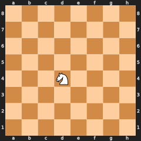
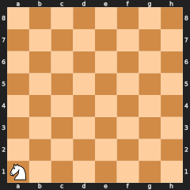
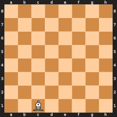
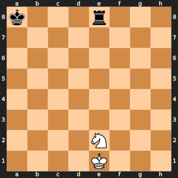
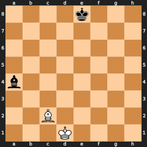
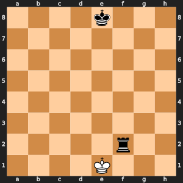
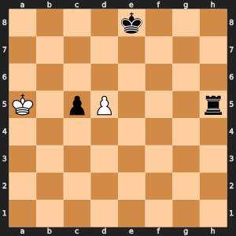
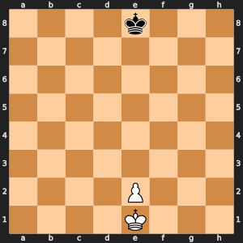

# The handouts

This page holds every sheet a student pair holds in its hands during the workshop:
one worksheet for each of the eight unplugged warm-ups that needs one, then four
cheat sheets that stay on the desk for the whole two weeks. Nothing on this page
gives an answer away. The answers are in the run sheets of
[`unplugged_activities.md`](unplugged_activities.md), and the "Teacher preparation"
list in the [course plan](remus_course_plan.md) says how many copies to print.

Print each handout as its own page. A section break (the `---` line) marks where
one handout ends and the next begins, so the printout can be cut or stapled per
handout. The boards print well in black and white.

| Handout | Warm-up or use | When |
| --- | --- | --- |
| [1. The board labeled both ways](#handout-1-the-board-labeled-both-ways) | Call the square | Day 1, period 3 |
| [2. Undo cards](#handout-2-undo-cards) | Undo from the card | Day 2, period 4 |
| [3. Shade the reach](#handout-3-shade-the-reach) | Shade the reach | Day 3, period 2 |
| [4. Pin hunt](#handout-4-pin-hunt) | Pin hunt | Day 4, period 3 |
| [5. Count by hand](#handout-5-count-by-hand) | Count by hand | Day 6, period 2 |
| [6. The game tree](#handout-6-the-game-tree) | Paper minimax, then Fewest flips | Day 8, periods 1 and 2 |
| [7. The hidden peak grid](#handout-7-the-hidden-peak-grid) | Find the hidden peak | Day 10, period 1 |
| [8. The mystery powder](#handout-8-the-mystery-powder) | Name the powder | Day 10, period 2 |
| [9. SAN and UCI cheat sheet](#handout-9-san-and-uci-cheat-sheet) | Reading and writing moves | Day 1 on |
| [10. The rules refresher](#handout-10-the-rules-refresher) | The rules that trip people up | Day 4 on |
| [11. The perft reference table](#handout-11-the-perft-reference-table) | Checking the move generator | Day 6 on |
| [12. The piece values](#handout-12-the-piece-values) | Evaluation | Day 7 on |

---

## Handout 1: The board labeled both ways

**Call the square. Day 1, period 3.** Team name: ______________________

The usual chess labels run along the bottom (files `a` to `h`) and the left side
(ranks `1` to `8`). Remus's own numbers run along the top (columns 0 to 7) and the
right side (rows 0 to 7). The square `e2` is marked.


When the teacher calls a `(row, col)` pair, the navigator puts the token on that
square and the driver names it. When the teacher calls a square name, the navigator
puts the token on it and the driver gives the `(row, col)` pair. Write each answer
here.

| Called | Your answer |
| --- | --- |
| `( , )` | |
| `( , )` | |
| `( , )` | |
| `( , )` | |
| | `( , )` |
| | `( , )` |
| | `( , )` |

Which square is `(0, 0)`? ________ Why is it not the other corner?

______________________________________________________________________

Write the two rules that turn a square name into a `(row, col)` pair:

`row = ` ______________________ `col = ` ______________________

---

## Handout 2: Undo cards

**Undo from the card. Day 2, period 4.** Team name: ______________________

The navigator plays three moves on the board and fills in one card for each move,
as it is made. The driver looks away. Then the driver takes the cards, and only the
cards, and puts the board back to the start position, newest card first.

A card holds exactly what `make_move()` will return on this period: the move, the
piece that moved, the piece it captured (write `.` for none), and the three parts of
the state that the move overwrites.

| Card 1 | |
| --- | --- |
| Move (from square to to square) | |
| Piece that moved | |
| Piece captured (`.` for none) | |
| Old en passant square (or none) | |
| Old halfmove clock | |
| Old fullmove number | |

| Card 2 | |
| --- | --- |
| Move (from square to to square) | |
| Piece that moved | |
| Piece captured (`.` for none) | |
| Old en passant square (or none) | |
| Old halfmove clock | |
| Old fullmove number | |

| Card 3 | |
| --- | --- |
| Move (from square to to square) | |
| Piece that moved | |
| Piece captured (`.` for none) | |
| Old en passant square (or none) | |
| Old halfmove clock | |
| Old fullmove number | |

Did the board come back exactly? Yes / No. If not, which card was missing something?

______________________________________________________________________

What would go wrong if a card had no "piece captured" line?

______________________________________________________________________

---

## Handout 3: Shade the reach

**Shade the reach. Day 3, period 2.** Team name: ______________________

The board is empty except for the one piece shown. Shade every square the piece can
move to, then write the count under the board.

  

| Piece | Squares it reaches |
| --- | --- |
| Knight on d4 | |
| Knight on a1 | |
| Bishop on c1 | |

Why does the knight on a1 reach so few squares?

______________________________________________________________________

Put a Black pawn on e3. Which of the bishop's squares disappear, and which one
becomes a capture?

______________________________________________________________________

---

## Handout 4: Pin hunt

**Pin hunt. Day 4, period 3.** Team name: ______________________

White moves in every position. Under each board is the list of moves that the Day 3
move generator offers the piece named. Some of those moves leave White's own king
attacked, so the rules of chess forbid them. Cross out every move that is illegal,
and leave the legal ones.

**Position 1.** The knight on e2.



Moves offered: Nc1, Nc3, Nd4, Nf4, Ng1, Ng3

**Position 2.** The bishop on c2.



Moves offered: Bb1, Bb3, Bd3, Be4, Bf5, Bg6, Bh7, Bxa4

**Position 3.** The king on e1.



Moves offered: Kd1, Kd2, Ke2, Kf1, Kxf2

**Position 4.** The king on a5 and the pawn on d5. Black has just played the pawn
from c7 to c5, so the pawn on d5 may capture it en passant, landing on c6.



Moves offered: Ka4, Ka6, Kb4, Kb5, Kb6, d6, dxc6 (en passant)

Which single question, asked after each move is made, settles all four positions?

______________________________________________________________________

---

## Handout 5: Count by hand

**Count by hand. Day 6, period 2.** Team name: ______________________

White to move: a king on e1 and a pawn on e2 against a lone Black king on e8.



1. Write every move White can make, one per index card, and copy the list here.
2. On each card, list every reply Black would have after that move and write the
   count under the list.
3. Add the counts across the cards.

| Card | White's move | Black's replies | How many |
| --- | --- | --- | --- |
| 1 | | | |
| 2 | | | |
| 3 | | | |
| 4 | | | |
| 5 | | | |
| 6 | | | |
| 7 | | | |
| 8 | | | |

Positions one ply deep (the number of cards): ________

Positions two plies deep (the sum of the last column): ________

`perft()` printed, at depth 1: ________ and at depth 2: ________

How many cards would you need to count three plies deep? ________

---

## Handout 6: The game tree

**Paper minimax. Day 8, period 1.** Team name: ______________________

White moves at the root and may choose A, B, or C. Black then chooses one of three
replies, and the number under each reply is how good the position is for White at
the end (bigger is better for White). Fill in each Black box with the score Black
will settle for, then fill in the root with the score White can count on, and circle
the move White should play.

```text
                               White to move
                              +-------------+
                              |             |
                              +-------------+
               A                     B                     C
        +-----------+         +-----------+         +-----------+
        |           |         |           |         |           |
        +-----------+         +-----------+         +-----------+
         /    |    \           /    |    \           /    |    \
        4     6     5         2     9     7         3     8     8
```

Why can White not count on the 9?

______________________________________________________________________

**Fewest flips. Day 8, period 2.** Cut the nine cards below apart and lay them face
down in the same order as the tree: group A on the left, then B, then C, with the
left card of each group nearest the group letter. Turn cards over one at a time,
left to right, and stop a group as soon as nothing left in it could change White's
choice. Count your flips.

| A, card 1 | A, card 2 | A, card 3 |
| :---: | :---: | :---: |
| **4** | **6** | **5** |

| B, card 1 | B, card 2 | B, card 3 |
| :---: | :---: | :---: |
| **2** | **9** | **7** |

| C, card 1 | C, card 2 | C, card 3 |
| :---: | :---: | :---: |
| **3** | **8** | **8** |

Flips: ________ Move chosen: ________

Your stopping rule, in one sentence:

______________________________________________________________________

---

## Handout 7: The hidden peak grid

**Find the hidden peak. Day 10, period 1.** Team name: ______________________

A 10 by 10 sample hides one hot spot. Each round, call out a square as `(row, col)`.
The teacher reads you the value measured there, and you write it in the square.
After five readings, mark the square you think is the peak with a star.

| row | 0 | 1 | 2 | 3 | 4 | 5 | 6 | 7 | 8 | 9 |
| ---: | :---: | :---: | :---: | :---: | :---: | :---: | :---: | :---: | :---: | :---: |
| **0** | | | | | | | | | | |
| **1** | | | | | | | | | | |
| **2** | | | | | | | | | | |
| **3** | | | | | | | | | | |
| **4** | | | | | | | | | | |
| **5** | | | | | | | | | | |
| **6** | | | | | | | | | | |
| **7** | | | | | | | | | | |
| **8** | | | | | | | | | | |
| **9** | | | | | | | | | | |

| Round | Square `(row, col)` | Value | Why this square? |
| --- | --- | --- | --- |
| 1 | | | |
| 2 | | | |
| 3 | | | |
| 4 | | | |
| 5 | | | |

Your guess for the peak: `( , )`

Did you choose your last square to explore (far from every reading) or to exploit
(next to your best reading)? ________________________

---

## Handout 8: The mystery powder

**Name the powder. Day 10, period 2.** Team name: ______________________

An X-ray beam went through a powder and came out at the eight angles below (in
degrees). Every crystal has its own fingerprint: the angles it always shows. The
powder is a mix of **two** crystals from the five fingerprints below. Find which two.

The mystery pattern:

| Peak | 1 | 2 | 3 | 4 | 5 | 6 | 7 | 8 |
| --- | --- | --- | --- | --- | --- | --- | --- | --- |
| Angle | 20.77 | 26.56 | 31.68 | 34.50 | 36.22 | 36.50 | 50.08 | 56.73 |

The same pattern drawn on a scale, each `^` one peak:

```text
20                  30                  40                  50                  60                  70
| . . . . | . . . . | . . . . | . . . . | . . . . | . . . . | . . . . | . . . . | . . . . | . . . . |
  ^          ^         ^     ^  ^^                          ^            ^
```

The five fingerprints, each with its four strongest peaks. Cut the strips apart
along the lines and slide each one under the pattern. A mark lines up with a peak
when they are within about a third of a degree.

```text
quartz    20.9  26.6  36.5  50.1
  ^          ^                   ^                          ^
```

```text
zincite   31.8  34.4  36.3  56.6
                        ^    ^   ^                                       ^
```

```text
rutile    27.4  36.1  41.2  54.3
               ^                ^         ^                          ^
```

```text
halite    31.7  45.4  56.5  66.2
                       ^                           ^                     ^                  ^
```

```text
silicon   28.4  47.3  56.1  69.1
                 ^                                     ^                ^                         ^
```

| Fingerprint | Peaks of the pattern it lines up with | Its marks that the pattern does not show |
| --- | --- | --- |
| quartz | | |
| zincite | | |
| rutile | | |
| halite | | |
| silicon | | |

The two crystals in the powder: ________________ and ________________

Peaks of the pattern your two leave unexplained: ________

Which fingerprint looked promising at first and then let you down, and how did you
catch it?

______________________________________________________________________

---

## Handout 9: SAN and UCI cheat sheet

People write moves in **standard algebraic notation**, SAN. Chess programs talk to
each other in **UCI** notation. Remus reads and writes both at its edges and uses
`(row, col)` pairs inside. [`learn_chess.md`](../students/learn_chess.md) explains
every line of this table with examples.

| Piece | Letter in SAN | Letter on the Remus board |
| --- | --- | --- |
| King | `K` | `K` White, `k` Black |
| Queen | `Q` | `Q` White, `q` Black |
| Rook | `R` | `R` White, `r` Black |
| Bishop | `B` | `B` White, `b` Black |
| Knight | `N` | `N` White, `n` Black |
| Pawn | no letter | `P` White, `p` Black |
| Empty square | | `.` |

| What happened | SAN | UCI | Remus inside |
| --- | --- | --- | --- |
| Pawn from e2 to e4 | `e4` | `e2e4` | `Move((6, 4), (4, 4))` |
| Knight from g1 to f3 | `Nf3` | `g1f3` | `Move((7, 6), (5, 5))` |
| Bishop on c4 takes the piece on f7 | `Bxf7` | `c4f7` | `Move((4, 2), (1, 5))` |
| Pawn on e5 takes on d6 (also en passant) | `exd6` | `e5d6` | `Move((3, 4), (2, 3))` |
| Two knights could reach d2; the one from b1 goes | `Nbd2` | `b1d2` | `Move((7, 1), (6, 3))` |
| Pawn from e7 reaches e8 and becomes a queen | `e8=Q` | `e7e8q` | `Move((1, 4), (0, 4), "Q")` |
| The same pawn becomes a knight | `e8=N` | `e7e8n` | `Move((1, 4), (0, 4), "N")` |
| White castles short (king e1 to g1) | `O-O` | `e1g1` | `Move((7, 4), (7, 6))` |
| White castles long (king e1 to c1) | `O-O-O` | `e1c1` | `Move((7, 4), (7, 2))` |
| A move that gives check | add `+`, as in `Bb5+` | nothing added | nothing added |
| A move that gives checkmate | add `#`, as in `Qh7#` | nothing added | nothing added |
| No legal move to send | | `0000` | |

The square names and the pairs:

| Square | `(row, col)` | Square | `(row, col)` |
| --- | --- | --- | --- |
| `a8` | `(0, 0)` | `h8` | `(0, 7)` |
| `a1` | `(7, 0)` | `h1` | `(7, 7)` |
| `e4` | `(4, 4)` | `d5` | `(3, 3)` |
| `e2` | `(6, 4)` | `e7` | `(1, 4)` |

`row = 8 - rank` and `col = "abcdefgh".index(file)`. Row 0 is rank 8, because
Remus prints the board with Black's side at the top, the way a chess book does.

---

## Handout 10: The rules refresher

Everyone knows how the pieces move. These are the rules that trip people up, and
the question Remus asks for each one. The "Day" column says when the code that
needs the rule is written.

| Rule | What has to be true | What Remus checks | Day |
| --- | --- | --- | --- |
| Check | The side to move's king stands on a square the other side attacks | `in_check()` asks whether any enemy piece attacks the king's square | 4 |
| A legal move | After the move, the mover's own king is not attacked. This forbids moving a pinned piece off its line and walking the king into check | `legal_moves()` makes each move, asks `in_check()`, and undoes it | 4 |
| Castling, short or long | The king and that rook have not moved yet (the right is still in the `castling` field), the squares between them are empty, the king is not in check, and the king passes over and lands on no attacked square | All four conditions, then the king moves two squares and the rook jumps over it | 5 |
| En passant | A pawn has just moved two squares, and an enemy pawn stands beside it. Only on the very next move | The `en_passant` field names the square behind the pawn; the capture lands there and removes the pawn beside it | 5 |
| Promotion | A pawn reaches the last rank. It must become a queen, rook, bishop, or knight: never stay a pawn, never become a king | Four moves instead of one, one per piece | 5 |
| Fifty-move rule | Fifty moves by each side, 100 plies, with no capture and no pawn move | The `halfmove_clock` counts plies since the last capture or pawn move and resets to 0 on either; a draw at 100 | 7 |
| Threefold repetition | The same position, with the same side to move, the same castling rights, and the same en passant square, appears three times | The position history holds one key per position; three equal keys is a draw | 7 |
| Stalemate | No legal move, and the king is not in check | Zero legal moves and `in_check()` is False: a draw, not a loss | 7 |
| Checkmate | No legal move, and the king is in check | Zero legal moves and `in_check()` is True: the side to move has lost | 7 |
| Insufficient material | Neither side can ever give checkmate: king against king, king and one minor piece against king, or king and bishop against king and bishop on the same color | Count the pieces left | 7 |

---

## Handout 11: The perft reference table

`perft(depth)` counts every position the legal move generator can reach in exactly
`depth` plies. The counts below are the agreed answers for five standard positions
and for the warm-up position. A generator that prints the same numbers is right in
every rule those positions use: castling, en passant, promotion, pins, and checks.

| Position | FEN | Depth 1 | Depth 2 | Depth 3 | Depth 4 |
| --- | --- | ---: | ---: | ---: | ---: |
| Start | `rnbqkbnr/pppppppp/8/8/8/8/PPPPPPPP/RNBQKBNR w KQkq - 0 1` | 20 | 400 | 8,902 | 197,281 |
| Kiwipete | `r3k2r/p1ppqpb1/bn2pnp1/3PN3/1p2P3/2N2Q1p/PPPBBPPP/R3K2R w KQkq - 0 1` | 48 | 2,039 | 97,862 | |
| Position 3 | `8/2p5/3p4/KP5r/1R3p1k/8/4P1P1/8 w - - 0 1` | 14 | 191 | 2,812 | 43,238 |
| Position 4 | `r3k2r/Pppp1ppp/1b3nbN/nP6/BBP1P3/q4N2/Pp1P2PP/R2Q1RK1 w kq - 0 1` | 6 | 264 | 9,467 | |
| Position 5 | `rnbq1k1r/pp1Pbppp/2p5/8/2B5/8/PPP1NnPP/RNBQK2R w KQ - 1 8` | 44 | 1,486 | 62,379 | |
| King and pawn against king (handout 5) | `4k3/8/8/8/8/8/4P3/4K3 w - - 0 1` | 6 | 30 | 210 | 1,424 |

Kiwipete holds every special move at once: both sides can castle, a pawn can be
promoted, and an en passant capture is possible. When a count is off, run
`divide()` on the same position: it prints the count under each root move, so the
one move whose count differs from the reference points at the bug.

Remus in plain Python counts a few thousand positions a second, so depth 3 from the
start finishes in seconds and depth 4 takes about a minute. The blank cells are
counts that take too long for a class period.

---

## Handout 12: The piece values

Remus measures a position in **centipawns**: a pawn is worth 100, so a score of
+150 means White stands a pawn and a half ahead. The king has no value because it
can never be captured.

| Piece | Centipawns | In pawns |
| --- | ---: | ---: |
| Pawn | 100 | 1 |
| Knight | 300 | 3 |
| Bishop | 300 | 3 |
| Rook | 500 | 5 |
| Queen | 900 | 9 |
| King | 0 | |

Material is the first term of `evaluate()`. The score is always given from the side
to move's point of view: a position where White is a rook up scores +500 when it is
White's turn and -500 when it is Black's. A mate scores `MATE_SCORE - plies`, so a
quicker mate scores higher than a slower one, and `MATE_SCORE` is 100,000, larger
than any pile of pieces.

The three tactics that win material, to look for in every game Remus plays:

| Tactic | What it looks like |
| --- | --- |
| Fork | One piece attacks two at once, and only one can be saved |
| Pin | A piece cannot move without exposing a more valuable piece, or the king, behind it |
| Skewer | A piece attacks a valuable piece, and when that piece moves away, the piece behind it falls |
