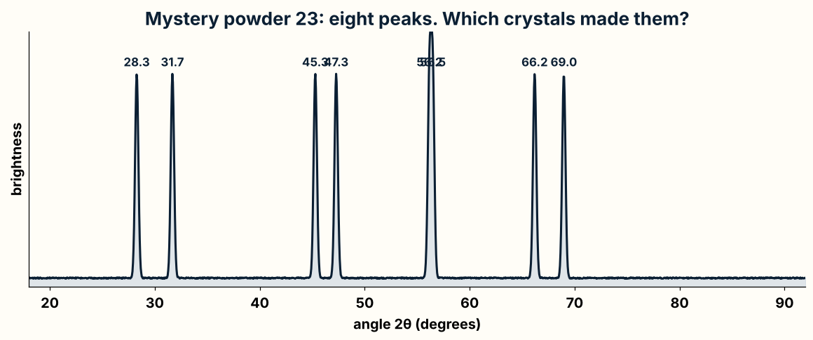

# Day 10, Period 2: The phase hunt: score a guess, and the greedy agent

`uv run phase_hunt.py` names the crystal phases in an X-ray powder pattern and counts the right and wrong calls over 200 powders.

## Learning objectives

By the end of this period, each pair can:

- Score a guess about what a powder holds. **Measured by:** The `score` test passes, and the pair explains why an extra phase costs a point even when every peak is explained.
- Build an answer greedily, one best step at a time. **Measured by:** The `greedy_phases` tests pass, and the pair explains why greedy names gold for a powder that holds silver.

## The experiment: what is in this powder?

Scientists at Brookhaven National Laboratory mix chemicals, heat them, and get a
gray powder. Did they make the new material they wanted, or something else? The
powder looks the same either way. To find out, they take it to a beamline at the
National Synchrotron Light Source II (NSLS-II), one of the brightest X-ray sources
in the world, and shine its X-ray beam through the powder.

A powder is millions of tiny crystals. In a crystal, the atoms sit in rows, as
neatly as the squares of a chessboard. The rows bounce the X-rays off at a few
special angles, so the detector shows bright rings. Each ring becomes a **peak**
in the pattern on the right. The angle of a peak is called **2θ** ("two theta"),
measured in degrees.

## Every crystal has a fingerprint

Each kind of crystal, called a **phase**, has its own spacing between its rows of
atoms. So each phase makes peaks at its own angles: a fingerprint. Bragg's law, a
rule from 1913, turns the spacing into the angles. `phase_hunt.py` holds the
fingerprints of ten real phases, with their four strongest peaks each, in the
dictionary `LIBRARY`.

Look closely: gold and silver have almost the same fingerprint. That will matter
later.

## The mystery powder

A powder can hold two or three phases at once. Then the pattern shows **all** their
peaks together, and the job is to work out which fingerprints were mixed. Here is
powder 23 from the benchmark. `make_pattern(23)` makes it.

Real patterns are messy, and `make_pattern()` makes them messy on purpose. A real
peak lands a little away from its library angle (up to 0.15 degrees here), and a
weak peak can hide in the noise (each peak shows up 85 times out of 100). So two
peaks count as the same peak when they are within `TOLERANCE`, 0.3 degrees.

## What Remus is searching

In chess, Remus tries moves, looks at each position, and keeps the best. In the
phase hunt, the program tries **guesses**. A guess is a set of phases, such as
silicon + halite. Adding a phase to the guess is like making a move, and taking it
back out is like undoing it. The program scores every guess and keeps the best one.

| Chess engine | Phase hunt |
| --- | --- |
| A position | A guess: the set of phases chosen so far |
| Legal moves | The phases in the library that are not in the guess yet |
| `make_move()` and `undo_move()` | `phases.append(name)` and `phases.pop()` |
| `material()`, the evaluation | `score()`: how well the guess explains the peaks |
| `greedy_move()` | `greedy_phases()`: add the phase that helps most, again and again |

## Your first function: `score()`

`score(phases, measured)` grades a guess, the way a teacher grades a test. It looks
at every peak twice:

1. For each **measured** peak (a dot in the picture): +1 if a phase in the guess
   explains it (green ✓), -1 if no phase does (orange ?).
2. For each **predicted** peak (a stick): -1 if the pattern does not show it
   (red ✗). A real phase would have made that peak.
3. Then -1 for each phase in the guess, so that a simpler explanation wins a tie.

Silicon alone explains 4 peaks and leaves 4 over: 4 - 4 - 0 - 1 = -1 point.
Silicon + halite explains all 8: 8 - 0 - 0 - 2 = 6 points. Adding zincite explains
nothing new, and two of its peaks are missing: 8 - 0 - 2 - 3 = 3 points. The best
guess is the one with the most points.

The helpers `predicted_peaks(phases)` (every peak of every phase in the guess, in one
list) and `matches(peak, peaks)` (is some peak within `TOLERANCE`?) are finished, so
`score()` needs only two loops and a few `+=` and `-=` lines.

## Your second function: `greedy_phases()`

`greedy_phases(measured)` builds a guess one phase at a time. At each step it tries
adding every phase that is not in the guess yet (`append`), scores the guess, takes
the phase back out (`pop`), and remembers the phase with the best score. If that
phase raises the score, it stays. If no phase helps, the guess is finished.

In step 1, silicon and halite tie at -1. Greedy keeps the first one it found,
silicon, and picks up halite in step 2. On powder 23 greedy gets the right answer.

## Where greedy goes wrong

Greedy never looks back, and it never doubts. Powder 12 holds anatase and silver.
Silver's peaks sit less than 0.3 degrees from gold's, so the peaks fit gold exactly
as well. Gold comes first in the library, so greedy says "anatase and gold" and
sounds just as sure as when it is right.

Run `uv run phase_hunt.py` when both functions pass their tests. Greedy names 166 of
the 200 benchmark powders right and 34 wrong. In period 3 you write `search()`, which
scores every guess of up to three phases, 176 of them, and keeps every guess that
ties for the best score. When gold and silver tie, the search can answer "can't
tell", and a scientist knows to take a second measurement.

## Real scientists do this

Naming the phases in a powder pattern is called **phase identification**, and
beamline scientists do it every day. At the NSLS-II Pair Distribution Function (PDF)
beamline, Brookhaven's Crystallography Companion Agent names phases while the data
comes in. The CrystalShift program (Cornell, 2025) and the Dara program (Berkeley Lab,
2025) search a tree of phase sets the way your code will in period 3, on real
patterns from the synchrotrons SSRL and CHESS and from a self-driving lab.
`docs/science_tree_search_survey.md` lists the papers.

## Words to know

- **phase:** one kind of crystal, such as quartz. A powder can mix several phases.
- **peak:** a bright spot in the X-ray pattern, at an angle called 2θ.
- **fingerprint:** the list of a phase's peaks, in `LIBRARY`.
- **tolerance:** how close two peaks must be, 0.3 degrees, to count as one peak.
- **guess:** a set of phases that might explain the pattern.
- **greedy:** always take the step that looks best right now, and never go back.

## The files

New files this period:

- `phase_hunt.py`
- `test_phase_hunt.py`

Functions the pairs write this period:

- `score()` in `phase_hunt.py`
- `greedy_phases()` in `phase_hunt.py`

In `student/` these functions raise `NotImplementedError` until a pair writes them. In `instructor/` they are finished.

## The changes and why

### `score()` in `phase_hunt.py`

Scores a guess about which phases are in the powder: a point for each measured peak the phases explain, and a point lost for each peak left over, each predicted peak that is missing, and each phase used. It is the evaluation of the science problem, like `material()` for a chess position, and the cost per phase makes the simpler explanation win a tie.

### `greedy_phases()` in `phase_hunt.py`

Adds the phase that raises the score most, then the next, and stops when no phase helps, the way `greedy_move()` takes the biggest capture. Each phase is tried with append and taken back with pop, like make and undo. Greedy gives one answer and never doubts it, so it names gold for a powder of silver.

Check the work from inside this folder with `uv run pytest`, and run any file on its own, such as `uv run board.py`.

## What you edit this period

Every other function in this folder is finished. Change only these, and only below each docstring:

| File | Function | Starts at line | Lines to type | Tests that check it |
| --- | --- | --- | --- | --- |
| `phase_hunt.py` | `score()` | 110 | 11 | `test_phase_hunt.py::test_score_rewards_explained_peaks_and_punishes_the_rest`, `test_search.py::test_negamax_finds_mate_in_one`, `test_search.py::test_quiescence_stands_pat_or_takes_a_free_pawn`, `test_search.py::test_gameworks_mate_in_two_puzzles`, `test_upgrades.py::test_upgraded_search_finds_a_mate_in_two` |
| `phase_hunt.py` | `greedy_phases()` | 134 | 17 | `test_phase_hunt.py::test_greedy_names_a_clean_mixture`, `test_phase_hunt.py::test_greedy_mistakes_silver_for_gold` |

Lines to type in all: 28. Each stub is two comment lines that start with `# Day ...` and a `raise NotImplementedError` statement. Delete them and write the body in their place.
